# Library IDE (Rinne V2)

**One desktop application where every department of a company works with its own AI agents, on one shared company brain, kept in sync by one runtime.**

Design, programming, marketing, finance, legal, operations, product and the C-suite each get their own agentic toolset. Humans and agents in every department share context about what every other department is doing, within strict access scopes. Leaders get God's eye: an end-to-end, cited view of the whole company. Cross-department work runs only after every department involved signs off, and ambient agents notice what needs doing and propose it without being asked.

> **Status:** architecture and security specification for v0. Implementation follows the build phases below. The idea is fixed; technical choices can change to improve the product.

## Contents

1. [What it is](#what-it-is)
2. [Decisions](#decisions)
3. [System components](#system-components)
4. [Scope and production bar](#scope-and-production-bar)
5. [System overview](#system-overview)
6. [Build phases](#build-phases)
7. [Components and contracts](#components-and-contracts)
8. [Desktop app and local node](#desktop-app-and-local-node)
9. [Gateway and request path](#gateway-and-request-path)
10. [Ingest and event adapter](#ingest-and-event-adapter)
11. [Company brain](#company-brain)
12. [Sync engine](#sync-engine)
13. [Core runtime (harness)](#core-runtime-harness)
14. [Plugins and connections](#plugins-and-connections)
15. [Ambient agents](#ambient-agents)
16. [Sandbox and Code Mode (after v0)](#sandbox-and-code-mode-after-v0)
17. [Volunteer compute (after v0)](#volunteer-compute-after-v0)
18. [Data model](#data-model)
19. [API](#api)
20. [Security model](#security-model)
21. [Performance, latency and cost](#performance-latency-and-cost)
22. [Evals and quality](#evals-and-quality)
23. [Operations](#operations)
24. [Local vs server split](#local-vs-server-split)
25. [Code Mode](#code-mode)
26. [Design problems and resolutions](#design-problems-and-resolutions)
27. [Summary view](#summary-view)
28. [Prior art: databases](#prior-art-databases)
29. [Free build path](#free-build-path)
30. [Delivery slices](#delivery-slices)
31. [Research findings](#research-findings)
32. [Research questions](#research-questions)
33. [Research basis](#research-basis)
34. [Reading list](#reading-list)
35. [Sources](#sources)
36. [Open questions](#open-questions)

## What it is

Library IDE is an IDE-style interface that controls and executes every kind of task, technical or not, and synchronizes every department inside a company or team.

| Department | Gets |
| --- | --- |
| Designers | Design tools |
| Programmers | Programming tools |
| Marketers | Marketing tools |
| Finance | Finance tools |
| Legal | Legal tools |
| Operations | Operations tools |
| Product team | Its own toolset, plus the tools of the teams it heads |
| C-suite and product leaders | Every tool plus God's eye |

- Every department has its own agentic setup with a conductor, an orchestrator and a synchronizer to run departmental and cross-departmental tasks.
- Library IDE connects to the tools teams already use (GitHub, Slack, Google Workspace, Notion, Jira, Linear and more) so that agents, not only humans, have context on everything going on.
- The knowledge base, proactiveness and ambience are central: the system senses its environment, builds context automatically and responds without explicit prompts.
- The vision: one unified interface that handles everything for any kind of team, where every department, human or agent, knows what every other department is doing and where it stands.

### Original sketch

Departments and the C-suite and product team connect into Library IDE, which connects to plugins.

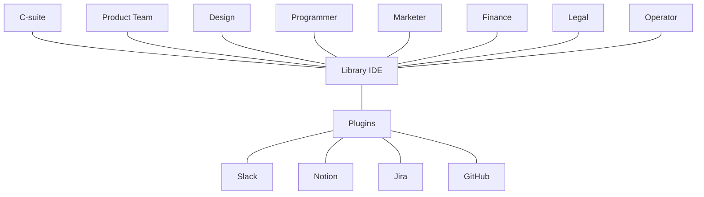

## Decisions

- **Form factor:** a full application for the interface. The agent runtime (sensing, conductor, orchestrator, synchronizer, knowledge base) runs server-side so it keeps working when devices are off. The harness is compiled into both the server and the local node: base tiers run agents on members' machines, higher tiers add server-side and ambient agents.
- **Access:** teams building the product and its distribution share context. Today that fold is design, programming and marketing, plus any other team working on the same product. HR, legal and finance are sealed from it. These departments can only give orders to their own departmental agents. Cross-departmental work can only happen after each department involved says yes or vouches for it. Agents then do the cross-departmental work alongside humans.
- **C-suite and product leaders:** get every tool plus the God eye, and can give orders to departments and agents.
- **Product team:** has its own toolset, plus access to the tools of whichever teams it heads.
- **Conductor, orchestrator, synchronizer:** three separate jobs that stay dependent on each other so no task is under-done or overdone.
- **Ambience:** the system continuously senses its environment, builds context automatically and responds without explicit prompts. Proactiveness and ambience are one capability.
- **Plugins:** 30 standard plugins ship in v0 on official vendor MCP servers (GitHub, Slack, Google Workspace and 27 more), including the setup flow for plugins the customer connects with their own app (Google Workspace, Slack); users add any other server the standard MCP way. Full catalog under Plugins and connections.
- **Events:** sensing must work with existing MCP servers, so neither we nor users adopt a new protocol. Until MCP Events is standard, we build our own adapter with SEP-3415 as the baseline.
- **Guardrails:** coordination runs on hard limits, and sensitive departments get approval gates (see Design problems and resolutions, 4 and 5).
- **Base:** the app starts from a fork of T3 Code and is modified on top of it.
- **Rinne V1:** nothing carries over to V2; V1 is outdated and current open-source work is better. V2 keeps only the Rinne name for its existing branding.
- **Programmer workspace:** no VS Code fork. The T3 Code fork stays the base, and VS Code-level editing comes from Monaco plus monaco-vscode-api.
- **Extensions:** Open VSX plus our own registry (mirroring permitted extensions), with open replacements for Microsoft-only extensions such as Pylance and C/C++.
- **Languages:** the server-side runtime is Rust, including the company brain (memory, context, knowledge base), conduction, orchestration, the synchronizer, the event adapter and access checks. The app stays TypeScript (T3 Code clients and its per-machine server, Monaco, team toolsets). App and runtime talk over JSON-RPC on WebSocket, with TypeScript types generated from the Rust types.
- **Database:** the server stores state only, all in Postgres (event log, state graph, deltas). SurrealDB runs embedded on each member's machine as a verified replica of their scopes, with local embeddings. Our own memory and distributed storage layer is designed with SurrealDB's Agent Memory and distributed storage engine as references (their published design, not their enterprise code).
- **Sync:** blockchain-style without consensus: the server sequences numbered deltas per scope with state roots; replicas apply them in order, verify, and repair from snapshots. Clients propose, the server decides.
- **Sandbox:** local-first (wasmtime plus QuickJS), server fallback; credentials stay on the server behind one dispatcher. Code Mode is built after v0.
- **Volunteer compute:** teammates' machines can take verifiable jobs, but nothing depends on them.
- **Ambient agents:** part of v0, built last. Server-side and ambient agents are limited to higher tiers.
- **Infrastructure:** Oracle VPS behind Cloudflare (Tunnel, DNS, firewall, R2, Zero Trust Access); full list and design under Operations.
- **Form factor, refined:** desktop app only (Electron, from T3 Code's desktop client) for macOS, Windows and Linux. No web app.
- **Build sequence:** hackathons come first. Each hackathon ships one production-grade slice of the real architecture, not a throwaway demo.

**Research applied (all in v0):**

- **Priorities:** the company brain and the core runtime must be top notch, with security alongside them, so users feel confident using the app.
- **Core runtime:** departments are skill packs on one harness; cache-stable prompt layout; decomposability check before fan-out, single agent for sequential work; advisor model routing; one writer per artifact through leases, reviewers with clean context; task state files (task list with pass flags, progress log, startup check); separate evaluator; tool search; budgets and loop detection; traces that split model time from tool time; a decision log of every routing and approval decision.
- **Company brain:** bitemporal facts (valid time and recorded time) with provenance and citations; quarantined, schema-checked extraction; entity resolution; hybrid retrieval (full-text, vectors, graph) with a reranker; small cited slices with restorable pointers; community summaries for God's eye; precomputed briefs; self-updating department playbooks; brain evals.
- **Security:** quarantine model for untrusted text; taint rule (a run that read untrusted input needs approval for external writes); plan-first for tasks that read untrusted data; tool definitions pinned by hash with re-approval on change; risk-tiered approvals; egress allowlists; audit records tool hash; confidence UI (scope badge, previews, sources, undo).
- **Plugins:** four sign-in modes (automatic registration, our app, customer app, API key); Slack and Google Workspace connect through each customer's own app, so no vendor review is needed; plugins needing a vendor process (Figma, Microsoft 365, DocuSign, Salesforce) come later.
- **Evals:** harness, brain, ambient and security suites of 20 to 50 tasks, graded on outcomes, reported as pass^k, gating every release.
- **Decision API:** a decision API and decision-making infrastructure to save tokens and time on runtime and brain decisions is planned for v1; v0 logs every decision so v1 has data.
- **Single source of truth:** the architecture in this README is the specification for building the app, organised in build phases with no dates.

## System components

Library IDE combines the jobs of tools like T3 Code, a VS Code-style IDE, Paper, Canva and n8n or Zapier, connects them to one company brain and keeps them synchronized.

### Core runtime

- **Conduction:** the transfer of data, context and control signals between AI components: how information flows from one model to another and how a decision moves through a pipeline of agents and tools. In systems terms, the integration and data-flow layer of orchestration.
- **Orchestration:** task planning and task distribution across the available models. Adopted routing parameters: task type, tools needed, context size, cost budget, latency target, model capability, data scope and confidence; a decomposability check decides single agent versus fan-out, and an executor model calls an advisor model when needed.
- **Synchronizer:** keeps everything in step, including separate sets of tasks. Resolved: continuous shared state (a blackboard on the task's state) with one writer per artifact through leases, checkpoints, clean-context reviewers and a final merge, instead of end-only sync.
- **Parallelism:** different agents work at the same time, and the synchronizer keeps their work pointed in the same direction.
- These parts depend on each other and on the company brain.

### Company brain

- **Memory:** proactiveness matters most here. Memory keeps working when the user has not allowed agents to automate a task, and when agents need permission first.
- **Context:** each task's context can stay the same or change completely. The system adjusts to it and may need to make some decisions instantly.
- **Knowledge base:** graph-based. Together with context and memory it acts as the company brain.

### Team tooling

- **Programmers:** a VS Code-style IDE with agents built in, starting from T3 Code.
- **Designers:** a design canvas like Paper, with full agent integration.
- **Marketers:** tools to create content and analyse it.
- **Every other team:** its own toolset, on the same pattern.
- **God's eye:** sees what each team is doing and gives everyone with access an end-to-end view of the company (sales, marketing, product, finance, legal, design) with smart analysis.
- **Plugins:** 30 standard plugins, customer-app setup for Google Workspace and Slack, and the standard MCP way for users to add their own.

### Build-base findings

- **T3 Code** is MIT-licensed and is a control surface for coding agents people already pay for (Claude Code, Codex, Cursor and others). It has an MCP server but no local-model support, and it is early-stage. It is not a code editor, so the programmer IDE also needs an editor component such as [Monaco](https://microsoft.github.io/monaco-editor/), the editor from VS Code. Upstream does not merge big features, so the fork carries its own maintenance. ([review](https://andrew.ooo/posts/t3-code-review-open-source-agent-control-surface/))
- **Paper** is a hosted product, not open source. Its canvas is real HTML and CSS and agents edit it through its [MCP server](https://paper.design/docs/mcp). Either integrate it as a plugin or build an HTML/CSS canvas of our own.
- **n8n** cannot be embedded in a product without a paid Embed license under its Sustainable Use License ([FAQ](https://docs.n8n.io/n8n-community-license/community-license/license-faq)). The workflow layer needs a permissively licensed engine or our own.
- **Canvas SDKs:** tldraw needs a license key in production ([docs](https://tldraw.dev/sdk-features/license-key)); Excalidraw is MIT.

## Scope and production bar

v0 is a production-grade desktop product: a company connects its tools, the server turns events into a scoped company brain, every member's app keeps a verified replica of the scopes they can see, department agents run on one hardened harness, leaders read God's eye, cross-department work runs only after sign-off, and ambient agents propose actions on their own.

| In v0 | Designed here, built after v0 |
| --- | --- |
| Desktop app (T3 Code fork, Electron) for macOS, Windows, Linux | Programmer workspace (Monaco, monaco-vscode-api) |
| Local node (Rust): sync client, SurrealDB replica, local embeddings, local retrieval, reranker | Code Mode scripts in the sandbox (local first, server fallback) |
| Sign-in, tenants, departments, folds, scopes, plan tiers and entitlements | Volunteer compute on teammates' machines |
| Core runtime (harness): conduction, orchestration, synchronizer, department skill packs, evaluator, advisor routing, tool search, budgets, traces, decision log | Local file indexing and desktop sensing |
| Company brain: bitemporal facts with provenance, quarantined extraction, entity resolution, hybrid retrieval, community summaries, precomputed briefs, department playbooks | Design canvas and marketing toolsets |
| Sync engine: numbered deltas, state roots, snapshots, scope keys, replica repair | Extension registry (Open VSX plus our own) |
| Plugin layer: four sign-in modes, 30 standard plugins (including customer-owned app setup for Google Workspace and Slack), standard MCP add, tool registry with hash pinning | Server-side vector index for higher tiers |
| Event ingestion: GitHub and Slack webhooks plus the SEP-3415 adapter | Decision API and decision infrastructure (v1) |
| God's eye: status, briefs and cited answers across scopes | Plugins that need a vendor process (Figma, Microsoft 365, DocuSign, Salesforce) |
| Cross-department tasks with sign-off, risk-tiered approvals and hash-chained audit | Parallel multi-agent execution at large scale |
| Ambient agents (first trigger: a PR stuck 24 hours proposes a Slack nudge) |  |
| Security: quarantine pass, taint rule, approval tiers, network allowlists, confidence UI |  |
| Eval suites: harness, brain, ambient, security |  |

**Tiers:** v0 ships the entitlement check, not the pricing. Base tiers run agents only on members' machines; higher tiers add server-side and ambient agents. The gateway checks the tenant's plan before any server-side agent runs.

**Production-ready means:**

- No path where a user, agent, event or replica gets data outside its scope; enforced in the database, not only in code.
- Every write is durable and ordered; every webhook is verified and deduplicated; every side effect is risk-tiered, approved where required and audited.
- Every replica can prove it matches the server (state roots) and repairs itself when it does not.
- Secrets are encrypted at rest and never reach the client, the model context or a sandbox.
- Untrusted text never reaches a model that holds tools; an agent that has read untrusted input cannot make an external write without approval.
- Every tool definition is pinned by hash; a changed definition is blocked until an admin re-approves it.
- Every answer from the brain cites its sources; every agent action is previewed before it runs.
- One command brings up the stack; migrations, backups and restore are tested.
- Every request and agent run is traced end to end, with model time and tool time split; failures alert instead of failing silently.
- Critical paths have tests: scope isolation, webhook verification, sign-off state machine, delta ordering, replica repair, tool pinning, quarantine and taint enforcement.
- Eval suites pass their thresholds on every release (see Evals and quality).

## System overview

The server is the single source of truth and the only place side effects leave from; members' machines hold verified replicas of their own scopes and do the local work (retrieval, embeddings, later sandboxed scripts).

Every diagram in this README is Mermaid and renders on GitHub; open a diagram and use the expand button to view it larger. Colours mean the same thing in every diagram: blue is the desktop app and local node, violet is server compute, green is the company brain, red is security and trust, grey is storage, amber is external or untrusted, and dashed grey is after v0.

The five layers at a glance:

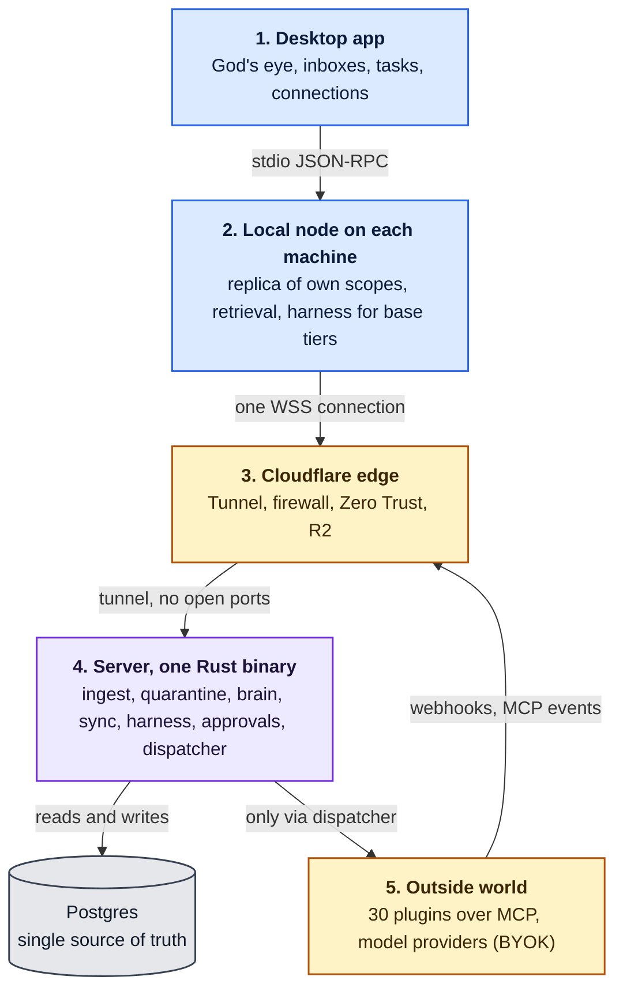

The complete architecture:

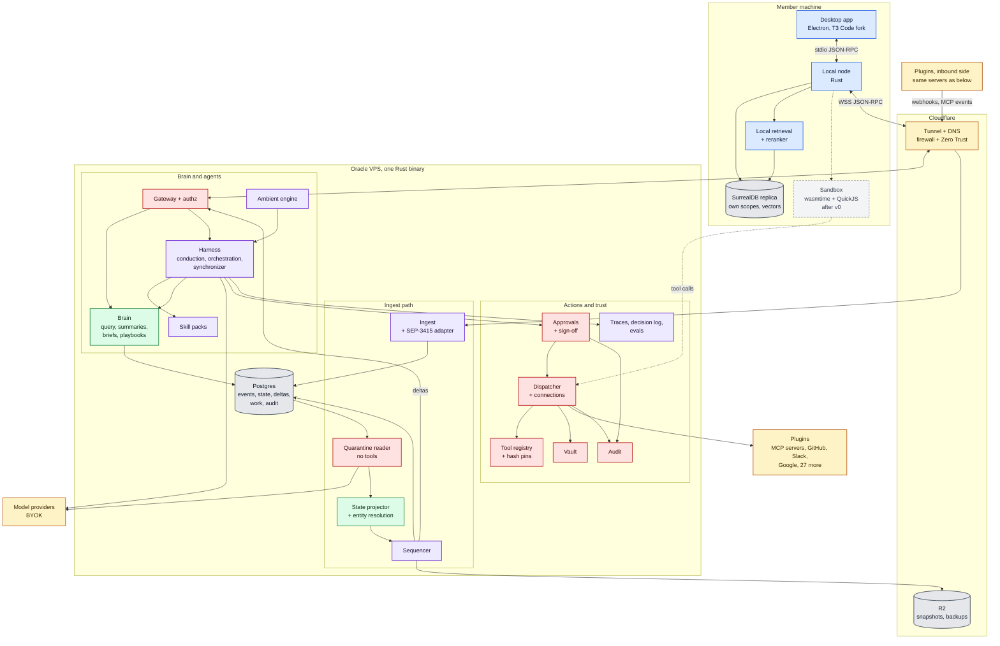

Reading it left to right: events enter through Cloudflare into ingest, are read by a tool-less quarantine model, become ordered state in Postgres, and flow back out as deltas to every replica that may see them. Agent work runs in the harness against the brain; every action leaves through approvals and the dispatcher, which checks the pinned tool registry and uses vault credentials. Each box has its own diagram in the sections below.

## Build phases

v0 is built in eleven phases ordered by dependency, not by date; a phase starts only when the phase it depends on has passed its exit gate. Ambient agents come last, as decided. The desktop app grows with each phase: every phase ships the screens for what it built.

```mermaid
%%{init: {"flowchart": {"curve": "basis", "nodeSpacing": 28, "rankSpacing": 42}}}%%
flowchart TB
  P0["<b>P0</b> Foundation"]:::srv
  P1["<b>P1</b> Trust core"]:::sec
  P2["<b>P2</b> Ingest + quarantine"]:::sec
  P3["<b>P3</b> Brain core + sequencer"]:::brain
  P4["<b>P4</b> Local node + sync + retrieval"]:::app
  P5["<b>P5</b> Harness"]:::srv
  P6["<b>P6</b> Plugins"]:::ext
  P7["<b>P7</b> Work + approvals"]:::sec
  P8["<b>P8</b> Brain intelligence"]:::brain
  P9["<b>P9</b> Ambient agents"]:::srv
  P10["<b>P10</b> Production hardening"]:::gate
  V0(("v0 release")):::gate
  A1["After v0<br/>workspace, Code Mode,<br/>volunteer compute, toolsets"]:::later
  V1(("v1<br/>decision API")):::later
  P0 -->|isolation tests green| P1
  P1 -->|audit chain verifies,<br/>no secret in logs| P2
  P2 -->|forged webhooks rejected,<br/>injection corpus passes| P3
  P3 -->|deterministic replay,<br/>stable roots| P4
  P4 -->|repair and revocation<br/>tests pass| P5
  P5 -->|harness evals at pass^k bar| P6
  P6 -->|every plugin smoke-tested,<br/>rug-pull test passes| P7
  P7 -->|sign-off and taint tests pass| P8
  P8 -->|brain evals at bar| P9
  P9 -->|silence and proposal<br/>evals at bar| P10
  P10 -->|restore drill,<br/>security evals| V0
  V0 -.-> A1
  A1 -.-> V1
  classDef app fill:#dbeafe,stroke:#2563eb,color:#0b1b3a,stroke-width:1.5px
  classDef srv fill:#ede9fe,stroke:#6d28d9,color:#1e1338,stroke-width:1.5px
  classDef brain fill:#dcfce7,stroke:#15803d,color:#0b2a16,stroke-width:1.5px
  classDef store fill:#e5e7eb,stroke:#374151,color:#111827,stroke-width:1.5px
  classDef sec fill:#fee2e2,stroke:#b91c1c,color:#3b0a0a,stroke-width:1.5px
  classDef ext fill:#fef3c7,stroke:#b45309,color:#3a2504,stroke-width:1.5px
  classDef later fill:#f3f4f6,stroke:#6b7280,color:#374151,stroke-dasharray:5 3
  classDef gate fill:#ffffff,stroke:#111827,color:#111827,stroke-width:2px
```

| Phase | Builds | Exit gate |
| --- | --- | --- |
| P0 Foundation | Repo and Rust workspace, Docker Compose, CI; migrations with forced row-level security; OAuth sign-in with PKCE; device registration and X25519 keys; `RequestCtx`; desktop shell from the T3 Code fork with sign-in | Row-level security isolation tests pass against real Postgres; sign-in works on macOS, Windows, Linux |
| P1 Trust core | Gateway (WSS JSON-RPC, entitlements, rate limits, typed errors); authz; vault with envelope encryption; hash-chained audit; tool registry schema with approval tiers; decision log; OpenTelemetry tracing | Audit chain verifier passes; log-redaction test finds no secret; every method rejects without role, scope or plan |
| P2 Ingest and quarantine | GitHub and Slack webhooks; SEP-3415 adapter (webhook mode, poll fallback); signature checks and dedupe; quarantine reader with structured output; taint tags on everything derived from external text | Forged and replayed webhooks rejected; injection corpus produces no instruction-bearing output |
| P3 Brain core | State projector with schema-checked extraction; entity resolution; bitemporal facts with provenance; sequencer with numbered deltas and state roots; snapshots to R2 | Replaying the event log gives identical state roots; extraction eval at its threshold |
| P4 Local node, sync, retrieval | Keychain session, WebSocket, sync client, SurrealDB replica, root checks and repair, scope keys; local embeddings; hybrid retrieval with reranker; sync status screen | Tampered replica detected and repaired; revoked scope deleted and keys stop; retrieval eval at its threshold |
| P5 Harness | Skill pack loader; conduction with cache-stable prompt layout; orchestration (task graph, decomposability score, single-agent path, advisor routing); synchronizer (blackboard, artifact leases); task state files; evaluator; tool search; budgets and loop detection; run traces | Harness eval suite at its pass^k bar; budget and loop kill tests pass |
| P6 Plugins | Four sign-in modes; dispatcher; tenant OAuth clients; 30 standard plugins; Google Workspace and Slack setup flows; standard MCP add; hash pinning with re-approval; connections screen | Every standard plugin passes its smoke test; changed tool definition is blocked until re-approved |
| P7 Work and approvals | Tasks; sign-off state machine; risk-tiered approvals; taint rule; sign-off inbox; action previews and undo | Sign-off race test passes; tainted run cannot make an external write without approval |
| P8 Brain intelligence | Community summaries; precomputed briefs; department playbooks; God's eye with cited answers; source chips in every answer | Brain eval suite at its thresholds; briefs refresh on new deltas |
| P9 Ambient agents | Ambient engine; stuck-PR trigger; proposals inbox with notify, question and review levels | Silence eval and proposal eval at their thresholds |
| P10 Production hardening | Deploy to the VPS behind Cloudflare; alerts; pgBackRest; restore drill; security eval suite; signed release pipeline; seeded demo company | Restore drill rebuilds the VPS and replicas match roots; security evals pass; all prior gates still green |
| After v0 | Programmer workspace (Monaco); Code Mode sandbox; volunteer compute; design and marketing toolsets; extension registry; server-side vectors | Defined when scheduled |
| v1 | Decision API and decision infrastructure, trained on the v0 decision log | Defined when scheduled |

## Components and contracts

The server is one Rust binary with one crate per component; each member's machine runs the desktop app and a Rust local node. Components talk only through typed traits and JSON-RPC, never through each other's tables.

### On the member's machine

| Component | Language | Owns | Talks to |
| --- | --- | --- | --- |
| Desktop app | TypeScript (Electron, T3 Code fork) | UI: God's eye, briefs, sign-off inbox, tasks, proposals, connections, tool approvals, scope badge, previews, sync status | Local node over JSON-RPC on stdio; never holds tokens |
| Local node | Rust | Session in the OS keychain (`keyring`), the one WebSocket to the gateway, sync, local retrieval | Gateway over WSS (JSON-RPC 2.0); desktop app |
| Sync client | Rust (in local node) | Applies ordered deltas per scope, verifies state roots, loads snapshots, repairs gaps | Sequencer |
| Local replica | SurrealDB embedded | Scope partitions of the state graph, encrypted with server-issued scope keys | Sync client, local retrieval |
| Local embeddings | Rust (`ort` with a small open embedding model) | Embeds replica content; vectors never leave the machine in v0 | Local replica |
| Local retrieval | Rust (in local node) | Hybrid full-text, vector and graph search plus a local cross-encoder reranker over the member's scopes | Local replica, harness context requests |
| Sandbox host (after v0) | Rust (wasmtime running QuickJS) | Runs Code Mode scripts with no network or files; only exit is the dispatcher | Dispatcher |
| Job worker (after v0) | Rust | Claims verifiable jobs (parse, chunk, embed) for scopes the member can access | Job queue |

### On the server (crates in one binary)

| Crate | Owns | Talks to |
| --- | --- | --- |
| `gateway` (axum) | WSS JSON-RPC, session checks, entitlements, rate limits, typed errors; reached only through Cloudflare Tunnel | Every crate through traits in `core` |
| `authz` | Roles, scopes, folds, entitlements; sets Postgres session variables for row-level security | Postgres |
| `ingest` | GitHub and Slack webhooks, SEP-3415 adapter, verification, normalisation, dedupe | Event log |
| `quarantine` | Tool-less model pass over untrusted text; emits schema-checked structured output and taint tags | Model provider, projector |
| `projector` | Turns quarantined output into entity and fact changes; entity resolution | Sequencer |
| `sequencer` | Single writer per tenant: numbers deltas per scope, writes state tables, computes state roots, pushes deltas, cuts snapshots | Postgres, R2, gateway |
| `brain` | Brain query, hybrid server retrieval, community summaries, briefs, playbooks | Postgres, harness |
| `harness` | Conduction, orchestration, synchronizer, agent runs, budgets, evaluator, advisor routing, tool search | Brain, skills, approvals, dispatcher, model providers |
| `skills` | Department skill packs: loading, versioning, progressive disclosure | Harness |
| `work` | Tasks, sign-off state machine, approvals with risk tiers, proposals | Harness, dispatcher, audit |
| `ambient` | Triggers over deltas and schedules; writes proposals | Harness, work |
| `registry` | Tool definitions per connection, hash pins, approval tiers, re-approval on change | Dispatcher, work |
| `dispatch` (rmcp) | Every outbound call: checks scope, tier, taint and approval, then calls the plugin with vault credentials | Registry, vault, audit, plugins |
| `connections` | Four sign-in modes, OAuth flows, tenant OAuth clients, per-user tokens | Vault, registry |
| `vault` | Envelope encryption of tokens, OAuth client secrets, model keys and scope keys | Postgres (ciphertext only) |
| `audit` | Hash-chained, insert-only log of every decision and side effect | Postgres |
| `telemetry` | Run traces (model time vs tool time), decision log, eval runner | Postgres, OpenTelemetry |
| `server` | Binary wiring and configuration | All |

**Contract rules:**

- Crates talk only through traits in `core`; no crate reads another crate's tables.
- Every call carries a `RequestCtx` (tenant, principal, scopes, plan, taint, trace id); nothing that touches data runs without one.
- Only the sequencer writes state tables, so ordering and state roots are always consistent.
- Clients propose, the server decides: replicas never write state; they submit actions the server validates and sequences.
- Only the quarantine crate sends untrusted text to a model, and that model call has no tools.
- Only the dispatcher calls plugins; nothing else holds a credential.
- The server stores no embeddings in v0; vectors live only in local replicas.
- All types that cross to the app are defined in Rust and exported to TypeScript with ts-rs.

## Desktop app and local node

The desktop app is only the interface; the local node owns the session, the network link, the replica and all local compute, so the app never touches a token or the network.

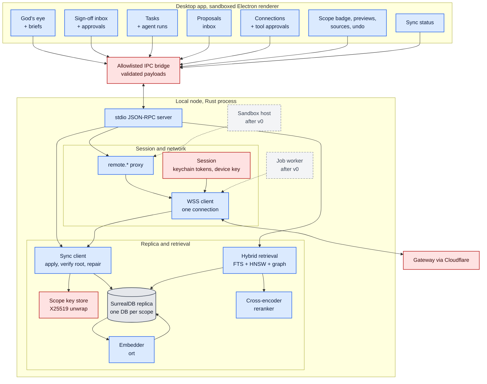

- **Process model:** the Electron main process starts the local node as a child process and talks to it over stdio; the renderer has `contextIsolation` and `sandbox` on, `nodeIntegration` off, a strict content security policy and no remote content.
- **Session:** tokens live in the OS keychain through `keyring`; the device's X25519 private key never leaves the keychain; access tokens refresh in the node.
- **Replica:** one SurrealDB database per scope inside a tenant namespace, so a scope can be wiped or re-keyed alone.
- **Local retrieval:** members' questions about their own scopes run here, offline-capable; the harness can also request a context slice from a member's node when that member is the requester.
- **Reranker:** a small cross-encoder in `ort` reranks the top candidates from full-text, vector and graph search before results go into context.
- **Confidence UI:** every agent answer shows source chips; every pending action shows a preview of exactly what will happen; the scope badge shows which scopes the current agent can read; reversible actions offer undo.

## Gateway and request path

Every call passes the same five checks in order, and the database checks scope a second time, so a bug in one layer cannot leak data.

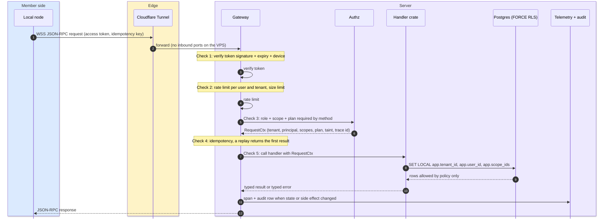

- **Method declarations:** every method declares its role, scope and plan requirement in Rust; the gateway rejects before the handler runs.
- **Database role:** the runtime connects as `app_rw`, which is not the table owner and has no BYPASSRLS; every table uses FORCE ROW LEVEL SECURITY; policies check tenant and scope.
- **Errors:** typed (code, message, retryable); no stack traces or SQL leave the server.
- **Versioning:** the protocol is versioned (`v1`); incompatible app or node versions are refused at connect.
- **Push:** the gateway pushes notifications on the same socket (deltas, approvals, run updates; full list under API).

## Ingest and event adapter

Every external event enters through one ingest path that verifies, deduplicates and commits it before anything reads it; the text inside is untrusted from that moment on.

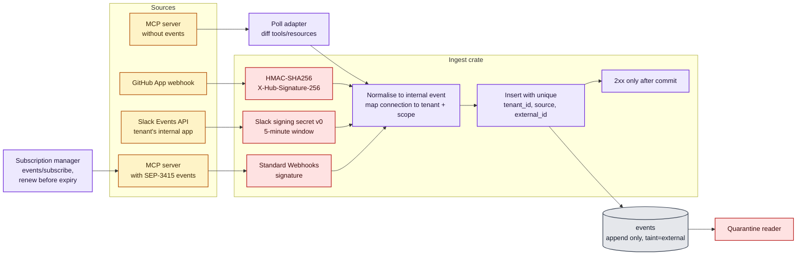

- **Sources in v0:** GitHub (our GitHub App, one webhook secret) and Slack (each tenant's internal Slack app, its signing secret kept per tenant in the vault and matched by app and team id). Other plugins connect as tools; adding event ingestion for one of them uses this same adapter.
- **SEP-3415 adapter:** speaks `events/list`, `events/subscribe`, `events/unsubscribe`, `events/poll` and `events/stream` with servers that support MCP Events; webhook delivery is the default mode; the subscription manager renews subscriptions before they expire.
- **Poll fallback:** for servers without events, the adapter polls the server's list tools or resources on a schedule and emits an event for each change it detects.
- **Ordering and duplicates:** delivery can repeat or arrive out of order; the unique key drops repeats, and the projector orders by the source's own timestamp or sequence where one exists.
- **Limits:** body size limits per source; processing is asynchronous after the commit, so webhooks are answered fast.
- **Taint:** every event row carries `taint = external`; anything derived from it inherits that taint (see Security model).

## Company brain

The brain is a scoped, bitemporal knowledge graph built only from the event log, with four memory tiers on top; it never hands an agent more than a small, cited slice, and every claim it makes links back to a source.

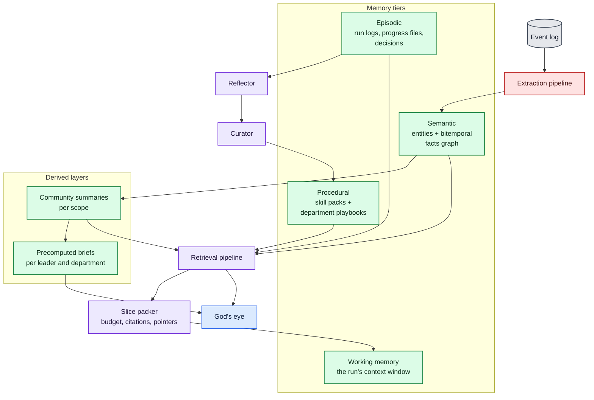

### Fact model

- **Entities:** people, repos, PRs, issues, channels, projects, decisions, customers, documents; each with a kind, name, summary and external ids.
- **Facts:** subject, relation, object and a plain statement. Each fact has two time axes: `valid_from` and `valid_to` (when it was true in the world) and `recorded_at` and `retracted_at` (when the brain learned or withdrew it). A contradiction closes the old fact and opens a new one; nothing is overwritten.
- **Provenance:** every fact carries `source_event_id`, `source_ref` (link, title, time), `extractor_version`, `confidence` and `taint`; every answer built from facts cites them.
- **Point-in-time reads:** "what did we know on date X" filters on `recorded_at`; "what was true on date X" filters on `valid_from` and `valid_to`.

### Extraction pipeline

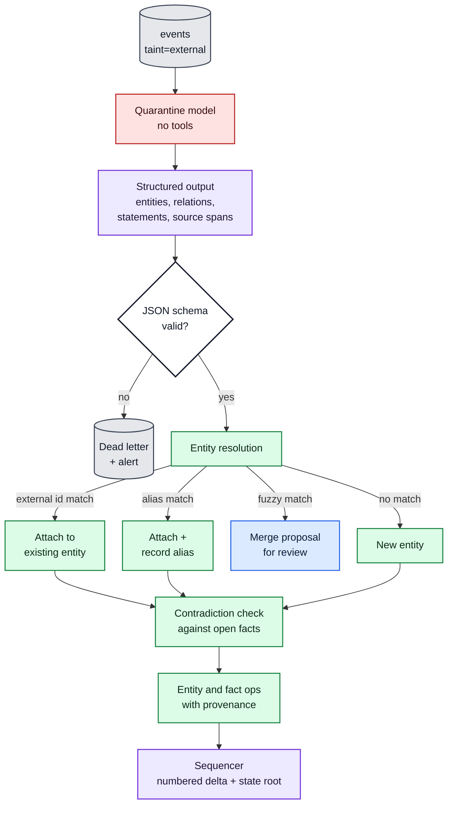

- The quarantine model sees only the event text and the output schema; it has no tools and its output cannot carry instructions forward, only typed fields.
- Entity resolution matches in order: external ids (GitHub login, Slack user id, email), the `entity_aliases` table, then fuzzy name and embedding similarity, which only produces a merge proposal. Merges and splits are themselves sequenced ops, so they replay.
- Projection is idempotent on `source_event_id` and `extractor_version`; re-running extraction with a new version produces a clean set of fact changes.

### Retrieval pipeline

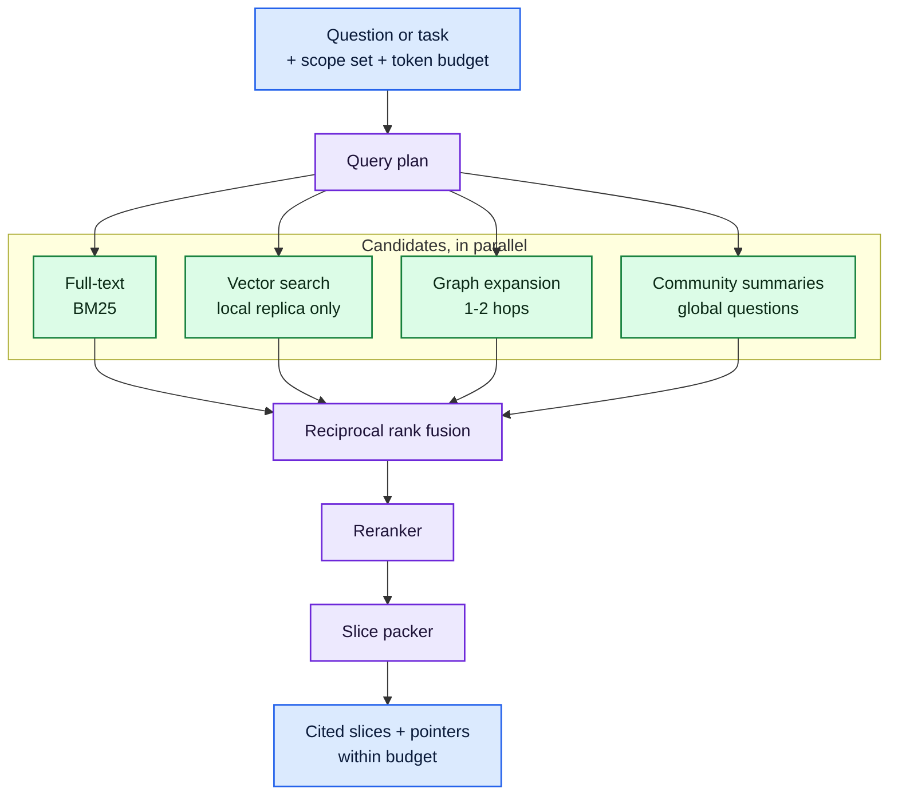

- **Where it runs:** members' questions run on their local node (full-text, vectors, graph, local reranker). God's eye runs on the server across every scope the leader holds (full-text, graph, community summaries), so no laptop needs every department's data.
- **Budgets:** the slice packer fits results to the caller's token budget; subagents return 1,000 to 2,000 tokens to their parent.
- **Restorable compression:** a slice that does not fit is replaced by its pointer (entity id or URL), which the agent can expand later; nothing is summarised away without a way back.
- **Untrusted marking:** slices derived from external text arrive in delimited blocks marked untrusted and carry their taint into the run.

### Community summaries

- The entity graph of each scope is clustered (Leiden), and a model writes one summary per community with citations to its facts.
- A summary is recomputed when the deltas touching its community pass a change threshold, and on a schedule.
- Summaries answer company-wide questions cheaply: God's eye reads summaries first and drills into facts only where needed.

### Precomputed briefs (sleep-time)

- A background worker writes a brief per leader and per department from community summaries, recent deltas and open tasks, before anyone asks.
- New deltas in a brief's scopes mark it stale; the worker refreshes stale briefs in priority order, so God's eye opens on a current brief instantly.
- Briefs cite their facts like any answer and run under the tenant's server-side entitlement.

### Department playbooks

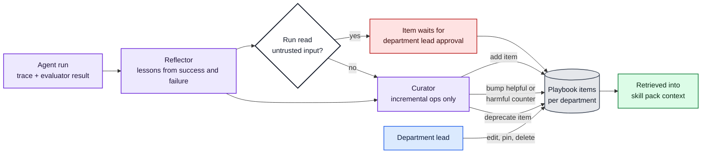

- Playbooks are lists of small items, never one document; the curator applies add, counter and deprecate ops so a playbook cannot collapse into a vague rewrite.
- Items are scoped to their department and retrieved into context like facts, ranked by relevance and helpful-minus-harmful score.
- Lessons from runs that read untrusted input wait for a department lead's approval, so injected text cannot plant instructions in a playbook.

## Sync engine

Sync works like a chain without consensus: the sequencer is the single writer per tenant, every change is a numbered delta per scope with a state root, and replicas apply deltas in order, verify, and repair themselves from snapshots.

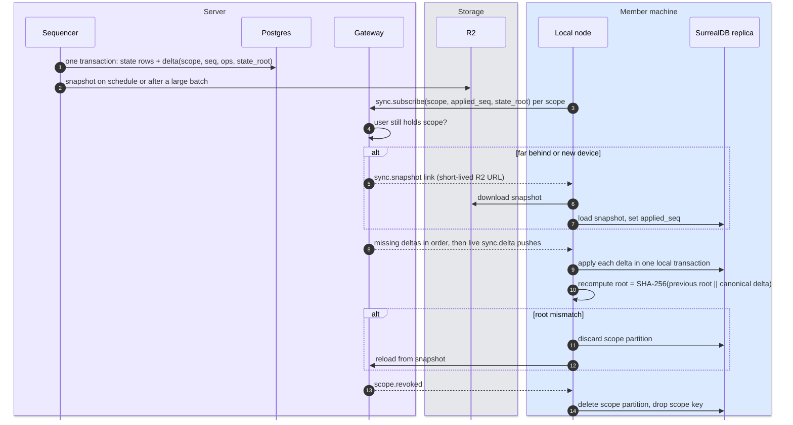

- **State roots:** each delta's root is `SHA-256(previous root || canonical delta)`. Two replicas with the same root at the same sequence have applied exactly the same history. A Merkle tree over state, for proving single facts, is a later upgrade.
- **What deltas carry:** entity, fact, summary and playbook changes with statements and source references (link, title, time), never raw event bodies. Replicas stay small and hold less sensitive material.
- **Scope keys:** each scope's replica is encrypted at rest with a scope key; the server wraps it to the device's X25519 public key; keys rotate, and revoked users stop receiving them.
- **Cursors:** `replica_cursors` records each device's applied sequence and root, so drift is visible on the server.
- **Offline:** an offline node catches up from its cursor on reconnect.
- **Writes from clients:** replicas never write state; the node submits actions through the gateway, and only the sequencer turns accepted actions into deltas.

## Core runtime (harness)

The harness is everything around the model except its weights: prompts and skill packs, tools, infrastructure, orchestration logic, hooks and model configuration. Library IDE runs every department on one harness; conduction moves context, orchestration plans and routes, and the synchronizer keeps parallel work consistent.

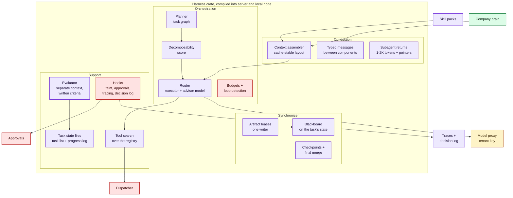

### Placement

- The harness is one Rust crate compiled into both the server binary and the local node.
- Base tiers run agents in the member's local node; higher tiers also run server-side and ambient agents.
- In both places, model calls use the tenant's BYOK key through the gateway's model proxy, and every tool call goes through the server dispatcher, so no credential reaches a machine. Coding agents inside the T3 Code fork keep using members' own subscriptions locally.
- Runs are persisted state machines (`runs`, `run_steps`); a crash resumes from the last checkpoint, and a run waiting days for an approval holds no worker.

### Department skill packs

- Every department (design, programming, marketing, finance, legal, operations, product, C-suite) is a skill pack on the same harness, not a separate agent.
- A pack holds: a `SKILL.md` entry file of about 100 lines (purpose, rules, when to use, links to deeper references), a tool allowlist by registry id, output schemas, evaluator criteria with calibration examples, and a link to the department's playbook.
- Progressive disclosure: only each pack's name and description sit in the prompt; the body loads when the pack is used; references load on demand.
- Packs are versioned; each run records the pack hash it used. C-suite and product leaders can use every pack; the product team uses its own pack plus the packs of teams it heads.

### Conduction and the cache-stable prompt layout

- Context is assembled in a fixed order: harness rules, loaded skill bodies, tool definitions, task spec, retrieved slices, then the running log of model and tool turns, with the task's goals recited at the end.
- Everything before the running log is a stable prefix; the log is append-only; JSON is serialised deterministically (sorted keys, fixed number formats); timestamps never appear in the prefix.
- Tools are masked, not removed, mid-run, so the prefix and its cache survive tool changes.
- Failed actions and errors stay in context, so the model does not repeat them.
- Components exchange typed messages (Rust structs exported with ts-rs), never free-form agent-to-agent chat.

### Orchestration

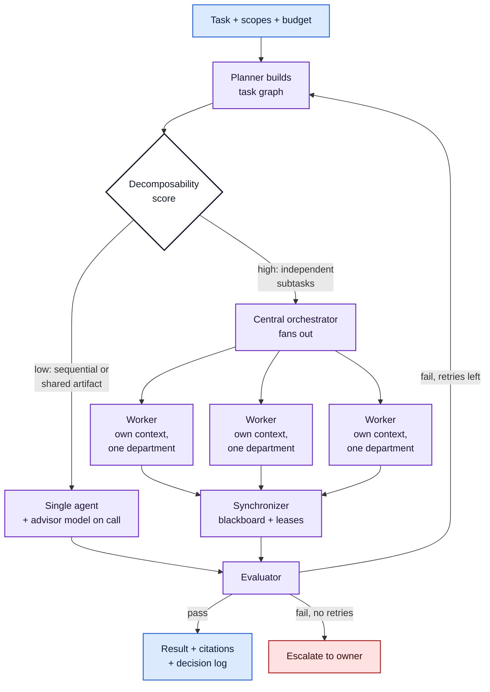

- **Task graph:** the planner emits a dependency graph; independent nodes run in parallel, dependent nodes wait for their inputs.
- **Decomposability score:** computed from the number of independent subtasks, shared artifacts and shared context needed; low scores route to one agent, because multi-agent setups degrade sequential work.
- **Split by context, not role:** parallel workers split along context boundaries (departments, separate artifacts), never one piece of work across writer, tester and reviewer agents.
- **Central control:** fan-out always runs under a central orchestrator; independent agents talking freely is not allowed.
- **Advisor routing:** a cheaper executor model does the work and calls a stronger advisor model when it is stuck or before a risky step.
- **Routing parameters:** task type, tools needed, context size, cost budget, latency target, model capability, data scope and confidence; every routing decision goes to the decision log.
- **Budgets:** each run has token, step, wall-time and cost limits; loop detection stops a run that repeats the same tool call with the same arguments or makes no progress in its progress log for a set number of steps.

### Synchronizer and artifact leases

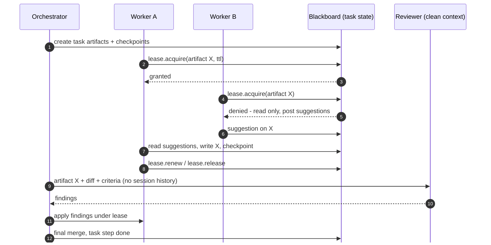

- Exactly one agent holds the write lease on an artifact; leases have a time limit and renew while the writer makes progress; an expired lease returns to the orchestrator.
- Other agents read the artifact and post suggestions to the blackboard; only the lease holder writes.
- Reviewers get the artifact, the diff and the criteria, never the writer's session history.
- The blackboard lives in the task's state (`task_artifacts`, `artifact_leases`, `progress_log`), so humans and agents see the same state live.

### Task state files and the evaluator

- Every task has a task list in JSON where each item has a `passes` flag that only the evaluator may flip, plus an append-only progress log.
- Every agent session starts by reading the progress log and running the task's startup check, so a resumed or handed-off run never declares victory on partial work.
- The evaluator runs in its own context with the skill pack's written criteria and calibration examples; it grades outcomes, not steps; for code it runs tests, for design and marketing it scores against the rubric.
- A failed evaluation sends a critique back to the worker within a bounded number of retries, then escalates to the owner.

### Tools inside the harness

- **Tool search:** only core tools load up front; all other definitions are found through a search tool over the tool registry and loaded when needed, which keeps dozens of plugins out of the prompt.
- **Tool definitions** include use examples; connectors return errors that say what failed, what to change and a useful next step.

### Traces and the decision log

- Every run step records model time, tool time, tokens in, tokens out, cached tokens and cost (`run_steps`, OpenTelemetry spans).
- Every routing, decomposition, approval-tier and lease decision is written to `decision_log` with its inputs and outcome; this log is the training data for the v1 decision API.

### Cross-department sign-off

- A product leader or C-suite user creates a task; the orchestrator lists the departments it touches; one `task_scopes` row per department waits for that department's lead.
- One rejection rejects the task; all approvals move it to running. Cross-department work passes only the artifacts attached to the task, never a scope's context.
- Every side effect goes through risk-tiered approvals, then the dispatcher, then the audit log; every transition is an event, so replicas see task state change live.
- State changes use optimistic locking on `version`, so two leads deciding at once cannot both win.

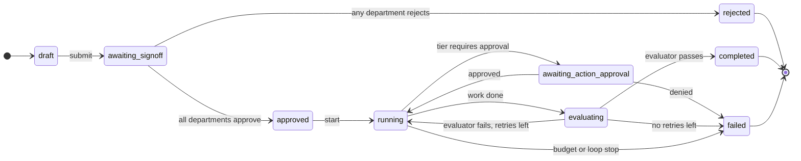

## Plugins and connections

v0 ships 30 standard plugins on official vendor MCP servers, the setup flow for customer-owned apps (Google Workspace, Slack) and the standard MCP way to add any other server; one connection layer with four sign-in modes covers all of them, and every tool definition is pinned by hash.

### Connecting a plugin

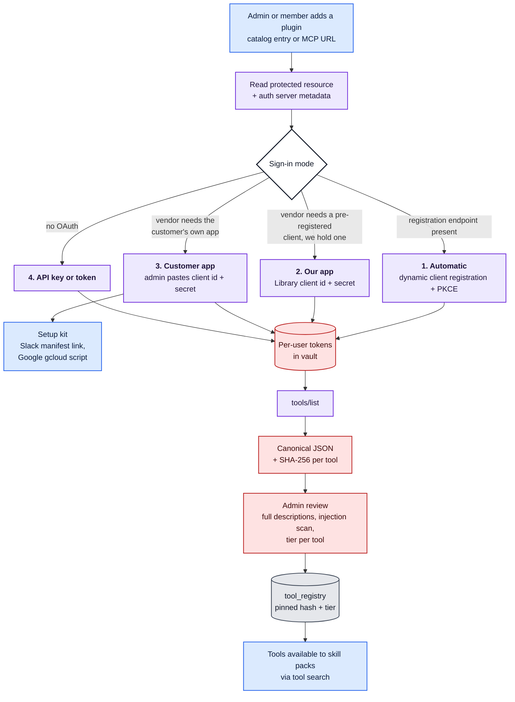

- **Mode 1, automatic:** the dispatcher discovers the server's authorization server, registers a client dynamically, runs OAuth with PKCE through the gateway callback and stores per-user tokens. CI probes every mode-1 plugin's metadata on each build, so a vendor dropping dynamic registration is caught before release.
- **Mode 2, our app:** Library holds a registered client for vendors that need one and do not review it (GitHub App, HubSpot MCP auth app, Atlassian and Box developer apps).
- **Mode 3, customer app:** the tenant's admin creates an app in their own vendor account and pastes its credentials into Library; they live in `tenant_oauth_clients`, encrypted by the vault.
- **Mode 4, API key or token:** stored per user or per tenant in the vault; used where a vendor offers keys only or where the customer prefers them.
- **Open servers** need no sign-in, but their tools are pinned and every call still goes through the dispatcher.

### Customer-owned app setup

- **Slack:** Slack's MCP server accepts only Marketplace-published or internal apps, and non-Marketplace distributed apps are throttled on `conversations.history` and `conversations.replies`. Each tenant therefore runs an internal Slack app: Library generates its manifest (user-token scopes for the tools used, Events API subscriptions pointing at our ingest endpoint, the gateway redirect URL), the admin installs it from a link and pastes the client id, client secret and signing secret.
- **Google Workspace:** the admin creates a Google Cloud project under their Workspace organization, sets the OAuth consent screen to Internal (no Google verification needed), enables the Gmail, Drive, Calendar, Chat and People MCP APIs, creates an OAuth client with "Use this client for an AI-powered agent" selected and the gateway redirect URL, and pastes the client id and secret. Library ships a gcloud script and a step-by-step guide for this.
- **Limits stated to customers:** Internal consent works only for Workspace organizations; a personal Google account is limited to 100 test users and re-authorization every 7 days.

### Tool call path

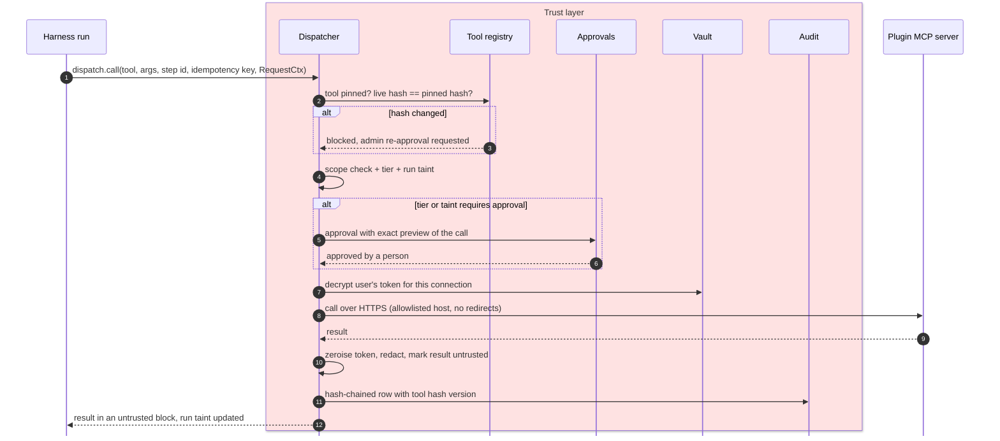

### Tool registry and pinning

- On connect and on every `tools/list_changed` notification, each tool definition is serialised canonically and hashed; a new or changed hash blocks the tool until an admin approves it.
- The review screen shows every description in full and flags injection patterns: instructions addressed to the model, hidden Unicode, references to other tools or credentials.
- Every tool gets an approval tier at review (read, sandbox write, external write); MCP annotations such as `readOnlyHint` and `destructiveHint` suggest the default, the admin decides.
- Every MCP server is treated as untrusted: tool results enter context as untrusted data and set the run's taint.

### Standard plugin catalog

| Plugin | Departments | Endpoint | Sign-in mode |
| --- | --- | --- | --- |
| GitHub | Programming, product | `https://api.githubcopilot.com/mcp/` plus GitHub App webhooks | 2, our app |
| Slack | Everyone | `https://mcp.slack.com/mcp` plus Events API | 3, customer app |
| Google Workspace (Gmail, Drive, Calendar, Chat, People) | Everyone | Google Workspace MCP servers (`gmailmcp.googleapis.com` and siblings) | 3, customer app |
| HubSpot | Marketing, sales | `https://mcp.hubspot.com` | 2, our app |
| Atlassian (Jira, Confluence) | Programming, product | Atlassian Rovo MCP server | 2, our app, or API token |
| Box | Legal, operations | `https://mcp.box.com` | 2, our app |
| Linear | Programming, product | `https://mcp.linear.app/mcp` | 1, automatic |
| Notion | Everyone | `https://mcp.notion.com/mcp` | 1, automatic |
| Sentry | Programming | `https://mcp.sentry.dev/mcp` | 1, automatic |
| Vercel | Programming | `https://mcp.vercel.com/` | 1, automatic |
| Supabase | Programming | `https://mcp.supabase.com/mcp` | 1, automatic |
| Cloudflare | Programming, operations | Cloudflare MCP servers (bindings, observability, docs) | 1, automatic |
| Netlify | Programming | `https://netlify-mcp.netlify.app/mcp` | 1, automatic |
| Neon | Programming | `https://mcp.neon.tech/mcp` | 1, automatic |
| Canva | Design, marketing | `https://mcp.canva.com/mcp` | 1, automatic |
| Webflow | Design, marketing | `https://mcp.webflow.com/sse` | 1, automatic |
| Asana | Operations, product | `https://mcp.asana.com/sse` | 1, automatic |
| monday.com | Operations, product | `https://mcp.monday.com/sse` | 1, automatic |
| Airtable | Operations | `https://mcp.airtable.com/mcp` | 1, automatic |
| Attio | Sales | `https://mcp.attio.com/mcp` | 1, automatic |
| Intercom | Support, operations | `https://mcp.intercom.com/mcp` | 1, automatic |
| Fireflies | Everyone (meeting transcripts) | `https://api.fireflies.ai/mcp` | 1, automatic |
| Stripe | Finance | `https://mcp.stripe.com/` | 1, automatic, or API key |
| PayPal | Finance | `https://mcp.paypal.com/sse` | 1, automatic |
| Square | Finance | `https://mcp.squareup.com/sse` | 1, automatic |
| Ramp | Finance | `https://ramp-mcp-remote.ramp.com/mcp` | 1, automatic |
| Exa | Everyone (web search) | `https://mcp.exa.ai/mcp` | Open |
| Context7 | Programming (library docs) | Context7 MCP server | Open |
| Hugging Face | Programming | `https://hf.co/mcp` | Open |
| DeepWiki | Programming | `https://mcp.deepwiki.com/sse` | Open |

Endpoints are confirmed against each vendor's own docs before pinning; SSE endpoints move to streamable HTTP wherever the vendor offers it.

**Needs a vendor process, not in v0:** Figma (only clients in the Figma MCP Catalog may connect), Microsoft 365 Work IQ (needs Microsoft 365 Copilot licensing), DocuSign and Salesforce (production requirements to confirm). Slack Marketplace listing and Google OAuth verification later remove the customer setup step; neither blocks v0.

**Any other server:** users add an MCP server by URL; it goes through the same discovery, sign-in, hash pinning and admin review, and user-added servers are blocked from private IP ranges.

Sources: [Slack MCP server](https://docs.slack.dev/ai/mcp-server/), [Slack rate limits for non-Marketplace apps](https://docs.slack.dev/changelog/2025/05/29/rate-limit-changes-for-non-marketplace-apps), [Google Workspace MCP setup](https://developers.google.com/workspace/guides/configure-mcp-servers), [Google OAuth user types](https://developers.google.com/identity/protocols/oauth2/production-readiness/overview), [HubSpot remote MCP GA](https://developers.hubspot.com/changelog/remote-hubspot-mcp-server-is-now-generally-available), [GitHub MCP server setup](https://docs.github.com/en/copilot/how-tos/provide-context/use-mcp/set-up-the-github-mcp-server), [Figma remote MCP](https://developers.figma.com/docs/figma-mcp-server/remote-server-installation), [Work IQ prerequisites](https://learn.microsoft.com/en-us/connectors/a365mcpservers/), [Remote MCP server list](https://github.com/jaw9c/awesome-remote-mcp-servers/).

## Ambient agents

Ambient agents sense changes in the brain and propose actions without being asked; they never act on their own, and they are tuned to stay quiet when nothing is worth raising. They are built last and limited to higher tiers.

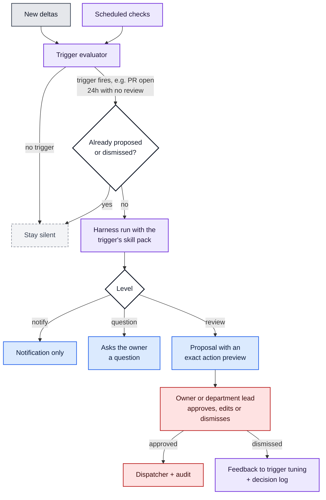

- **Triggers:** each trigger is a declared rule over state (kind, condition, scope, cooldown); the first is a PR open 24 hours with no review, which proposes a Slack nudge to its owner.
- **Three levels:** notify (inform only), question (ask the owner something) and review (a proposed action waiting for approval), following the notify, question and review pattern for human-in-the-loop agents.
- **Silence:** cooldowns, duplicate suppression and dismissal feedback keep noise down; the silence eval measures how often the engine stays quiet when it should.
- **Execution:** an approved proposal goes through the dispatcher and the audit log like any other side effect; ambient runs carry the same taint rules as task runs.

## Sandbox and Code Mode (after v0)

Agents write one script against a department's typed tool API, and a sandbox on the member's machine runs it; credentials stay on the server, and the only way out of the sandbox is the dispatcher.

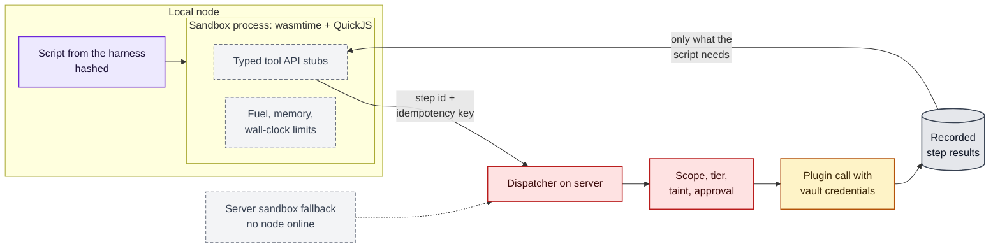

- The sandbox is a separate process with no file system, network or clock beyond what the host injects; fuel, memory and wall-clock limits apply to every script.
- Every tool call leaves as a dispatcher request with a step id and idempotency key; the server records each result.
- A paused script resumes by replaying recorded results; only the exact same script (by hash) may resume.
- If the script has read untrusted content, every side effect needs human approval. With no node online, the same script runs in the server sandbox.
- Saved scripts become reusable company workflows, the basis of the workflow builder.

## Volunteer compute (after v0)

Online teammates' machines can take verifiable jobs to offload the server, but nothing depends on them and the server never trusts their output blindly.

```mermaid
%%{init: {"sequence": {"showSequenceNumbers": true, "mirrorActors": false, "messageAlign": "left"}}}%%
sequenceDiagram
  autonumber
  participant S as Server job queue
  participant N as Online local node
  participant V as Verifier
  S->>S: queue verifiable job (parse, chunk, embed with pinned model)
  N->>S: jobs.claim (user can access the job's scope)
  S-->>N: job + time lease
  N->>N: compute
  N->>S: jobs.complete(result)
  S->>V: spot-check a sample by recomputing
  alt mismatch
    V-->>S: reject result, distrust device
  end
  Note over S: expired lease returns the job to the server
```

- Only verifiable, deterministic jobs are offered; model extraction always stays on the server.
- A node can claim jobs only for scopes its user can access; results are validated for scope and schema before use.

## Data model

Postgres holds the event log, the brain's state, sync, work, runs and security; each replica holds a copy of its scopes' state plus local-only vectors. Like a chain: events are transactions, deltas are blocks, the state tables are the world state.

```mermaid
erDiagram
  TENANTS ||--o{ SCOPES : has
  TENANTS ||--o{ MEMBERSHIPS : has
  USERS ||--o{ MEMBERSHIPS : holds
  USERS ||--o{ DEVICES : owns
  SCOPES ||--o{ SCOPE_MEMBERS : includes
  SCOPES ||--o{ CONNECTIONS : owns
  CONNECTIONS ||--o{ OAUTH_TOKENS : issues
  CONNECTIONS ||--o{ TOOL_REGISTRY : exposes
  CONNECTIONS ||--o{ EVENTS : emits
  EVENTS ||--o{ FACTS : sources
  ENTITIES ||--o{ FACTS : subject
  ENTITIES ||--o{ ENTITY_ALIASES : known_as
  SCOPES ||--o{ DELTAS : sequences
  SCOPES ||--o{ SNAPSHOTS : snapshots
  SCOPES ||--o{ COMMUNITY_SUMMARIES : summarises
  SCOPES ||--o{ PLAYBOOK_ITEMS : keeps
  TASKS ||--o{ TASK_SCOPES : signed_off_by
  TASKS ||--o{ TASK_ITEMS : tracks
  TASKS ||--o{ TASK_ARTIFACTS : produces
  TASK_ARTIFACTS ||--o| ARTIFACT_LEASES : locked_by
  TASKS ||--o{ RUNS : executes
  RUNS ||--o{ RUN_STEPS : records
  RUNS ||--o{ DECISION_LOG : decides
  RUNS ||--o{ APPROVALS : waits_on
  PROPOSALS ||--o{ APPROVALS : waits_on
  TENANTS ||--o{ AUDIT_LOG : chains
```

### Server: Postgres

Every table has `tenant_id`; every table with department data also has `scope_id`. Row-level security is forced on all of them.

| Group | Table | Key columns | Notes |
| --- | --- | --- | --- |
| Org | tenants | id, name | One per company |
| Org | plans | tenant_id, plan, features, limits, updated_at | Entitlements and budgets checked by the gateway |
| Org | users | id, email, display_name | Global identity |
| Org | memberships | tenant_id, user_id, role | member, department_lead, product_leader, c_suite, admin |
| Org | scopes | id, tenant_id, kind, name, fold_id | department or fold; HR, legal, finance can never join a fold |
| Org | scope_members | scope_id, user_id, scope_role | Who belongs where |
| Org | devices | id, user_id, public_key, last_seen, revoked_at | One per installed local node |
| Sources | connections | id, tenant_id, scope_id, provider, server_url, auth_mode, oauth_client_ref, status | One per plugin install |
| Sources | tenant_oauth_clients | id, tenant_id, provider, client_id, secret_ref, signing_secret_ref, redirect_uri | Customer-owned apps (Slack, Google) |
| Sources | oauth_tokens | connection_id, user_id, secret_ref, granted_scopes, expires_at | Per-user tokens, ciphertext in secrets |
| Sources | events | id, tenant_id, scope_id, source, external_id, kind, occurred_at, payload, taint | Append only; unique (tenant_id, source, external_id) |
| Tools | tool_registry | id, connection_id, tool_name, def_hash, definition, tier, status, approved_by, approved_at | status: pending, approved, blocked; tier: read, sandbox_write, external_write |
| Skills | skill_packs | id, tenant_id, department, version, hash, manifest | Built-in packs have no tenant_id; tenant packs override |
| State | entities | id, tenant_id, scope_id, kind, name, summary, external_ids, tsv, seq | People, repos, PRs, issues, channels, projects, decisions, customers, documents |
| State | entity_aliases | entity_id, alias, source | Used by entity resolution |
| State | merge_proposals | id, scope_id, entity_a, entity_b, score, state, decided_by | Fuzzy matches wait for review |
| State | facts | id, tenant_id, scope_id, subject_id, relation, object_id, statement, valid_from, valid_to, recorded_at, retracted_at, source_event_id, source_ref, extractor_version, confidence, taint, tsv, seq | Never overwritten: a contradiction closes the old fact and opens a new one |
| State | community_summaries | id, scope_id, community_key, member_ids, summary, citations, computed_seq | Recomputed past a change threshold |
| State | briefs | id, tenant_id, audience_kind, audience_id, scope_ids, content, citations, stale, computed_at | Per leader and per department |
| State | playbook_items | id, scope_id, department, content, helpful, harmful, status, source_run_id, approved_by | status: pending, active, deprecated |
| Sync | deltas | scope_id, seq, tenant_id, ops, state_root, created_at | Primary key (scope_id, seq) |
| Sync | snapshots | scope_id, seq, r2_key, state_root | Full scope state at a sequence, in R2 |
| Sync | replica_cursors | device_id, scope_id, applied_seq, state_root | Drift detection |
| Sync | scope_keys | scope_id, key_version, wrapped_key, valid_from, valid_to | Replica encryption keys |
| Work | tasks | id, tenant_id, title, owner_id, state, version, budget | Cross-department tasks |
| Work | task_scopes | task_id, scope_id, decision, decided_by, decided_at | One sign-off row per department |
| Work | task_items | task_id, item_key, description, passes, evaluated_by_run | Only the evaluator flips `passes` |
| Work | progress_log | task_id, seq, run_id, entry, created_at | Append only |
| Work | task_artifacts | id, task_id, kind, ref, version | The blackboard's artifacts |
| Work | artifact_leases | artifact_id, run_id, expires_at | One writer per artifact |
| Work | approvals | id, task_id or proposal_id, run_id, tool_id, tier, preview, decided_by, decision | Every gated side effect waits here |
| Work | triggers | id, tenant_id, scope_id, kind, condition, cooldown, level | Ambient trigger rules |
| Work | proposals | id, tenant_id, scope_id, trigger_id, level, suggestion, preview, state | Ambient output |
| Runs | runs | id, tenant_id, task_id, skill_pack_hash, placement, state, taint, budget_tokens, budget_steps, budget_ms, budget_cost | Persisted run state machine |
| Runs | run_steps | run_id, seq, kind, model, tool_id, tool_hash, tokens_in, tokens_out, tokens_cached, model_ms, tool_ms, cost, checkpoint | One row per model or tool step |
| Runs | decision_log | id, tenant_id, run_id, kind, inputs, choice, outcome | Training data for the v1 decision API |
| Evals | eval_runs | id, suite, suite_version, build, k, pass_k, score, created_at | Release gates |
| Security | secrets | id, tenant_id, ciphertext, wrapped_dek, key_version | Readable only by the vault role |
| Security | audit_log | seq, tenant_id, actor, action, target, tool_hash, payload_hash, prev_hash, hash | Hash chain per tenant; insert only |

### Client: SurrealDB embedded replica

One database per scope inside a tenant namespace, so a scope can be wiped or re-keyed alone.

| Table | Type | Fields |
| --- | --- | --- |
| entity | node | Mirrors the server row, plus local `embedding` |
| fact | edge (entity to entity) | Mirrors the server row, plus local `embedding` |
| summary | record | Mirrors `community_summaries`, plus local `embedding` |
| playbook_item | record | Mirrors active `playbook_items` for the scope's department |
| sync_meta | record | applied_seq, state_root, key_version |

Indexes: HNSW on `embedding`, full-text on `name`, `summary` and `statement`. Embeddings never leave the machine in v0.

## API

Two links, both JSON-RPC 2.0: the desktop app talks to its local node over stdio, and the local node keeps one authenticated WebSocket to the gateway. HTTP is used only for sign-in and plugin OAuth callbacks and inbound webhooks.

### Local node to gateway

| Method | Who can call | Purpose |
| --- | --- | --- |
| `session.whoami` / `session.refresh` | Signed-in device | Tenant, roles, scopes, plan; token rotation |
| `sync.subscribe` | Any member, own scopes | Send each scope's applied_seq and state_root; receive missing deltas, then live ones |
| `sync.snapshot` | Any member, own scopes | Short-lived R2 link to the latest snapshot of a scope |
| `sync.key` | Any member, own scopes | Current scope key, wrapped to the device's public key |
| `org.departments.list` / `org.departments.upsert` | Admin | Departments, folds and members |
| `plugins.catalog` | Any member | Standard plugins with departments and sign-in mode |
| `connections.list` / `connections.start` / `connections.revoke` | Admin, department lead | List plugins; start a sign-in in any of the four modes; disconnect |
| `connections.oauth_client.set` | Admin | Store a customer-owned app's client id, secret and signing secret |
| `connections.setup_kit` | Admin | Slack manifest link or Google gcloud script for this tenant |
| `mcp.add` | Admin, department lead | Add any MCP server by URL; runs discovery and sign-in |
| `tools.pending` / `tools.review` | Admin | Review new or changed tool definitions; approve with a tier or block |
| `brain.status` / `brain.ask` | Product leader, C-suite | God's eye status and cited answers across their scopes |
| `brain.brief` | Product leader, C-suite, department lead | Latest precomputed brief for the caller or a department |
| `brain.context` | Harness on the server, own scopes | Cited slices for a run within a token budget |
| `brain.merges.pending` / `brain.merges.decide` | Department lead | Review entity merge proposals |
| `playbooks.list` / `playbooks.edit` / `playbooks.approve` | Department lead | Read, edit, pin, delete or approve playbook items |
| `skills.list` / `skills.upsert` | Admin | Built-in and tenant skill packs |
| `tasks.create` / `tasks.get` / `tasks.list` | Leaders create; members read own scopes | Cross-department tasks with items, progress and artifacts |
| `signoffs.pending` / `signoffs.decide` | Department lead | Approve or reject for their department |
| `runs.start` / `runs.get` / `runs.cancel` | Task owner; members for their own runs | Agent runs, steps, traces and budgets |
| `runs.lease` | Harness, own task | Acquire, renew or release an artifact lease |
| `model.call` | Harness in a local node | Model proxy with the tenant's key, budget-checked |
| `approvals.pending` / `approvals.decide` | Task owner, department lead | Approve each gated side effect from its preview |
| `actions.undo` | Whoever approved the action | Reverse an action where the plugin supports it |
| `proposals.list` / `proposals.decide` | Owner, department lead (higher tiers) | Act on ambient notifications, questions and proposals |
| `triggers.list` / `triggers.upsert` | Admin, department lead (higher tiers) | Ambient trigger rules |
| `audit.query` | Admin, C-suite | Read the tenant's audit log |
| `evals.results` | Admin | Latest eval runs per suite |
| `dispatch.call` | Harness in a local node; sandbox (after v0) | One tool call with step id and idempotency key |
| `jobs.claim` / `jobs.complete` (after v0) | Local node, own scopes | Volunteer compute |

**Pushed to the node:** `sync.delta`, `scope.revoked`, `key.rotated`, `task.updated`, `signoff.requested`, `approval.requested`, `run.updated`, `lease.changed`, `brief.ready`, `proposal.created`, `tool.changed`, `connection.expired`.

### Desktop app to local node

| Method | Purpose |
| --- | --- |
| `local.ask` | Answer from the replica (members' own scopes), offline-capable, with citations |
| `local.context` | Cited slices from the replica for a run started by this member |
| `local.sync_status` | Per-scope sequence, root check and lag, shown in the app |
| `local.runs` | Runs executing in this node, with steps and budgets |
| `remote.*` | Proxies every gateway method, so the app never touches tokens or the network |

**Rules:**

- Every method declares its role, scope and plan requirement in Rust; the gateway rejects before the handler runs, and row-level security rejects again in the database.
- Errors are typed (code, message, retryable); no stack traces or SQL leave the server.
- Writes carry an idempotency key; replays return the first result.
- The protocol is versioned (`v1`); incompatible app or node versions are refused at connect.

## Security model

Two rules hold everywhere: no single bug may expose data across tenants or scopes, and once an agent has read untrusted input it cannot cause a consequential action without a person approving it. Every boundary is enforced twice, once in Rust and once in the database or the dispatcher.

### Trust boundaries

```mermaid
%%{init: {"flowchart": {"curve": "basis", "nodeSpacing": 28, "rankSpacing": 42}}}%%
flowchart TB
  subgraph UNTRUSTED["Untrusted"]
    direction LR
    EXT["Plugin servers +<br/>their tool definitions"]:::ext
    EVT["Event text, documents,<br/>tool results"]:::ext
    WEB["Internet"]:::ext
  end
  subgraph DEVICE["Member device, trusted only for its own user"]
    direction LR
    APP["Renderer<br/>sandboxed"]:::app
    NODE["Local node<br/>keychain, scope keys"]:::app
    REP[("Replica<br/>own scopes only")]:::store
  end
  subgraph EDGE["Cloudflare edge"]
    CF["Tunnel, firewall,<br/>Zero Trust"]:::ext
  end
  subgraph CORE["Server core, the authority"]
    direction LR
    GW["Gateway + authz"]:::sec
    QU["Quarantine model<br/>no tools"]:::sec
    HA["Harness<br/>privileged planner"]:::srv
    DS["Dispatcher<br/>only exit"]:::sec
    VA["Vault<br/>only key holder"]:::sec
    PG[("Postgres<br/>FORCE RLS")]:::store
  end
  APP --> NODE --> CF --> GW
  EVT --> CF
  GW --> PG
  EVT -.->|text only| QU
  QU -.->|typed fields| HA
  HA --> DS
  DS --> VA
  DS --> EXT
  EXT -.->|results marked untrusted| HA
  classDef app fill:#dbeafe,stroke:#2563eb,color:#0b1b3a,stroke-width:1.5px
  classDef srv fill:#ede9fe,stroke:#6d28d9,color:#1e1338,stroke-width:1.5px
  classDef brain fill:#dcfce7,stroke:#15803d,color:#0b2a16,stroke-width:1.5px
  classDef store fill:#e5e7eb,stroke:#374151,color:#111827,stroke-width:1.5px
  classDef sec fill:#fee2e2,stroke:#b91c1c,color:#3b0a0a,stroke-width:1.5px
  classDef ext fill:#fef3c7,stroke:#b45309,color:#3a2504,stroke-width:1.5px
  classDef later fill:#f3f4f6,stroke:#6b7280,color:#374151,stroke-dasharray:5 3
  classDef gate fill:#ffffff,stroke:#111827,color:#111827,stroke-width:2px
```

### Identity and sessions

- Sign-in with Google, Microsoft or GitHub via OAuth 2.0 with PKCE, opened in the system browser with a loopback redirect (the native-app pattern), never inside an embedded webview.
- The runtime issues its own tokens: a 15-minute signed access token and a 30-day rotating refresh token bound to the device. Reusing an old refresh token revokes the whole session family.
- The local node stores tokens in the OS keychain (the `keyring` crate); the desktop app never sees them. Each device generates an X25519 key pair at install and registers the public key.
- Agents get their own principal: a task capability covering only the task's scopes, issued after sign-off, expiring when the task ends. Plugin calls use the requesting user's own token, so an agent can never do more in a plugin than its user can.

### Tenancy and scopes

- The runtime connects as `app_rw`, which is not the table owner and has no BYPASSRLS; every table uses FORCE ROW LEVEL SECURITY. Each transaction sets `app.tenant_id`, `app.user_id` and `app.scope_ids` with SET LOCAL, and policies check tenant and scope.
- Migrations run as a separate owner role; the secrets table is readable only by the vault's own role and pool.
- The brain's state lives in Postgres, so the same forced row-level security covers it; God's eye, briefs and summaries add the scope filter in code as well.
- HR, legal and finance scopes can never join a fold. Cross-department work passes only the artifacts attached to the task, never a scope's context.

### Replicas and sync

- The server sends a device deltas, snapshots and keys only for scopes its user holds right now, checked on every subscribe and every push.
- Each scope's replica is encrypted at rest with a scope key wrapped to the device's public key; keys rotate, and revoked users stop receiving them.
- Revocation deletes the partition on the device and stops key issue. Data already on a laptop can never be fully recalled; this limit is stated plainly to customers.
- Replicas never write state. A tampered replica can only mislead its own user, and state roots let the node detect and repair it.
- The server never trusts anything a replica or local job returns; it validates scope and schema, and spot-checks computed results.

### Secrets

- Envelope encryption: each tenant has a data key (AES-256-GCM) wrapped by a master key held outside the database (environment in v0, cloud KMS later), with key versions for rotation.
- Plugin tokens, customer-owned app secrets, Slack signing secrets and BYOK model keys are decrypted only inside the dispatcher or model proxy at call time and zeroised after use. Tracing redacts them by type.
- Secrets never enter a model's context, a run log, a replica or a sandbox.

### Inbound webhooks and outbound calls

- GitHub: HMAC-SHA256 (`X-Hub-Signature-256`) with constant-time comparison. Slack: per-tenant signing secret over timestamp and body, 5-minute window. MCP Events: Standard Webhooks signatures.
- Body size limits, dedupe on the unique event key, and a fast 2xx after commit with processing done asynchronously.
- Each connection has an egress allowlist of the hosts its plugin uses; the dispatcher calls nothing else. User-added MCP servers are blocked from private IP ranges, the IP is re-checked on every request, and redirects are not followed.

### Prompt injection: quarantine, taint and plan-first

```mermaid
%%{init: {"flowchart": {"curve": "basis", "nodeSpacing": 28, "rankSpacing": 42}}}%%
flowchart TB
  REQ["Trusted request<br/>from a person"]:::app
  PLAN["Privileged planner<br/>plan + allowed tools fixed<br/>before reading untrusted data"]:::srv
  UNT["Untrusted text<br/>events, documents, tool results"]:::ext
  QM["Quarantine model<br/>no tools, schema-only output"]:::sec
  VAL["Typed values<br/>with taint labels"]:::srv
  EXEC["Executor fills the plan<br/>with typed values"]:::srv
  T{"Run tainted and action<br/>is an external write?"}:::gate
  APR["Approval with<br/>exact preview"]:::sec
  DSP["Dispatcher"]:::sec
  REQ --> PLAN
  UNT --> QM --> VAL --> EXEC
  PLAN --> EXEC
  EXEC --> T
  T -->|yes| APR
  T -->|no, and tier allows| DSP
  APR --> DSP
  EXEC -.->|cannot add tools<br/>outside the plan| PLAN
  classDef app fill:#dbeafe,stroke:#2563eb,color:#0b1b3a,stroke-width:1.5px
  classDef srv fill:#ede9fe,stroke:#6d28d9,color:#1e1338,stroke-width:1.5px
  classDef brain fill:#dcfce7,stroke:#15803d,color:#0b2a16,stroke-width:1.5px
  classDef store fill:#e5e7eb,stroke:#374151,color:#111827,stroke-width:1.5px
  classDef sec fill:#fee2e2,stroke:#b91c1c,color:#3b0a0a,stroke-width:1.5px
  classDef ext fill:#fef3c7,stroke:#b45309,color:#3a2504,stroke-width:1.5px
  classDef later fill:#f3f4f6,stroke:#6b7280,color:#374151,stroke-dasharray:5 3
  classDef gate fill:#ffffff,stroke:#111827,color:#111827,stroke-width:2px
```

- **Quarantine:** untrusted text reaches only a model with no tools whose output must pass a JSON schema; the planner sees typed fields and references, never the raw text as instructions.
- **Taint:** a run becomes tainted the moment untrusted content enters its context (event-derived slices, documents, any tool result); taint is recorded on `runs` and every step.
- **Taint rule:** a tainted run's external writes always need approval, whatever the tool's tier.
- **Plan-first:** for tasks that will read untrusted data, the plan and its tool set are fixed from the trusted request before any untrusted content is read; the executor cannot add tools outside the plan.
- **Context marking:** untrusted slices arrive in delimited blocks marked untrusted, and nothing in them can grant permission.
- **Playbooks:** lessons from tainted runs wait for a department lead's approval before they can influence future runs.

### Plugins: tool poisoning and rug pulls

- Every MCP server is untrusted. Tool definitions are pinned by hash at approval; a changed definition is blocked until an admin re-approves it, which stops a server swapping a benign tool for a malicious one after approval.
- The review screen shows full descriptions and flags injection patterns, hidden Unicode and references to other tools or credentials.
- Tool results are untrusted data and taint the run.

### Approval tiers

```mermaid
%%{init: {"flowchart": {"curve": "basis", "nodeSpacing": 28, "rankSpacing": 42}}}%%
flowchart LR
  A["Proposed action"]:::app
  S{"Scope sensitive?<br/>finance, legal, HR"}:::gate
  TN{"Run tainted and<br/>external write?"}:::gate
  TI{"Tool tier"}:::gate
  AP["Approval required"]:::sec
  AUTO["Runs automatically"]:::brain
  PREV["Person sees exact preview,<br/>approves or denies"]:::sec
  DSP["Dispatcher + audit"]:::sec
  A --> S
  S -->|yes| AP
  S -->|no| TN
  TN -->|yes| AP
  TN -->|no| TI
  TI -->|read| AUTO
  TI -->|sandbox write:<br/>task artifacts, reversible| AUTO
  TI -->|external write:<br/>send, merge, pay, delete, share| AP
  AP --> PREV --> DSP
  AUTO --> DSP
  classDef app fill:#dbeafe,stroke:#2563eb,color:#0b1b3a,stroke-width:1.5px
  classDef srv fill:#ede9fe,stroke:#6d28d9,color:#1e1338,stroke-width:1.5px
  classDef brain fill:#dcfce7,stroke:#15803d,color:#0b2a16,stroke-width:1.5px
  classDef store fill:#e5e7eb,stroke:#374151,color:#111827,stroke-width:1.5px
  classDef sec fill:#fee2e2,stroke:#b91c1c,color:#3b0a0a,stroke-width:1.5px
  classDef ext fill:#fef3c7,stroke:#b45309,color:#3a2504,stroke-width:1.5px
  classDef later fill:#f3f4f6,stroke:#6b7280,color:#374151,stroke-dasharray:5 3
  classDef gate fill:#ffffff,stroke:#111827,color:#111827,stroke-width:2px
```

- Reads and reversible writes inside the task's own artifacts run without prompts, so approval requests stay rare enough that people read them.
- External writes always show an exact preview (recipient, content, amount, target) before approval.
- Sensitive scopes (finance, legal, HR) default to approval before any action except reads; each scope can tune its tiers.

### Confidence controls in the app

- **Scope badge** on every agent: which scopes it can read right now.
- **Previews** of every gated action before it runs.
- **Source chips** on every answer and brief, linking to the original item.
- **Undo** for actions the plugin can reverse; the audit log keeps the full trail either way.

### Sandbox (after v0)

- Separate process: wasmtime running QuickJS, with no file system, network or clock beyond what the host injects; fuel, memory and wall-clock limits on every script.
- The only exit is the dispatcher; credentials stay on the server, and every call is checked for scope, tier, taint and approval.
- Every step is recorded with an idempotency key so resumes replay results instead of repeating actions.

### Desktop app hardening

- `contextIsolation` and `sandbox` on, `nodeIntegration` off, a strict content security policy, no remote content loaded, and an allowlisted IPC bridge with validated payloads.
- External links open in the system browser; dev tools are disabled in release builds.

### Audit

- Insert-only grants; each row stores `hash = SHA-256(prev_hash || canonical payload)` per tenant, so any edit or deletion breaks the chain.
- Rows record the actor, the approval, and the tool's pinned hash for every plugin call.
- The daily chain head is signed and stored outside the database, and a verifier tool checks the whole chain.

### Abuse and supply chain

- Rate limits per user and tenant, request size limits, per-run budgets and per-tenant model spend limits.
- cargo-deny and cargo-audit in CI, npm audit for the app, pinned lockfiles, GitHub Actions pinned to commit hashes, and Renovate for updates.

### Threats and mitigations

| Threat | Mitigation |
| --- | --- |
| Bug leaks another tenant's data | Forced RLS on tenant, replicas hold only permitted scopes, isolation tests in CI |
| Marketing reads HR or finance data | Scope policies in RLS, scope filter in every brain query, sealed scopes |
| Forged or replayed webhook | Signature check, 5-minute window, unique event key |
| Event or document injects instructions | Quarantine model without tools, typed output, plan-first, taint rule |
| Injected text tries to exfiltrate data | Tainted runs need approval for external writes; egress allowlists; no secrets in context |
| Malicious tool description (tool poisoning) | Admin review with injection scan, untrusted results, plan-fixed tool sets |
| Tool swapped after approval (rug pull) | Hash pinning, block on change, re-approval |
| Approval fatigue | Risk tiers keep prompts to external writes; exact previews |
| Poisoned playbook lesson | Tainted lessons wait for a lead's approval; helpful and harmful counters |
| Stolen desktop session | Short access tokens, refresh rotation with reuse detection, keychain storage, revocation |
| Leaked plugin token or customer app secret | Envelope encryption, vault-only role, redaction, per-user least-privilege tokens |
| Malicious MCP server URL (SSRF) | Private ranges blocked, IP re-checked per request, no redirects |
| Tampering with the audit trail | Insert-only grants, hash chain, signed daily head stored outside |
| Runaway agent cost or loop | Per-run budgets, loop detection, per-tenant spend caps |
| Compromised dependency | cargo-deny, cargo-audit, npm audit, pinned actions |
| Stolen laptop with a replica | Replica encrypted with scope keys; device revoked; keys stop |
| Tampered or forked replica | Replicas cannot write; state roots expose drift; repair from snapshot |
| Malicious result from a volunteer job (after v0) | Only verifiable jobs; spot-checks; extraction stays on the server |
| Sandbox escape (after v0) | Separate process, WebAssembly isolation, no credentials inside, every exit checked by the dispatcher |

## Performance, latency and cost

Input tokens dominate agent cost and latency, so the design keeps prompts cache-warm, small and routed to the cheapest model that can do the step; heavy work moves to members' machines or runs before anyone asks.

```mermaid
%%{init: {"flowchart": {"curve": "basis", "nodeSpacing": 28, "rankSpacing": 42}}}%%
flowchart LR
  REQ["Request"]:::app
  PRE{"Precomputed?"}:::gate
  FAST["Serve instantly"]:::brain
  LOC{"Member's own<br/>scopes?"}:::gate
  LR["Local retrieval<br/>on the replica"]:::app
  SR["Server retrieval"]:::srv
  PK["Slice packer<br/>within budget"]:::srv
  CACHE["Cache-stable<br/>prompt prefix"]:::srv
  RT{"Router"}:::gate
  EX["Executor model"]:::ext
  AD["Advisor model"]:::ext
  TS["Tool search<br/>load only needed tools"]:::srv
  REQ --> PRE
  PRE -->|brief or summary exists| FAST
  PRE -->|no| LOC
  LOC -->|yes| LR
  LOC -->|no| SR
  LR & SR --> PK
  PK --> CACHE --> RT
  RT -->|routine step| EX
  RT -->|hard or risky step| AD
  EX & AD --> TS
  classDef app fill:#dbeafe,stroke:#2563eb,color:#0b1b3a,stroke-width:1.5px
  classDef srv fill:#ede9fe,stroke:#6d28d9,color:#1e1338,stroke-width:1.5px
  classDef brain fill:#dcfce7,stroke:#15803d,color:#0b2a16,stroke-width:1.5px
  classDef store fill:#e5e7eb,stroke:#374151,color:#111827,stroke-width:1.5px
  classDef sec fill:#fee2e2,stroke:#b91c1c,color:#3b0a0a,stroke-width:1.5px
  classDef ext fill:#fef3c7,stroke:#b45309,color:#3a2504,stroke-width:1.5px
  classDef later fill:#f3f4f6,stroke:#6b7280,color:#374151,stroke-dasharray:5 3
  classDef gate fill:#ffffff,stroke:#111827,color:#111827,stroke-width:2px
```

| Lever | Rule | Effect |
| --- | --- | --- |
| Prompt caching | Stable prefix, append-only log, deterministic serialisation, tools masked not removed | Cached input is about 10x cheaper and cuts time to first token |
| Small context | Cited slices within a budget; subagents return 1,000 to 2,000 tokens; pointers instead of content | Less context rot, fewer tokens |
| Tool search | Only core tools loaded; the rest found on demand | Keeps 30+ plugins out of every prompt |
| Advisor routing | Executor model by default, advisor model when needed | Lower cost at similar quality |
| Decomposability check | Fan out only splittable work | Avoids paying multi-agent token costs where they hurt quality |
| Precompute | Community summaries and briefs built in the background | God's eye opens instantly |
| Local-first | Members' retrieval, embeddings and reranking run on their machine | Lower server load, offline reads |
| Budgets | Token, step, wall-time and cost caps per run; per-tenant spend caps | No runaway cost |
| Parallel tool calls | Independent nodes of the task graph run together | Lower wall-clock time |

Every run step records model time, tool time and cached-token share, so the dashboards show where latency and cost go per skill pack and per plugin.

## Evals and quality

Four eval suites gate every release; each starts with 20 to 50 tasks drawn from real failures, grades outcomes rather than exact steps, and reports pass^k so reliability across repeated runs is measured, not just a single success.

```mermaid
%%{init: {"flowchart": {"curve": "basis", "nodeSpacing": 28, "rankSpacing": 42}}}%%
flowchart LR
  FAIL["Real failures +<br/>bug reports"]:::sec
  TR["Run traces"]:::srv
  SUITE["Eval suites"]:::srv
  RUNK["Run each task k times"]:::srv
  GRADE["Outcome grader<br/>tests, schemas, rubric,<br/>human labels"]:::srv
  PK["pass^k per suite"]:::srv
  GATE{"Above threshold?"}:::gate
  REL["Release"]:::brain
  BLOCK["Block release<br/>+ open issue"]:::sec
  FAIL --> SUITE
  TR --> SUITE
  SUITE --> RUNK --> GRADE --> PK --> GATE
  GATE -->|yes| REL
  GATE -->|no| BLOCK
  classDef app fill:#dbeafe,stroke:#2563eb,color:#0b1b3a,stroke-width:1.5px
  classDef srv fill:#ede9fe,stroke:#6d28d9,color:#1e1338,stroke-width:1.5px
  classDef brain fill:#dcfce7,stroke:#15803d,color:#0b2a16,stroke-width:1.5px
  classDef store fill:#e5e7eb,stroke:#374151,color:#111827,stroke-width:1.5px
  classDef sec fill:#fee2e2,stroke:#b91c1c,color:#3b0a0a,stroke-width:1.5px
  classDef ext fill:#fef3c7,stroke:#b45309,color:#3a2504,stroke-width:1.5px
  classDef later fill:#f3f4f6,stroke:#6b7280,color:#374151,stroke-dasharray:5 3
  classDef gate fill:#ffffff,stroke:#111827,color:#111827,stroke-width:2px
```

| Suite | What it measures | Graded by |
| --- | --- | --- |
| Harness | Department tasks end to end: correct result, within budget, no premature victory, correct single-agent vs fan-out choice | Tests for code, schemas for structured output, rubric plus calibrated grader for design and marketing |
| Brain | Extraction accuracy, entity resolution, retrieval recall@k, citation correctness, point-in-time answers, brief freshness | Labelled event sets and question sets |
| Ambient | Proposal usefulness, and silence: staying quiet when nothing is worth raising | Labelled scenarios, dismissal rates |
| Security | Injection corpus through quarantine, taint enforcement, rug-pull detection, scope isolation, exfiltration attempts | Pass or fail per case; any failure blocks release |

- pass^k is the share of tasks that succeed on all k runs; at 75% per run, three runs in a row succeed about 42% of the time, which is why pass^k is the bar for anything customers rely on.
- Eval results are stored in `eval_runs` per build and shown to admins.
- New failures found in production become eval tasks.

## Operations

v0 runs on one Oracle VPS behind Cloudflare; everything except the domain and model usage is free.

```mermaid
%%{init: {"flowchart": {"curve": "basis", "nodeSpacing": 28, "rankSpacing": 42}}}%%
flowchart TB
  subgraph USERS["Members"]
    direction LR
    D1["Desktop app + local node<br/>macOS"]:::app
    D2["Desktop app + local node<br/>Windows"]:::app
    D3["Desktop app + local node<br/>Linux"]:::app
  end
  subgraph CF["Cloudflare"]
    direction LR
    DNS["DNS + firewall<br/>+ DDoS"]:::ext
    TUN["Tunnel<br/>api.domain"]:::ext
    ZT["Zero Trust Access<br/>admin"]:::sec
    R2[("R2<br/>snapshots, WAL, backups")]:::store
  end
  subgraph VPS["Oracle VPS: Ubuntu LTS, Arm, Docker Compose"]
    direction LR
    CFD["cloudflared"]:::ext
    SRV["server<br/>one Rust binary"]:::srv
    PG[("postgres")]:::store
    OTL["otel-collector"]:::srv
    PGB["pgbackrest"]:::store
  end
  GRAF["Grafana Cloud Free"]:::ext
  GHA["GitHub Actions<br/>+ Releases"]:::ext
  PLUG["Plugin MCP servers"]:::ext
  LLM["Model providers"]:::ext
  D1 & D2 & D3 --> DNS --> TUN --> CFD --> SRV
  ZT --> CFD
  SRV --> PG
  PGB --> R2
  SRV --> R2
  SRV --> OTL --> GRAF
  SRV --> PLUG
  SRV --> LLM
  GHA -->|signed builds| USERS
  classDef app fill:#dbeafe,stroke:#2563eb,color:#0b1b3a,stroke-width:1.5px
  classDef srv fill:#ede9fe,stroke:#6d28d9,color:#1e1338,stroke-width:1.5px
  classDef brain fill:#dcfce7,stroke:#15803d,color:#0b2a16,stroke-width:1.5px
  classDef store fill:#e5e7eb,stroke:#374151,color:#111827,stroke-width:1.5px
  classDef sec fill:#fee2e2,stroke:#b91c1c,color:#3b0a0a,stroke-width:1.5px
  classDef ext fill:#fef3c7,stroke:#b45309,color:#3a2504,stroke-width:1.5px
  classDef later fill:#f3f4f6,stroke:#6b7280,color:#374151,stroke-dasharray:5 3
  classDef gate fill:#ffffff,stroke:#111827,color:#111827,stroke-width:2px
```

### Infrastructure

| Layer | Choice | Cost |
| --- | --- | --- |
| Desktop shell | Electron from the T3 Code fork, macOS, Windows, Linux | Free |
| Local node | Rust: sync client, SurrealDB embedded replica, `ort` embeddings and reranker, harness, wasmtime plus QuickJS sandbox (after v0) | Free |
| Server host | Oracle Cloud VPS (2 OCPU, 12 GB Arm), Ubuntu LTS, Docker Compose | Free |
| Server runtime | One Rust binary (axum, Tokio, sqlx, rmcp, wasmtime) | Free |
| Database | Postgres: events, state graph, full-text, work, runs, row-level security; pgvector later for higher tiers | Free |
| Edge | Cloudflare DNS, Tunnel (no inbound ports on the VPS), firewall and DDoS protection, Zero Trust Access for admin pages | Free |
| Object storage | Cloudflare R2: snapshots, backups | Free up to 10 GB-month |
| Models | Anthropic API with our key for the demo; customers bring their own keys; Ollama for local development | Pay per use |
| Sign-in | Google, Microsoft and GitHub OAuth apps | Free |
| Plugins | GitHub App; HubSpot, Atlassian, Box developer apps; customers' own Slack and Google apps; dynamic registration for the rest | Free |
| Observability | OpenTelemetry collector to Grafana Cloud Free | Free |
| CI and releases | GitHub Actions, GitHub Releases | Free |
| Domain | Cloudflare Registrar | About $10 a year |
| Code signing | Microsoft Store (free); Apple Developer (about $100 a year) before outside Mac users | Deferred |

### Deployment

- Docker Compose on the VPS runs `server`, `postgres`, `cloudflared`, `otel-collector` and `pgbackrest`.
- Cloudflare Tunnel routes `api.<domain>` (WebSocket, webhooks, OAuth callbacks) to the server; admin endpoints sit behind Zero Trust Access.
- The master key comes from an environment file readable only by the server user; it moves to a cloud key service after v0.
- Migrations run with `sqlx migrate` as the owner role before each release; the server itself runs as `app_rw`.

### Backups and recovery

- pgBackRest archives the write-ahead log to R2 continuously, with a weekly full backup.
- Scope snapshots go to R2 on a schedule and after large batches of deltas.
- The restore drill rebuilds the VPS from scratch, restores Postgres, reconnects replicas and confirms state roots match; it runs before every major release.

### Observability and alerts

- Every request, event, delta, run step and dispatch carries one trace id from ingest to replica.
- Dashboards: model time vs tool time, cached-token share, cost per run and per tenant, eval pass^k per suite, brief freshness.
- Alerts: webhook verification failures, projector lag, dead-letter growth, sequencer errors, replica root mismatches, blocked tools awaiting re-approval, expiring plugin connections, budget stops, 5xx rate, disk use, model spend per tenant.

### CI

- On every push: `cargo fmt`, `clippy` with warnings as errors, unit tests, row-level security isolation tests against a real Postgres, quarantine and taint tests, cargo-deny, cargo-audit, npm audit.
- On every build: dynamic-registration probe and smoke test for every standard plugin; tool definition drift check against pinned hashes.
- Before release: all four eval suites at their thresholds.
- On tags: build the local node for macOS (Arm and Intel), Windows and Linux, bundle it into the Electron app, publish to GitHub Releases.

### Repo layout

```
library/
  crates/
    core/          types, traits, RequestCtx
    gateway/  authz/  ingest/  quarantine/  projector/  sequencer/
    brain/         query, retrieval, summaries, briefs, playbooks
    harness/       conduction, orchestration, synchronizer, evaluator, router
    skills/        skill pack loader
    work/  ambient/  registry/  dispatch/  connections/
    vault/  audit/  telemetry/
    server/        server binary wiring
    node/          local node binary: sync, replica, embeddings, retrieval, harness, sandbox
    protocol/      ts-rs exports for the app
  skills/          built-in department skill packs (SKILL.md, criteria, schemas)
  plugins/         standard plugin catalog, setup kits (Slack manifest, Google gcloud script)
  evals/           eval suites and graders
  migrations/
  apps/desktop/    T3 Code fork
  deploy/          compose, cloudflared, pgbackrest, otel
```

## Local vs server split

Rule: the user's machine is a worker, never an authority. Local work goes back to the server as events, and the server checks scope before anything enters the company brain.

| Work | Where | Why |
| --- | --- | --- |
| Coding agents (Claude Code, Codex, Cursor and others) through the T3 Code server | Local | Users' own subscriptions pay for the model; repos and credentials stay on the machine |
| Git, terminals, builds, tests, file operations | Local | Already how T3 Code works |
| Parsing, chunking and embedding the user's own files | Local, server fallback | Moves the heaviest ingest work off our servers; raw files leave only when needed |
| Code Mode sandbox for local tools | Local | Tool calls and intermediate data stay on the machine |
| Desktop sensing the user opts into (file changes, app activity) | Local | Only the device can see it |
| Scoped read cache of the company brain | Local | Fast context assembly and offline reads; rebuilt from the server |
| Small-model tasks (classification, routing hints, short summaries) | Local when the device can run them | Optional, detected per device |
| Company brain, access checks, approvals, audit | Server | A client is never trusted for permissions or shared truth |
| SaaS events (webhooks, MCP Events) | Server | Needs a public, always-on endpoint |
| Cross-department orchestration, synchronizer, ambient sensing | Server | Laptops sleep |
| Code Mode sandbox for shared SaaS tools | Server | Holds organisation credentials, which never enter the sandbox |

## Code Mode

Agents get each department's tools as a typed API and write one script against it; a sandbox runs the script and only the final result returns to the model. Anthropic's [Code execution with MCP](https://www.anthropic.com/engineering/code-execution-with-mcp) and Cloudflare's [Code Mode](https://blog.cloudflare.com/code-mode/) describe the pattern; in Claude Code it is still experimental and off by default.

- **Why it fits:** dozens of department plugins would flood the context with tool definitions; sensitive intermediate data (finance, HR) stays out of the model; one script runs independent calls in parallel; saved scripts become reusable company workflows, which can replace an n8n-style engine.
- **Our build:** the Rust runtime hosts the sandbox (decided: WebAssembly through wasmtime running QuickJS, local first with a server fallback). Credentials stay host-side, and every call out of the sandbox goes through a dispatcher that enforces access scopes and approval gates.
- **Risks:** the sandbox is now a security boundary; event text and documents can inject code-shaped instructions; every side effect still needs approval and must be recorded so a paused script can resume safely.

## Design problems and resolutions

Five problems surfaced while designing the product. Each lists what is decided and what the research must settle.

### 1. Access scopes

**Problem:** if every department can see every other department, privileged material leaks (legal matters, salaries, personnel files). No company with a compliance team will adopt that.

**Decided:** the product fold (design, programming, marketing and any team on the same product) shares context. HR, legal and finance are sealed.

**Proposed:** scopes are a first-class object in the system. The God eye shows status across all scopes; detail is visible only inside a scope or by grant. A cross-scope task (legal reviewing launch copy) passes only the artifact it needs, not the scope's context.

### 2. Event layer that works with existing MCP

**Problem:** MCP tools are pull-based: an agent calls them when it decides to. Ambience needs push, the tools telling the runtime something changed.

**Finding:** this protocol is already being built inside MCP. The Triggers and Events Working Group's draft, MCP Events (SEP-3415, proposed 5 Oct 2026, still in review), adds `events/list`, `events/poll`, `events/stream`, `events/subscribe` and `events/unsubscribe`. Webhook delivery is the mode most implementations use. ChatGPT, Vercel AI SDK and Mastra support it experimentally; Claude does not yet. ([Hookdeck guide](https://hookdeck.com/webhooks/guides/what-are-mcp-events), [WorkOS](https://workos.com/blog/mcp-events-chatgpt-subscription-revocation))

**Decided:** until MCP Events ships as standard, we build the adapter using SEP-3415 as the baseline, and speak MCP Events natively wherever a server supports it. For servers that do not support it yet, an adapter produces the same events by polling the server's tools or resources for changes, or by taking the tool's own webhooks (GitHub, Slack). Everything lands on one internal event bus, so users only ever add an MCP server.

**Risks to research:** the draft can still change; delivery can be duplicated or out of order; subscriptions expire unless renewed; event text is untrusted input that can carry prompt injection.

### 3. Always-on runtime

**Decided:** the runtime runs server-side and the application is the interface on top.

**To research:** hosted vs self-hosted for companies that will not send data out, and the cost of continuous sensing at company scale.

### 4. Coordination between conductor, orchestrator and synchronizer

**Split:** conduction moves data, context and control signals between components; orchestration plans tasks and distributes them across models; the synchronizer keeps tasks and state in step (see System components).

**Agreed:** they depend on each other through shared state and hard limits (time, steps, cost, stop conditions), not free-form agent-to-agent messaging. Agents that can overrule each other loop. **Designed:** central orchestrator, decomposability check, artifact leases, evaluator and budgets with loop detection (see Core runtime (harness)).

### 5. Approval gates

**Agreed:** proactive means the system proposes and a human approves. Sensitive scopes (finance, legal) default to approval before any action; each scope can tune this. **Designed:** risk tiers (reads and reversible task writes run automatically, external writes need approval with an exact preview) plus the taint rule (see Security model).

## Summary view

The application is only the interface. Everything that senses, plans and acts runs in the harness behind access scopes, quarantine and approval gates. The complete diagram and one diagram per component are under System overview and the component sections.

```mermaid
flowchart TB
  subgraph APP[Library IDE desktop app on a T3 Code fork]
    T1[Programmer IDE]
    T2[Design canvas]
    T3[Marketing tools]
    T4[Other team toolsets]
    GE[God's eye + briefs]
  end
  APP <--> LN[Local node: replica, retrieval, harness for base tiers]
  LN <--> RT
  subgraph RT[Server runtime]
    EB[Event bus] --> QU[Quarantine model]
    QU --> CD[Conduction]
    SK[Department skill packs] --> CD
    CD --> OR[Orchestration: task graph, decomposability, advisor routing]
    OR --> PA[Parallel agents]
    PA --> SY[Synchronizer: blackboard + leases]
    SY --> EV[Evaluator]
    EV --> CD
    AG[Risk-tiered approvals + taint rule] -.- OR
  end
  subgraph CB[Company brain]
    MEM[Episodic memory]
    CTX[Context slices]
    KB[Bitemporal graph + summaries]
    PB[Playbooks]
  end
  RT <--> CB
  AS[Access scopes] -.- CB
  subgraph PL[Plugins]
    REG[Tool registry with hash pins]
    EVT[MCP Events adapter on SEP-3415]
  end
  PA --> REG
  EVT --> EB
  REG --- EXT[30 standard plugins + user-added MCP servers]
  EVT --- EXT
```

## Prior art: databases

Comparable products almost all keep Postgres as the system of record and add a specialised store for retrieval or memory. SurrealDB runs in production for agent memory, but none of the direct comparables use it.

| Product | Segment | System of record | Retrieval or memory store |
| --- | --- | --- | --- |
| [Cursor](https://www.zenml.io/llmops-database/scaling-ai-assisted-coding-infrastructure-from-auto-complete-to-global-deployment) | AI IDE | Postgres (moved off Yugabyte) | [turbopuffer](https://turbopuffer.com/customers/cursor), one namespace per codebase |
| [Notion](https://www.notion.com/blog/the-great-re-shard), Linear | Workspace | Postgres (Notion sharded) | turbopuffer, one namespace per workspace or org ([Sacra](https://sacra.com/c/turbopuffer)) |
| [Figma](https://pganalyze.com/blog/5mins-postgres-figma-dbproxy-sharding-postgres) | Design tool | Postgres (sharded) | Not covered |
| [Dust](https://qdrant.tech/blog/case-study-dust-v2/) | Company agent platform | Not covered | Qdrant, called from a Rust service; [Temporal](https://temporal.io/blog/how-dust-builds-agentic-ai-temporal) for orchestration |
| [Onyx](https://docs.onyx.app/security/architecture/system_description) | Enterprise search | Postgres | Vespa or OpenSearch (hybrid vector and keyword) |
| [Glean](https://glean.com/blog/knowledge-graph-agentic-engine) | Enterprise search | Not public | Knowledge graph with fine-grained access controls |
| [Letta](https://aws.amazon.com/blogs/database/how-letta-builds-production-ready-ai-agents-with-amazon-aurora-postgresql) | Agent memory | Postgres | pgvector |
| [Mem0](https://zby.github.io/commonplace/sources/mem0-memory-layer) | Agent memory | SQLite for history | Vector store plus optional graph (Neo4j, Memgraph, Neptune) |
| [Zep / Graphiti](https://github.com/getzep/graphiti) | Agent memory | Not covered | Graph database (Neo4j, FalkorDB, Neptune) |
| [Cobrainer](https://surrealdb.com/blog/how-cobrainer-built-graph-based-agent-memory-on-one-engine), [DigitalKin](https://surrealdb.com/customer/digitalkin), PolyAI | Agent memory and agents | Not covered | SurrealDB |

**Superseded (20 Nov 2026):** the first conclusion here (Postgres plus SurrealDB as the server-side brain store) was replaced by a state-only server: Postgres holds the event log, state graph and deltas, and SurrealDB runs embedded on members' machines as verified replicas. See Decisions (Database) and Data model.

## Free build path

Everything up to a working alpha can be built for free; the first unavoidable costs are signing the desktop apps.

| Layer | Free choice | Paid only when |
| --- | --- | --- |
| App | T3 Code fork, Monaco, monaco-vscode-api, Excalidraw, Yjs (open source) | Never |
| Extensions | Public Open VSX registry | Own managed registry |
| Runtime | Rust, Tokio, rmcp, deno_core or wasmtime | Never |
| Databases | Postgres; SurrealDB Community (free in production) | SurrealDB Enterprise features |
| Hosting | Oracle Cloud Always Free (2 OCPU, 12 GB Arm since June 2026) | Real customer load |
| Models | Users' own coding-agent subscriptions run locally; customers bring their own API keys; local models for development | Hosted inference we pay for |
| Distribution | `Desktop builds on GitHub Releases; no web app` | Signed desktop builds |
| Windows desktop | Microsoft Store MSIX (Store signs it free) | Azure Artifact Signing (about $10 a month) for direct downloads |
| Linux desktop | AppImage or .deb | Never |
| macOS desktop | Unsigned preview with Open Anyway | Apple Developer Program, about $100 a year, before outside Mac users |

## Delivery slices

Each slice is a module of the real product on the real stack (Rust runtime, Postgres, SurrealDB, access scopes), so nothing is rebuilt after the event.

1. **Company brain and God's eye:** GitHub and Slack events through the SEP-3415 adapter into the brain, and a God's eye view of the product fold.
2. **Cross-department task:** programmer, designer and marketer agents working in parallel, with the synchronizer, department sign-off, approval gates and Code Mode.
3. **Programmer workspace:** the T3 Code fork with Monaco, reading context from the brain.

**Production bar for every slice:** one-command local setup (Postgres and SurrealDB in Docker), database migrations, tests on the critical paths, OpenTelemetry tracing, scoped auth from day one, credentials never inside a sandbox, and seeded demo data.

## Research findings

About 30 sources were read for the harness, parallel work, the company brain, tools, ambience, sync, security, latency and evals, plus a plugin survey. Every finding below is applied in the architecture above.

| Area | Finding | Applied as |
| --- | --- | --- |
| Harness | A harness is everything except the model weights: prompts and skills, tools, bundled infrastructure, orchestration logic, hooks and middleware, model configuration. The Last Harness paper proposes worker, adversarial evaluator and evolution agent, but reports no experiments | Harness outline; evaluator and traces now, automated harness evolution as later research |
| Harness | Long-running agents need structured state (feature list with pass flags, progress file, startup script); later agents otherwise declare victory early | Task state files and startup check |
| Harness | Agents overrate their own subjective work; a separate evaluator with calibrated criteria fixes this | Evaluator per skill pack |
| Harness | Knowledge in Slack or people's heads is invisible to agents; keep entry docs to about 100 lines that link deeper | Brain as the non-code departments' repo; short SKILL.md entry files |
| Parallel work | Centralized multi-agent improved parallelizable tasks by 80.9% but every multi-agent variant degraded sequential tasks by 39-70%; independent agents amplified errors 17.2x vs 4.4x centralized | Decomposability check; central orchestrator; single agent for sequential work |
| Parallel work | Multi-agent works when one agent writes and others contribute; parallel writers make conflicting implicit choices; reviewers need clean context | Artifact leases; clean-context reviewers |
| Parallel work | Agents use about 4x chat tokens, multi-agent about 15x; split by context, not by role | Fan-out only when worth it; split along departments |
| Parallel work | LLMCompiler: parallel tool calls from a dependency plan, up to 3.7x faster and 6.7x cheaper than ReAct; blackboard designs improved data-discovery success 13-57% | Task graph executor; blackboard synchronizer |
| Company brain | Recall drops as context grows (context rot); subagents should return 1,000-2,000 token summaries | Small cited slices, subagent budgets |
| Company brain | Restorable compression (drop content, keep the URL); keep errors in context; recite goals at the end | Pointers in the slice packer; context layout |
| Company brain | ACE playbooks with incremental updates avoid context collapse: +10.6% on agents, +8.6% on finance | Department playbooks with add, counter and deprecate ops |
| Company brain | Zep: facts record when they became true and stopped being true; Mem0: 91% lower p95 latency, over 90% token savings; GraphRAG: community summaries answer global questions | Bitemporal facts; community summaries for God's eye |
| Company brain | Sleep-time compute cut test-time compute about 5x, best when queries are predictable | Precomputed briefs |
| Company brain | Anthropic moved from specialized agents to skills with progressive disclosure | Departments as skill packs |
| Tools | Tool search cut context from about 77K to 8.7K tokens and raised selection accuracy from 79.5% to 88.1%; tool use examples raised accuracy from 72% to 90% | Tool search; examples in definitions |
| Tools | Advisor strategy: near top-model quality at near mid-model cost; weak primaries fail to escalate | Executor plus advisor routing |
| Ambience | Notify, question and review patterns; ambient does not mean autonomous; proactive agents must also stay silent | Three proposal levels; silence eval |
| Sync | Linear: sync groups and subscriptions; permission checks became set operations as scale grew; client actions never write model tables directly | Scopes as sync groups; clients propose, server decides; expected Postgres read-path work at scale |
| Security | CaMeL: privileged planner plus quarantined model, 77% of tasks with provable security vs 84% undefended; six patterns share one rule: after untrusted input, no consequential actions | Quarantine model, taint rule, plan-first |
| Security | MCP tool poisoning hides instructions in tool descriptions; rug pulls swap tools after approval | Hash pinning with re-approval |
| Security | Users approved about 93% of permission prompts; sandboxing cut prompts by 84%; both filesystem and network isolation are needed | Risk-tiered approvals; egress allowlists |
| Latency and cost | Input outweighs output about 100:1; cached input is about 10x cheaper; prompt caching cut time to first token for a 100K prompt from 11.5s to 2.4s | Cache-stable prompt layout |
| Evals | Start with 20-50 tasks from real failures, grade outcomes, measure pass^k (75% per run is about 42% over three runs) | Four eval suites gating releases |

### Plugin survey findings

- 37 of 42 common business apps document an official MCP server; payments, analytics, support and marketing have the most gaps (no official server for Lemon Squeezy, Shopify, Plausible, Zendesk, Mailchimp; GA4's is local only).
- Many vendor servers support dynamic client registration, so any client connects with no registration: Linear, Notion, Sentry, Vercel, Supabase, Cloudflare, Canva, Asana, monday.com, Airtable, Attio, Intercom, Webflow, Stripe, PayPal, Square, Ramp, Netlify, Neon, Fireflies.
- GitHub, HubSpot, Atlassian and Box need a pre-registered client, which takes minutes and no review.
- Slack's MCP server allows only Marketplace-published or internal apps and does not support dynamic registration; non-Marketplace distributed apps are limited to 1 request per minute and 15 messages on `conversations.history` and `conversations.replies`. Internal customer-built apps are exempt, so each customer runs its own internal Slack app.
- Google Workspace MCP servers (developer preview) need an OAuth client; an Internal consent screen needs no Google verification, while an external app with Gmail scopes needs a security assessment of about 6 weeks. Each customer uses its own Internal client.
- Figma's remote server accepts only clients in its MCP Catalog; Microsoft's Work IQ server requires Microsoft 365 Copilot licensing.
- Aggregators (Composio, Merge, Apideck) would hold customers' tokens outside our dispatcher, which breaks the credential model.

## Research questions

1. **Prior art:** how existing multi-agent and workspace systems implement shared context, orchestration and plugins, as architecture to borrow from.
2. **Orchestration parameters:** which parameters decide how tasks are planned and which model gets each one.
3. **Conduction:** how data, context and control signals move between components (message bus, schemas, context routing).
4. **Synchronization:** continuous vs end-of-task sync, the shared-state model (blackboard, CRDT), conflict resolution and checkpoints.
5. **Parallelism:** dependency graphs for parallel agents, and how their results merge.
6. **Company brain:** memory tiers, per-task context assembly, the graph knowledge base schema, facts that change over time and partitioning by scope.
7. **Proactiveness and ambience:** when to surface something and when to stay quiet, and what memory does when automation is not allowed.
8. **Access model:** how to partition agent memory and context by scope, which authorization model fits (role-based, attribute-based, relationship-based) and how cross-department sign-off is enforced before agents act.
9. **MCP Events adapter:** the adapter design on the SEP-3415 baseline, covering servers without event support, deduplication, ordering, subscription renewal and untrusted event payloads.
10. **Team toolsets:** build vs integrate for each team (editor, design canvas, content and analytics, workflows), and how God's eye computes its analysis.
11. **T3 Code fork:** its architecture, how to extend it beyond coding and how to keep up with upstream.
12. **Runtime:** hosted vs self-hosted, durable execution for long tasks and approvals, and the cost of continuous sensing per company.

## Research basis

Each design choice traces to a source in the reading list below; the Research findings section holds the numbers.

| Design choice | Source |
| --- | --- |
| Harness defined as six components; evaluator and traces split model time from tool time | The Last Harness You'll Ever Build (arXiv 2604.21003) |
| Task list with pass flags, progress log, startup check | Effective harnesses for long-running agents, Anthropic |
| Separate calibrated evaluator for subjective work | Harness design for long-running apps, Anthropic |
| Short entry docs that link deeper; drift-gardening agents | Harness engineering, OpenAI |
| Decomposability check, central orchestrator, single agent for sequential work | Towards a science of scaling agent systems, Google Research |
| One writer per artifact, clean-context reviewers, advisor model | Multi-agents: what's actually working, Cognition |
| Split by context not role; effort scaled to the question | Multi-agent research system and When to use multi-agent systems, Anthropic |
| Task graph with parallel execution | LLMCompiler |
| Blackboard synchronizer | Blackboard multi-agent papers |
| Small cited slices, subagent summaries | Effective context engineering, Anthropic; Context rot, Chroma |
| Cache-stable prompt layout, restorable compression, errors kept in context | Context engineering lessons from building Manus |
| Department playbooks with incremental updates | Agentic Context Engineering (ACE) |
| Bitemporal facts | Zep / Graphiti |
| Memory layer latency and token savings | Mem0 |
| Community summaries for global questions | GraphRAG, Microsoft Research |
| Precomputed briefs | Sleep-time compute, Letta |
| Departments as skill packs with progressive disclosure | Agent Skills, Anthropic |
| Tool search, tool use examples | Advanced tool use, Anthropic |
| Helpful tool errors | Writing tools for agents, Anthropic |
| Notify, question, review levels | Ambient agents, LangChain |
| Sync groups and subscriptions | Linear sync engine posts and reverse-engineering write-up |
| Quarantine model, plan-first | CaMeL, Google DeepMind; Design patterns for securing LLM agents |
| Tool pinning against poisoning and rug pulls | Invariant Labs; Cloud Security Alliance MCP guidance |
| Risk-tiered approvals, filesystem plus network isolation | Sandboxing Claude Code, Anthropic |
| Prompt caching | Prompt caching docs, Anthropic |
| 20-50 task suites, outcome grading, pass^k | Demystifying evals for AI agents, Anthropic |

## Reading list

Start with the two lab guides and the MAST failure paper, then go topic by topic.

| Topic | Resource | Why read it |
| --- | --- | --- |
| Orchestration | [How we built our multi-agent research system](https://www.anthropic.com/engineering/multi-agent-research-system), Anthropic | Orchestrator-worker design with parallel subagents, each in its own context window |
| Orchestration | [A practical guide to building agents](https://cdn.openai.com/business-guides-and-resources/a-practical-guide-to-building-agents.pdf), OpenAI | Manager vs decentralized handoff patterns, plus guardrails |
| Orchestration | [Why Do Multi-Agent LLM Systems Fail?](https://arxiv.org/abs/2503.13657), UC Berkeley | 14 failure modes; most come from system design, not the model |
| Orchestration parameters | [RouteLLM](https://arxiv.org/pdf/2406.18665), ICLR 2025 | Routing each query between strong and weak models on cost vs quality |
| Parallelism | [LLMCompiler](https://arxiv.org/abs/2312.04511), ICML 2024 | Planner, task dispatcher and parallel executor that respects dependencies |
| Synchronization | [Blackboard-based LLM multi-agent systems](https://arxiv.org/html/2507.01701v1) | Agents coordinate only through a shared blackboard picked by a control unit |
| Synchronization | [LLM multi-agent blackboard system](https://arxiv.org/abs/2510.01285v2), Google Cloud AI Research | Blackboard beats master-worker when the coordinator can't know every agent |
| Synchronization | [Yjs docs](https://docs.yjs.dev/) | CRDT for conflict-free shared state between humans and agents |
| Durable execution | [Durable agents with Temporal and AI SDK](https://temporal.io/blog/building-durable-agents-with-temporal-and-ai-sdk-by-vercel), Temporal | Agent work that survives crashes and waits days for approvals |
| Context | [Effective context engineering for AI agents](https://www.anthropic.com/engineering/effective-context-engineering-for-ai-agents), Anthropic | Context rot, compaction, note-taking and sub-agent isolation |
| Memory | [MemGPT](https://arxiv.org/abs/2310.08560v2) | Tiered memory that pages context in and out like an operating system |
| Memory and knowledge base | [Zep: temporal knowledge graph for agent memory](https://arxiv.org/html/2501.13956) | Graph memory where every fact carries the time window it held true |
| Knowledge base | [GraphRAG: From Local to Global](https://arxiv.org/html/2404.16130v2), Microsoft Research | Entity graph plus community summaries for company-wide questions (God's eye) |
| Proactiveness | [Proactive Agent](https://arxiv.org/html/2410.12361v3) | Predicting tasks from environment events without instructions |
| Proactiveness | [ProAgent](https://arxiv.org/abs/2512.06721) | End-to-end system mapping sensed context to proactive tool calls |
| Proactiveness | [Beyond Reactivity](https://www.arxiv.org/abs/2510.19771v2) | How to measure proactive problem solving |
| Events | [What are MCP Events](https://hookdeck.com/webhooks/guides/what-are-mcp-events), Hookdeck | SEP-3415 methods, delivery modes and security notes for the adapter |
| Access | [RBAC isn't enough for AI agents](https://zuplo.com/blog/fine-grained-authz-ai-agents), Zuplo, and the [Zanzibar paper](https://research.google/pubs/pub48190/) | Relationship-based authorization for agents acting for people |
| Base | [T3 Code repository](https://github.com/pingdotgg/t3code) | The fork's code and docs |

**Added 20 Nov 2026 (harness, brain, runtime and security research):**

| Topic | Resource | Why read it |
| --- | --- | --- |
| Harness | The Last Harness You'll Ever Build, Sylph.AI (arXiv 2604.21003) | Harness definition and the worker, evaluator and evolution loop |
| Harness | Effective harnesses for long-running agents, Anthropic | Feature list, progress file and startup check across sessions |
| Harness | Harness design for long-running apps, Anthropic | Separate evaluator for subjective work |
| Harness | Harness engineering, OpenAI | Constrain, inform, verify, correct; short AGENTS.md; drift cleanup agents |
| Parallel work | Towards a science of scaling agent systems, Google Research | When multi-agent helps (parallel) and hurts (sequential); error amplification |
| Parallel work | Multi-agents: what's actually working, Cognition | Single writer, clean-context reviewers, smart-friend escalation |
| Parallel work | When to use multi-agent systems, Anthropic | Split by context, not role; early-victory problem |
| Context | Context rot, Chroma | Performance drops with input length across 18 models |
| Context | Context engineering lessons from building Manus | KV-cache rules, restorable compression, todo recitation, keep errors |
| Context | Agentic Context Engineering (ACE), ICLR 2026 | Evolving playbooks with incremental updates |
| Memory | Mem0 paper | Latency and token savings of a memory layer |
| Memory | Sleep-time compute, Letta | Precomputing context before queries arrive |
| Skills | Equipping agents for the real world with Agent Skills, Anthropic | Skills with progressive disclosure instead of specialized agents |
| Tools | Advanced tool use, Anthropic | Tool search, programmatic tool calling, tool use examples |
| Tools | Writing effective tools for agents, Anthropic | Tool and error design |
| Models | The advisor strategy, Anthropic | Cheaper executor with a stronger advisor |
| Ambience | Introducing ambient agents, LangChain | Notify, question and review patterns |
| Sync | Linear sync engine posts and the reverse-engineering write-up | Sync groups, subscriptions, deltas |
| Security | CaMeL: Defeating prompt injections by design, Google DeepMind | Privileged planner and quarantined model |
| Security | Design patterns for securing LLM agents against prompt injections | Six patterns and their shared rule |
| Security | MCP tool poisoning notice, Invariant Labs | Hidden instructions in tool descriptions; rug pulls |
| Security | Beyond permission prompts: sandboxing Claude Code, Anthropic | Filesystem plus network isolation; approval fatigue |
| Latency | Prompt caching docs, Anthropic | Cache rules and latency gains |
| Evals | Demystifying evals for AI agents, Anthropic | Task suites, outcome grading, pass^k |

## Sources

- [What Are MCP Events and How Do They Work?](https://hookdeck.com/webhooks/guides/what-are-mcp-events), Hookdeck, current as of 26 Oct 2026 (Hookdeck sells webhook infrastructure)
- [MCP Events in ChatGPT](https://workos.com/blog/mcp-events-chatgpt-subscription-revocation), WorkOS, 1 Oct 2026
- [Triggers and Events Working Group charter](https://modelcontextprotocol.io/community/triggers-events/charter), Model Context Protocol
- [The New MCP Roadmap](https://blog.modelcontextprotocol.io/posts/mcp-roadmap/), MCP blog, 22 Aug 2026

Plugin survey sources (20 Nov 2026):

- [Business apps with MCP servers: we checked 42](https://contextbolt.com/blog/business-apps-with-mcp-servers/), Context Board, checked 12 Nov 2026 (the publisher sells an MCP product)
- [Awesome remote MCP servers](https://github.com/jaw9c/awesome-remote-mcp-servers/), community list with auth types
- [Slack MCP server overview](https://docs.slack.dev/ai/mcp-server/), Slack
- [Rate limit changes for non-Marketplace apps](https://docs.slack.dev/changelog/2025/05/29/rate-limit-changes-for-non-marketplace-apps), Slack
- [Configure the Google Workspace MCP servers](https://developers.google.com/workspace/guides/configure-mcp-servers), Google
- [OAuth production readiness and user types](https://developers.google.com/identity/protocols/oauth2/production-readiness/overview), Google
- [OAuth verification FAQ](https://support.google.com/cloud/answer/13463817), Google
- [Remote HubSpot MCP server is generally available](https://developers.hubspot.com/changelog/remote-hubspot-mcp-server-is-now-generally-available), HubSpot
- [Set up the GitHub MCP server](https://docs.github.com/en/copilot/how-tos/provide-context/use-mcp/set-up-the-github-mcp-server), GitHub
- [Figma remote MCP server installation](https://developers.figma.com/docs/figma-mcp-server/remote-server-installation), Figma
- [Work IQ MCP servers](https://learn.microsoft.com/en-us/connectors/a365mcpservers/), Microsoft
- [Docusign MCP server general availability](https://www.docusign.com/blog/developers/docusign-mcp-server-general-availability), Docusign

## Open questions

1. Replica encryption at rest: SurrealDB embedded's storage-engine encryption or an OS-level encrypted container; settle before P4.
2. Local embedding and reranker models: quality against download size.
3. Server-side reranking for God's eye while the server holds no vectors: a model-based rerank of the top candidates, or none.
4. Extraction: quarantine model choice, prompt and schema design, cost per event.
5. Entity resolution: thresholds for automatic attach versus merge proposals.
6. Community summaries and briefs: change threshold, refresh cadence, and which tiers get precomputed briefs.
7. Orchestration: decomposability score formula and threshold, executor and advisor model pairs, evaluator retry count.
8. Budget defaults per plan (tokens, steps, wall time, cost).
9. Eval thresholds and k per suite.
10. Which plugins get event adapters beyond GitHub and Slack.
11. Final permissions and scopes per plugin: GitHub App, Slack manifest, Google scopes, HubSpot, Atlassian, Box.
12. Delta retention and snapshot cadence per scope.
13. Latency and cost targets per surface (God's eye, local ask, agent step, approval round trip).
14. Tier names, limits and prices (the entitlement check ships without them).
15. When to apply for the Figma MCP Catalog, Slack Marketplace listing and Google OAuth verification.