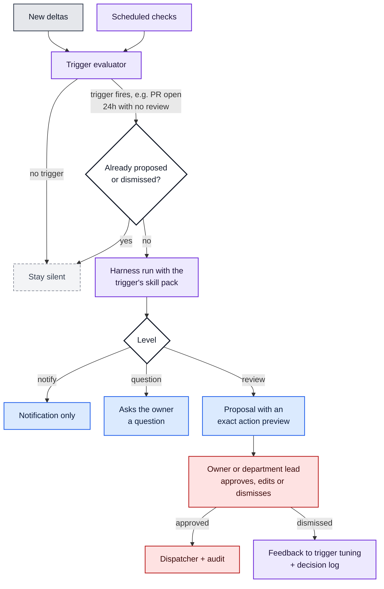

<!-- Copy of README sections: "## Ambient agents". Change the README and this file together; `cargo xtask spec-check` enforces it. -->

## Ambient agents

Ambient agents sense changes in the brain and propose actions without being asked; they never act on their own, and they are tuned to stay quiet when nothing is worth raising. They are built last and limited to higher tiers.

- **Triggers:** each trigger is a declared rule over state (kind, condition, scope, cooldown); the first is a PR open 24 hours with no review, which proposes a Slack nudge to its owner.
- **Three levels:** notify (inform only), question (ask the owner something) and review (a proposed action waiting for approval), following the notify, question and review pattern for human-in-the-loop agents.
- **Silence:** cooldowns, duplicate suppression and dismissal feedback keep noise down; the silence eval measures how often the engine stays quiet when it should.
- **Execution:** an approved proposal goes through the dispatcher and the audit log like any other side effect; ambient runs carry the same taint rules as task runs.
