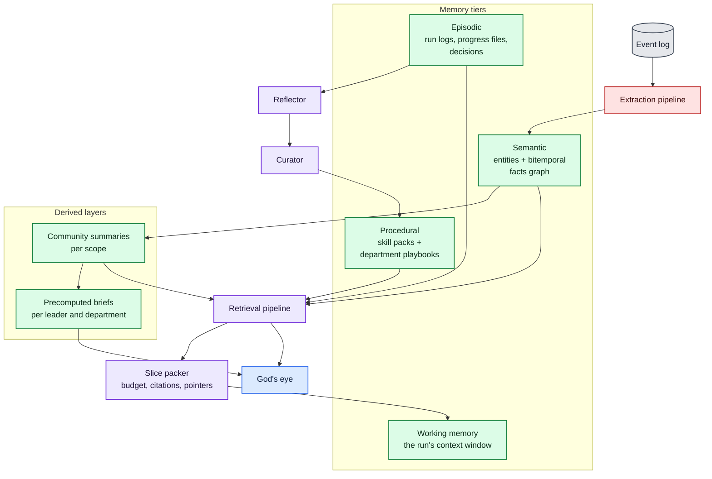
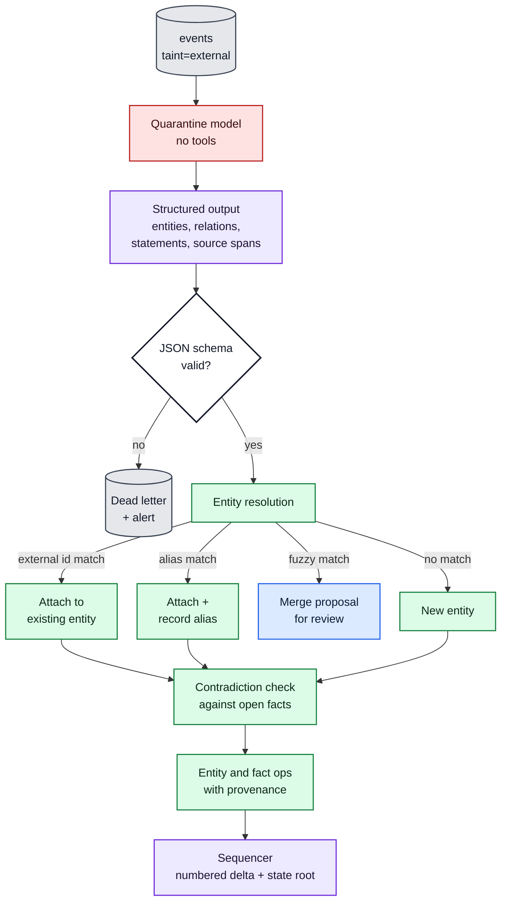
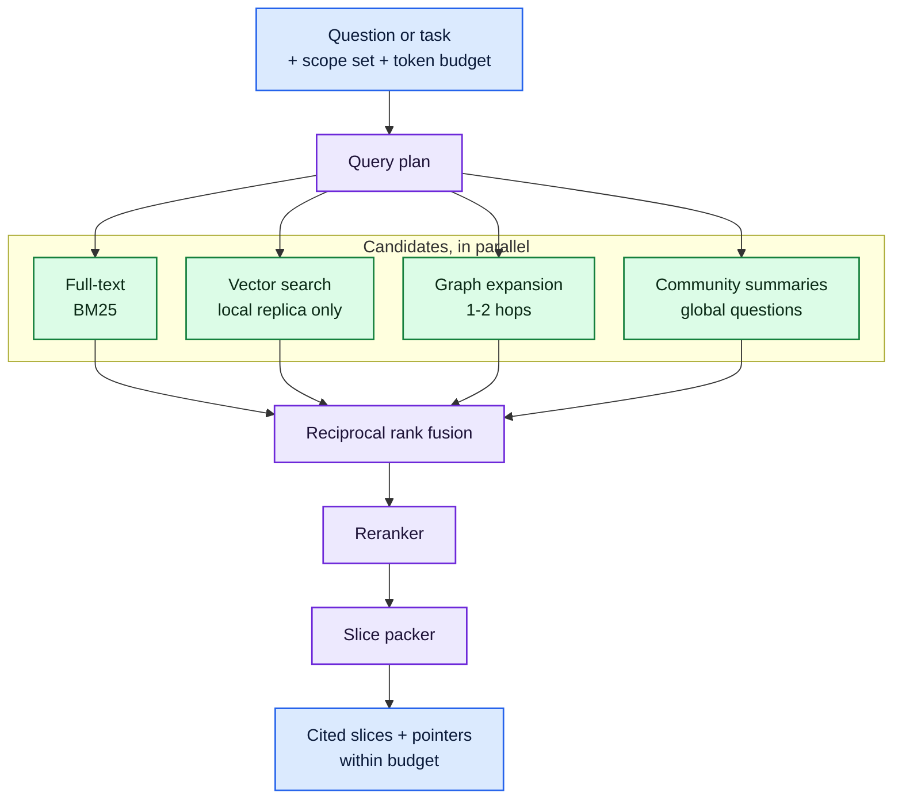
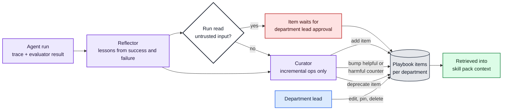

<!-- Copy of README sections: "## Company brain". Change the README and this file together; `cargo xtask spec-check` enforces it. -->

## Company brain

The brain is a scoped, bitemporal knowledge graph built only from the event log, with four memory tiers on top; it never hands an agent more than a small, cited slice, and every claim it makes links back to a source.

### Fact model

- **Entities:** people, repos, PRs, issues, channels, projects, decisions, customers, documents; each with a kind, name, summary and external ids.
- **Facts:** subject, relation, object and a plain statement. Each fact has two time axes: `valid_from` and `valid_to` (when it was true in the world) and `recorded_at` and `retracted_at` (when the brain learned or withdrew it). A contradiction closes the old fact and opens a new one; nothing is overwritten.
- **Provenance:** every fact carries `source_event_id`, `source_ref` (link, title, time), `extractor_version`, `confidence` and `taint`; every answer built from facts cites them.
- **Point-in-time reads:** "what did we know on date X" filters on `recorded_at`; "what was true on date X" filters on `valid_from` and `valid_to`.

### Extraction pipeline

- The quarantine model sees only the event text and the output schema; it has no tools and its output cannot carry instructions forward, only typed fields. It runs as a model relay job in locked mode on a member's local CLI, under the strictest rules, or on the company API key on the server.
- Entity resolution attaches automatically only on official ids issued by the source system: GitHub numeric user id, Slack user id, a verified email, and the ids Google, Linear, Atlassian and other plugins issue. The entity_aliases table and fuzzy name or embedding matches never attach on their own; they create a merge proposal that a person confirms by linking the official ids. Every action (assigning, mentioning, messaging, permission checks) runs against official ids, never names or aliases. Merges and splits are themselves sequenced ops, so they replay.
- Projection is idempotent on `source_event_id` and `extractor_version`; re-running extraction with a new version produces a clean set of fact changes.

### Retrieval pipeline

- **Where it runs:** members' questions run on their local node (full-text, vectors, graph, local reranker). God's eye retrieval runs on the server across every scope the leader holds (full-text, graph, community summaries, then the same small reranker on CPU), and the answer is written on the leader's own machine through the model relay, so no laptop needs every department's data and the server needs no model.
- **Budgets:** the slice packer fits results to the caller's token budget; subagents return 1,000 to 2,000 tokens to their parent.
- **Restorable compression:** a slice that does not fit is replaced by its pointer (entity id or URL), which the agent can expand later; nothing is summarised away without a way back.
- **Untrusted marking:** slices derived from external text arrive in delimited blocks marked untrusted and carry their taint into the run.

### Community summaries

- The entity graph of each scope is clustered (Leiden), and a model writes one summary per community with citations to its facts.
- A summary is rewritten only when its community changes materially (see Change detection); there is no schedule.
- Summaries answer company-wide questions cheaply: God's eye reads summaries first and drills into facts only where needed.

### Precomputed briefs (change-driven)

- A brief per leader and per department is written from community summaries, recent deltas and open tasks before anyone asks, but only when something it covers has changed.
- Material changes in a brief's scopes mark it stale; stale briefs refresh in priority order through the model relay, so God's eye opens on a current brief instantly.
- Briefs cite their facts like any answer. Precomputed briefs are a higher-tier feature; base tiers get briefs on demand.

### Change detection

Summaries and briefs change only when the company changes. Nothing refreshes on a timer, so a quiet day costs no tokens.

- **Change score:** every delta that touches a community adds to its score: a decision or a status change 5, a retracted or contradicted fact 4, a new entity 3, a new fact 1, an edited statement 0.5. Reactions, views and bot noise are dropped at ingest and score nothing.
- **Novelty check:** a new fact that repeats one the summary already cites (same subject and relation, near-identical statement by its text fingerprint) scores 0. The node that takes the job checks again with local embeddings and returns a no-op if nothing is new.
- **Trigger:** a summary is rewritten when its score reaches 10, or straight away when a decision fact changes, after 15 quiet minutes so a burst of activity causes one rewrite.
- **Incremental rewrite:** the job gets the previous summary and only the changed facts, never the whole community, so cost follows the size of the change.
- **Briefs:** a brief refreshes only when a summary it cites was rewritten, a task it lists changes state or an approval it shows is decided. With no change, God's eye shows the current brief marked with the time of the last material change, and spends nothing.

### Department playbooks

- Playbooks are lists of small items, never one document; the curator applies add, counter and deprecate ops so a playbook cannot collapse into a vague rewrite.
- Items are scoped to their department and retrieved into context like facts, ranked by relevance and helpful-minus-harmful score.
- Lessons from runs that read untrusted input wait for a department lead's approval, so injected text cannot plant instructions in a playbook.
