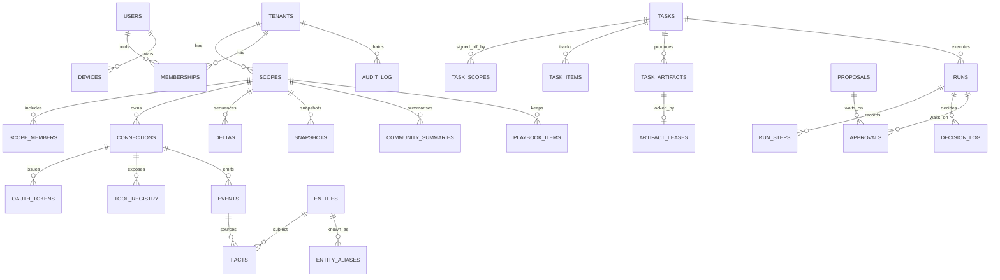

<!-- Copy of README sections: "## Data model". Change the README and this file together; `cargo xtask spec-check` enforces it. -->

## Data model

Postgres holds the event log, the brain's state, sync, work, runs and security; each replica holds a copy of its scopes' state plus local-only vectors. Like a chain: events are transactions, deltas are blocks, the state tables are the world state.

### Server: Postgres

Every table has `tenant_id` except `users` and `identities` (global identity: a person can belong to many tenants) and `tenants` itself; every table with department data also has `scope_id`. Row-level security is forced on all of them.

| Group | Table | Key columns | Notes |
| --- | --- | --- | --- |
| Org | tenants | id, name | One per company |
| Org | plans | tenant_id, plan, features, limits, updated_at | Entitlements and budgets checked by the gateway |
| Org | users | id, email, display_name | Global identity |
| Org | memberships | tenant_id, user_id, role | member, department_lead, product_leader, c_suite, admin |
| Org | scopes | id, tenant_id, kind, name, fold_id | department or fold; HR, legal, finance can never join a fold |
| Org | scope_members | scope_id, user_id, scope_role | Who belongs where |
| Org | devices | id, tenant_id, user_id, public_key, signing_public_key, last_seen, revoked_at | One per installed local node and tenant; `public_key` is the X25519 sealing key, `signing_public_key` the Ed25519 key that signs relay results and registration proofs |
| Org | identities | provider, subject, user_id | Which Google, Microsoft or GitHub account is which user; global like `users`, matched on the provider's own subject id |
| Sources | connections | id, tenant_id, scope_id, provider, server_url, auth_mode, oauth_client_ref, status | One per plugin install |
| Sources | tenant_oauth_clients | id, tenant_id, provider, client_id, secret_ref, signing_secret_ref, redirect_uri | Customer-owned apps (Slack, Google) |
| Sources | oauth_tokens | connection_id, user_id, secret_ref, granted_scopes, expires_at | Per-user tokens, ciphertext in secrets |
| Sources | events | id, tenant_id, scope_id, source, external_id, kind, occurred_at, payload, taint | Append only; unique (tenant_id, source, external_id) |
| Tools | tool_registry | id, connection_id, tool_name, def_hash, definition, tier, status, approved_by, approved_at | status: pending, approved, blocked; tier: read, sandbox_write, external_write |
| Skills | skill_packs | id, tenant_id, department, version, hash, manifest | Built-in packs have no tenant_id; tenant packs override |
| State | entities | id, tenant_id, scope_id, kind, name, summary, external_ids, tsv, seq | People, repos, PRs, issues, channels, projects, decisions, customers, documents |
| State | entity_aliases | entity_id, alias, source | Search and display; never attaches on its own |
| State | merge_proposals | id, scope_id, entity_a, entity_b, score, state, decided_by | Fuzzy matches wait for review |
| State | facts | id, tenant_id, scope_id, subject_id, relation, object_id, statement, valid_from, valid_to, recorded_at, retracted_at, source_event_id, source_ref, extractor_version, confidence, taint, tsv, seq | Never overwritten: a contradiction closes the old fact and opens a new one |
| State | community_summaries | id, scope_id, community_key, member_ids, summary, citations, computed_seq | Rewritten only on material change |
| State | briefs | id, tenant_id, audience_kind, audience_id, scope_ids, content, citations, stale, computed_at | Per leader and per department |
| State | playbook_items | id, scope_id, department, content, helpful, harmful, status, source_run_id, approved_by | status: pending, active, deprecated |
| Sync | deltas | scope_id, seq, tenant_id, ops, state_root, created_at | Primary key (scope_id, seq) |
| Sync | snapshots | scope_id, seq, r2_key, state_root | Full scope state at a sequence, in R2 |
| Sync | replica_cursors | device_id, scope_id, applied_seq, state_root | Drift detection |
| Sync | scope_keys | scope_id, key_version, wrapped_key, valid_from, valid_to | Replica encryption keys |
| Work | tasks | id, tenant_id, title, owner_id, state, version, budget | Cross-department tasks |
| Work | task_scopes | task_id, scope_id, decision, decided_by, decided_at | One sign-off row per department |
| Work | task_items | task_id, item_key, description, passes, evaluated_by_run | Only the evaluator flips `passes` |
| Work | progress_log | task_id, seq, run_id, entry, created_at | Append only |
| Work | task_artifacts | id, task_id, kind, ref, version | The blackboard's artifacts |
| Work | artifact_leases | artifact_id, run_id, expires_at | One writer per artifact |
| Work | approvals | id, task_id or proposal_id, run_id, tool_id, tier, preview, decided_by, decision | Every gated side effect waits here |
| Work | triggers | id, tenant_id, scope_id, kind, condition, cooldown, level | Ambient trigger rules |
| Work | proposals | id, tenant_id, scope_id, trigger_id, level, suggestion, preview, state | Ambient output |
| Runs | runs | id, tenant_id, task_id, skill_pack_hash, placement, state, taint, budget_tokens, budget_steps, budget_ms, budget_cost | Persisted run state machine |
| Runs | run_steps | run_id, seq, kind, model, tool_id, tool_hash, tokens_in, tokens_out, tokens_cached, model_ms, tool_ms, cost, checkpoint | One row per model or tool step |
| Runs | decision_log | id, tenant_id, run_id, kind, inputs, choice, outcome | Training data for the v1 decision API |
| Runs | relay_jobs | id, tenant_id, scope_id, kind, input_refs, schema_version, cause, state, claimed_by_device, attempts, result_hash, signature | Model relay jobs; every state change is a delta |
| Runs | change_scores | scope_id, community_key, score, last_delta_at, last_rewrite_seq | Drives summary and brief rewrites; no timers |
| Runs | usage_meter | tenant_id, user_id, provider, job_kind, day, runs, seconds, tokens_reported | Local CLI usage; shown, never capped |
| Evals | eval_runs | id, suite, suite_version, build, k, pass_k, score, created_at | Release gates |
| Security | secrets | id, tenant_id, ciphertext, wrapped_dek, key_version | Readable only by the vault role |
| Security | audit_log | seq, tenant_id, actor, action, target, tool_hash, payload_hash, prev_hash, hash | Hash chain per tenant; insert only |
| Security | refresh_tokens | id, tenant_id, user_id, device_id, family_id, token_hash, issued_at, expires_at, used_at, revoked_at | Only the SHA-256 hash is stored; each use rotates the token, and presenting a used one revokes its whole family |
| Security | idempotency_keys | tenant_id, user_id, key, method, params_hash, state, response, created_at | A write carries a client-chosen key; replaying it returns the first result. The method and a hash of the params are stored, so reusing a key for a different request is refused. A call stuck in progress for 60 seconds may be retried |

### Client: SurrealDB embedded replica

One database per scope inside a tenant namespace, so a scope can be wiped or re-keyed alone.

Encryption at rest: SurrealDB's own encryption at rest is an Enterprise feature, so the node encrypts at the application layer. Every record's content (statements, summaries, source titles and links, embeddings) is sealed with XChaCha20-Poly1305 under the scope key before it is written; ids, kinds, relation types, scope, sequence numbers and timestamps stay readable so graph traversal works. The node also requires OS disk encryption (BitLocker or Device encryption on Windows, LUKS on Linux, FileVault once macOS ships) before it syncs any scope; see Platforms and packaging for how it is checked.

| Table | Type | Fields |
| --- | --- | --- |
| entity | node | Mirrors the server row, plus local `embedding` |
| fact | edge (entity to entity) | Mirrors the server row, plus local `embedding` |
| summary | record | Mirrors `community_summaries`, plus local `embedding` |
| playbook_item | record | Mirrors active `playbook_items` for the scope's department |
| sync_meta | record | applied_seq, state_root, key_version |

Indexes: full-text on `name`, `summary` and `statement` and HNSW on `embedding`, built in memory when the node unlocks and never written to disk. Embeddings never leave the machine in v0.
