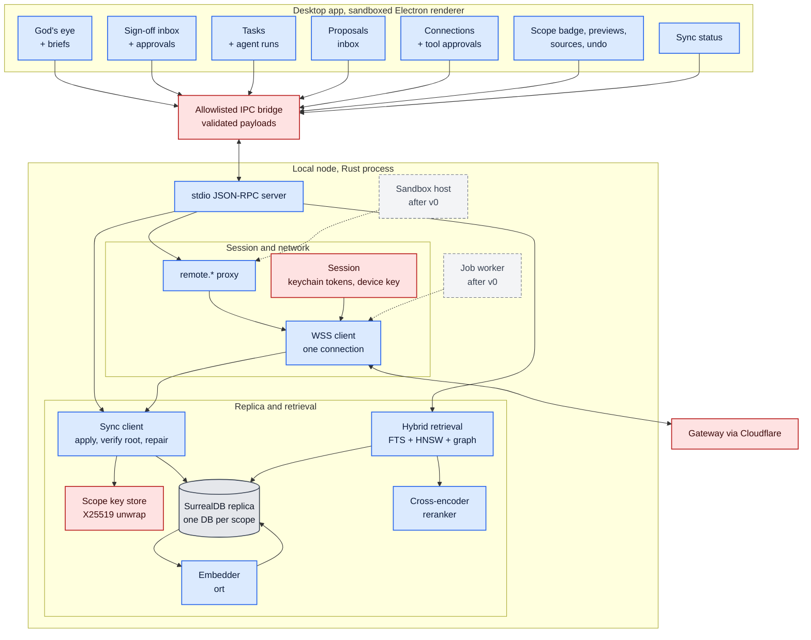

<!-- Copy of README sections: "## Desktop app and local node". Change the README and this file together; `cargo xtask spec-check` enforces it. -->

## Desktop app and local node

The desktop app is only the interface; the local node owns the session, the network link, the replica and all local compute, so the app never touches a token or the network.

- **Process model:** the Electron main process starts the local node as a child process and talks to it over stdio; the renderer has `contextIsolation` and `sandbox` on, `nodeIntegration` off, a strict content security policy and no remote content. T3 Code's bundled Node WebSocket server is removed; its provider adapters become Rust provider runners inside the local node, so no local port is opened.
- **Session:** tokens and the device's private keys (X25519 for sealing, Ed25519 for signing) are stored only in the OS keychain through `keyring`: Windows Credential Manager on Windows, the Secret Service (GNOME Keyring or KWallet) on Linux. The node loads a key into memory only to use it and zeroises it afterwards. The keychain protects keys per OS user, so any process running as that user can read them; the threat model assumes the member's own account is not compromised. Access tokens refresh in the node.
- **Replica:** one SurrealDB database per scope inside a tenant namespace, so a scope can be wiped or re-keyed alone.
- **Local retrieval:** members' questions about their own scopes run here, offline-capable; the harness can also request a context slice from a member's node when that member is the requester.
- **Reranker:** a small cross-encoder in `ort` reranks the top candidates from full-text, vector and graph search before results go into context.
- **Confidence UI:** every agent answer shows source chips; every pending action shows a preview of exactly what will happen; the scope badge shows which scopes the current agent can read; reversible actions offer undo.

### Platforms and packaging

Windows comes first, then Linux; macOS comes after v0. Every phase's exit gate that names platforms means Windows 11 and Linux.

| | Windows | Linux |
| --- | --- | --- |
| Minimum | Windows 11 x64 | x64, Ubuntu LTS and Debian (glibc) |
| Package | MSIX family package (built as `.appx` by electron-builder), published through the Microsoft Store | `.deb` and AppImage |
| Signing | The Store signs the package at no cost; the local node binary ships inside the package, so it is covered too | None needed; checksums published with each release |
| Updates | Through the Store | `.deb` through the package manager; AppImage through its own update check |
| Company rollout | Intune deploys Store apps | The company's own package tooling |
| Keychain | Credential Manager | Secret Service; the node refuses to sign in without one and says why |
| Disk encryption check | BitLocker or Windows Device encryption | LUKS (dm-crypt) on the volume holding the replica |

- **Store packaging:** the app is a full-trust packaged desktop app. MSIX redirects a packaged process's writes to AppData and parts of the registry into a private location, and child processes inherit this. The provider runners must be tested to confirm each CLI they start (Claude Code, Codex, Kiro and the rest) sees the member's real configuration and sign-in; Windows 11 lets a package turn the redirection off, which is the fallback.
- **Disk encryption check without admin rights:** the usual tools (`manage-bde`, the BitLocker WMI class) need an administrator, and members are often not administrators. The node must find the volume's protection state without elevation; until that method is proven, this is a P4 spike. If the state cannot be read, the node refuses to sync and tells the member.
- **Corporate networks:** the node honours the system proxy settings (including PAC files) and trusts the OS certificate store, so its WebSocket works behind proxies that inspect TLS.
- **Starting CLIs on Windows:** many CLIs install as `.cmd` or `.ps1` shims. The runners resolve the real executable where one exists and otherwise start the shim through `cmd.exe` with strict argument quoting, never by building a shell string.
- **Paths:** git long paths are enabled, and worktrees use short base paths, because Windows still limits many tools to 260 characters.
- **Antivirus and EDR:** company security tools inspect unsigned or unusual child processes. The node is signed inside the package, starts only the CLIs a member enabled, and logs each start, so security teams can allow it by publisher.
