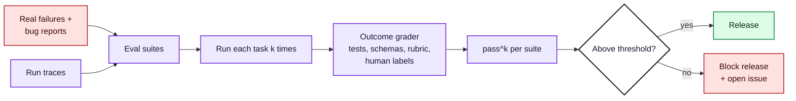

<!-- Copy of README sections: "## Evals and quality". Change the README and this file together; `cargo xtask spec-check` enforces it. -->

## Evals and quality

Four eval suites gate every release; each starts with 20 to 50 tasks drawn from real failures, grades outcomes rather than exact steps, and reports pass^k so reliability across repeated runs is measured, not just a single success.

| Suite | What it measures | Graded by |
| --- | --- | --- |
| Harness | Department tasks end to end: correct result, within budget, no premature victory, correct single-agent vs fan-out choice | Tests for code, schemas for structured output, rubric plus calibrated grader for design and marketing |
| Brain | Extraction accuracy, entity resolution, retrieval recall@k, citation correctness, point-in-time answers, brief freshness | Labelled event sets and question sets |
| Ambient | Proposal usefulness, and silence: staying quiet when nothing is worth raising | Labelled scenarios, dismissal rates |
| Security | Injection corpus through quarantine, taint enforcement, rug-pull detection, scope isolation, exfiltration attempts | Pass or fail per case; any failure blocks release |

- pass^k is the share of tasks that succeed on all k runs; at 75% per run, three runs in a row succeed about 42% of the time, which is why pass^k is the bar for anything customers rely on.
- Eval results are stored in `eval_runs` per build and shown to admins.
- New failures found in production become eval tasks.
