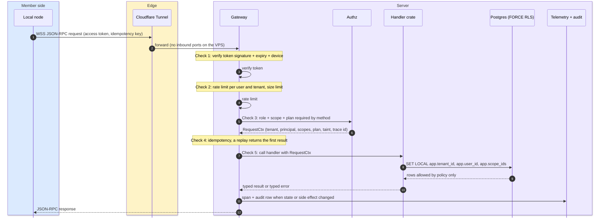

<!-- Copy of README sections: "## Gateway and request path". Change the README and this file together; `cargo xtask spec-check` enforces it. -->

## Gateway and request path

Every call passes the same five checks in order, and the database checks scope a second time, so a bug in one layer cannot leak data.

- **Method declarations:** every method declares its role, scope and plan requirement in Rust; the gateway rejects before the handler runs.
- **Database role:** the runtime connects as `app_rw`, which is not the table owner and has no BYPASSRLS; every table uses FORCE ROW LEVEL SECURITY; policies check tenant and scope.
- **Errors:** typed (code, message, retryable); no stack traces or SQL leave the server.
- **Versioning:** the protocol is versioned (`v1`); incompatible app or node versions are refused at connect.
- **Push:** the gateway pushes notifications on the same socket (deltas, approvals, run updates; full list under API).
