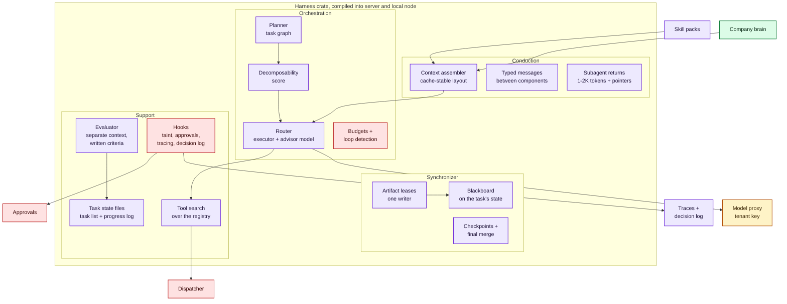
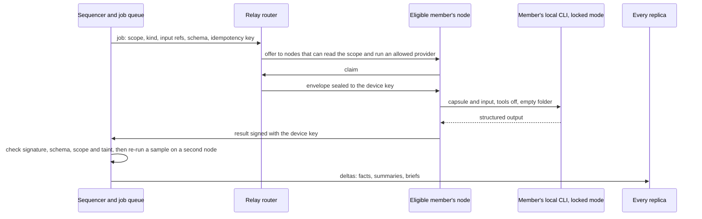
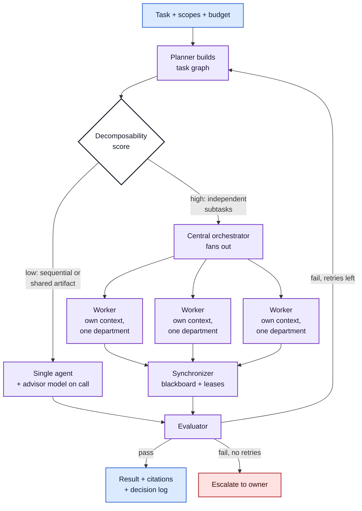
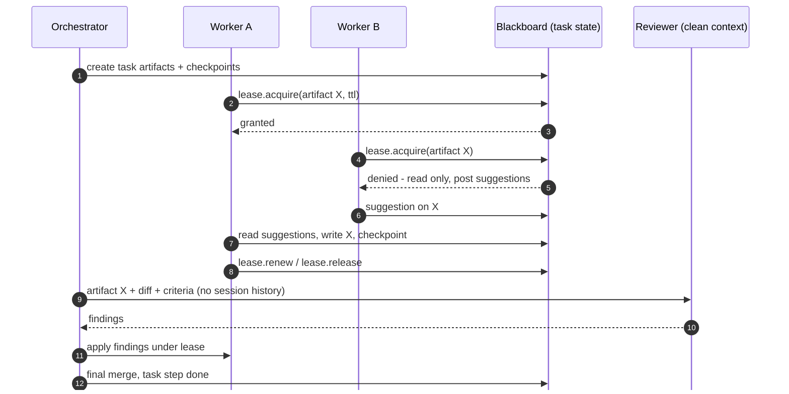
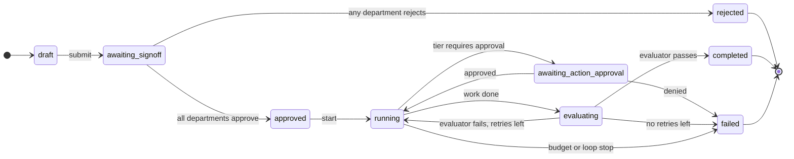

<!-- Copy of README sections: "## Core runtime (harness)". Change the README and this file together; `cargo xtask spec-check` enforces it. -->

## Core runtime (harness)

The harness is everything around the model except its weights: prompts and skill packs, tools, infrastructure, orchestration logic, hooks and model configuration. Library IDE runs every department on one harness; conduction moves context, orchestration plans and routes, and the synchronizer keeps parallel work consistent.

### Placement

- The harness is one Rust crate compiled into both the server binary and the local node.
- Base tiers run agents in the member's local node; higher tiers also run server-side and ambient agents.
- In both places, every tool call goes through the server dispatcher, so no plugin credential reaches a machine. Which model a step runs on follows Model access, below.
- Runs are persisted state machines (`runs`, `run_steps`); a crash resumes from the last checkpoint, and a run waiting days for an approval holds no worker.

### Model access

Library IDE ships no models of its own in v0. Local CLI mode is the primary way to work: members' own subscriptions run through the official CLIs installed on their machines, so those CLIs must be installed locally. API keys are the second way. Models on credit, sold by Library IDE, come later through the same router.

- **Local CLI mode (primary):** the local node drives each provider's official CLI or SDK on the member's machine, the way T3 Code does: Codex, Claude Code, Grok Build, Kiro, OpenCode, Cursor and agents on the ACP registry. Library IDE never reads or forwards a subscription's login token; it starts the provider's own tool, which keeps the member inside that provider's terms.
- **API keys:** members or admins can add provider API keys. A personal key stays in the member's OS keychain and runs through the local node; a company key sits in the vault and runs through the gateway's model proxy.
- **Models on credit (later):** Library IDE sells model usage on credit through the same router; the API-key budgets below become the base for it.
- **Both at once:** CLIs and keys work independently and together. The router treats every connected CLI and key as a model source with its capabilities, limits and cost, and picks by task type, capability needed, data scope and remaining headroom. Every choice goes to the decision log.
- **Limits and fallback:** when a subscription hits its limit, the run pauses and resumes when the limit resets, or moves to another source the member allowed. Provider rules for programmatic use of subscriptions changed several times during 2026 (Claude plans now draw programmatic use from a separate monthly credit), so every job type must also be able to run on an API key.
- **Usage meter:** local CLI runs have no budget. A meter shows use per member, provider, department and job type: runs, time, tokens where the CLI reports them, and how close each subscription is to its limits, including Claude's programmatic credit. It sits in Settings and the top bar.
- **Brain work** (extraction, community summaries, briefs, God's eye answers, ambient proposals) runs through the model relay below, on members' local CLIs. A company API key, when set, lets the server take relay jobs too.
- **Quality bar:** results must be no worse than Claude Code or Codex. Coding tasks go to the provider's own coding agent, whose harness is tuned for its models, wrapped in Library IDE's context, leases, approvals and evaluator. The coding agent keeps its own tools only within the member's permissions (see Security model: Coding agents' own tools). Other departments run on Library IDE's own harness.
- **Where prompts come from:** internal prompts and harness patterns are studied from open-licensed projects: OpenAI Codex CLI (Apache-2.0), OpenCode (MIT), Gemini CLI (Apache-2.0), Cline (Apache-2.0), Goose (Apache-2.0), Aider (Apache-2.0), Pi, T3 Code (MIT) and Orca (MIT). Anything copied keeps its license notice; leaked prompts from closed products are never used.
- **From Orca** (Stably AI, YC W22, MIT): one git worktree per agent, several accounts per provider with usage tracking, a CLI that lets agents drive the IDE (open projects, create worktrees, post progress), comments on AI diffs sent back to the agent, and remote worktrees over SSH.

### Model relay

Brain work runs on members' own local CLIs and moves between machines the way mail moves between relays. The server queues each job as a sealed envelope and delivers it to a node that may read the job's scope; the node runs it on its member's CLI, and the signed result comes back to be checked, sequenced and synced to every replica. Only the processing moves: data never reaches a machine whose member could not already read it. As in federated learning, raw data stays where it is allowed to be, but nothing is trained; the relay only runs jobs. It is built in P3 alongside extraction.

- **Jobs:** extraction, community summaries, briefs, God's eye answers and ambient proposals. Each job carries its scope, kind, input references, output schema, idempotency key and the change that caused it. Every state change is a delta in relay_jobs, so a job survives any machine going offline.
- **Who can take a job:** like mail records for a domain, each scope has a set of eligible nodes: devices of members who can read that scope, have opted in and run a provider the admin allows for that scope. Sealed scopes go only to their own members. Envelopes are sealed to the claiming device's X25519 key.
- **Raw text:** extraction envelopes carry the raw event text, which never enters a replica; the node deletes it when the job ends.
- **Continuation:** a provider's session lives on one machine and cannot move to another, so continuity lives in the synced state, not in the CLI session. Each job carries a capsule (the stable prompt prefix, the scope's current summaries and the job's checkpoint), and any eligible node continues from the last synced checkpoint. On one machine, the node keeps a warm session per scope and provider and resumes it (claude --resume, codex exec resume and their equivalents) to reuse the provider's prompt cache, and starts a fresh one when it grows past a set size.
- **Locked mode:** every tool, MCP server, file access and web access off; an empty temporary folder; output must match the job's schema or it is discarded. Only providers verified to run this way take relay jobs. Extraction runs under the strictest rules: untrusted text in delimited blocks, closed relation lists and nothing but typed fields carried forward.
- **Verification:** results are signed with the device key, and the server checks signature, schema, scope and taint before the sequencer accepts them. A sample of jobs (5% to start) re-runs on a second eligible node; a disagreement pauses that node's claims and sends its recent results to review.
- **Scheduling:** idle machines on power go first. Each member sets how much of their subscription the relay may use (share, hours, providers), and the usage meter shows it. If no eligible node is online, jobs wait, and briefs show when they were last updated.
- **Where data goes:** a job's text reaches the provider of the member who runs it, under that member's account. Admins choose which providers each scope may use, and can require a company API key or business account for sealed scopes.
- **Reranking stays out of the relay:** the reranker is a small local cross-encoder, not a language model. It runs on members' nodes for their questions and on the server's CPU for God's eye retrieval.
- **Later:** trusted execution environments (attested confidential VMs or enclaves), so brain jobs can run on shared hardware without trusting the machine, and models on credit through the same router.

### Department skill packs

- Every department (design, programming, marketing, finance, legal, operations, product, C-suite) is a skill pack on the same harness, not a separate agent.
- A pack holds: a `SKILL.md` entry file of about 100 lines (purpose, rules, when to use, links to deeper references), a tool allowlist by registry id, output schemas, evaluator criteria with calibration examples, and a link to the department's playbook.
- Progressive disclosure: only each pack's name and description sit in the prompt; the body loads when the pack is used; references load on demand.
- Packs are versioned; each run records the pack hash it used. C-suite and product leaders can use every pack; the product team uses its own pack plus the packs of teams it heads.

### Conduction and the cache-stable prompt layout

- Context is assembled in a fixed order: harness rules, loaded skill bodies, tool definitions, task spec, retrieved slices, then the running log of model and tool turns, with the task's goals recited at the end.
- Everything before the running log is a stable prefix; the log is append-only; JSON is serialised deterministically (sorted keys, fixed number formats); timestamps never appear in the prefix.
- Tools are masked, not removed, mid-run, so the prefix and its cache survive tool changes.
- Failed actions and errors stay in context, so the model does not repeat them.
- Components exchange typed messages (Rust structs exported with ts-rs), never free-form agent-to-agent chat.

### Orchestration

- **Task graph:** the planner emits a dependency graph; independent nodes run in parallel, dependent nodes wait for their inputs.
- **Decomposability ****check:** from the planner's graph, count independent branches (B), the share of context the branches have in common (S, from 0 to 1) and artifacts more than one branch would write (W). Fan out only when B is at least 3, S is at most 0.3 and W is 0, with at most 5 parallel workers, and log B × (1 − S). Everything else runs on one agent, because multi-agent setups degrade sequential work.
- **Split by context, not role:** parallel workers split along context boundaries (departments, separate artifacts), never one piece of work across writer, tester and reviewer agents.
- **Central control:** fan-out always runs under a central orchestrator; independent agents talking freely is not allowed.
- **Advisor routing:** roles are chosen by tier, not vendor, from the member's own sources. The executor is the fast tier of the source picked for the task; the advisor is the strongest model the member has, from a second provider when one is connected. The advisor is called after two failed attempts at a step, before any step that needs approval, and to review plans for large tasks.
- **Routing parameters:** task type, tools needed, context size, cost budget, latency target, model capability, data scope and confidence; every routing decision goes to the decision log.
- **Budgets: **runs on API keys have token, step, wall-time and cost limits and tenant spend caps, which become the base for models on credit later. Local CLI runs have no budget and show on the usage meter. Loop detection applies to every run: it stops a run that repeats the same tool call with the same arguments or makes no progress in its progress log for a set number of steps.

### Synchronizer and artifact leases

- Exactly one agent holds the write lease on an artifact; leases have a time limit and renew while the writer makes progress; an expired lease returns to the orchestrator.
- Other agents read the artifact and post suggestions to the blackboard; only the lease holder writes.
- Reviewers get the artifact, the diff and the criteria, never the writer's session history.
- The blackboard lives in the task's state (`task_artifacts`, `artifact_leases`, `progress_log`), so humans and agents see the same state live.

### Task state files and the evaluator

- Every task has a task list in JSON where each item has a `passes` flag that only the evaluator may flip, plus an append-only progress log.
- Every agent session starts by reading the progress log and running the task's startup check, so a resumed or handed-off run never declares victory on partial work.
- The evaluator runs in its own context with the skill pack's written criteria and calibration examples; it grades outcomes, not steps; for code it runs tests, for design and marketing it scores against the rubric.
- A failed evaluation sends a critique back to the worker on a different model where possible, within 2 retries, then escalates to the owner.

### Tools inside the harness

- **Tool search:** only core tools load up front; all other definitions are found through a search tool over the tool registry and loaded when needed, which keeps dozens of plugins out of the prompt.
- **Tool definitions** include use examples; connectors return errors that say what failed, what to change and a useful next step.

### Traces and the decision log

- Every run step records model time, tool time, tokens in, tokens out, cached tokens and cost (`run_steps`, OpenTelemetry spans).
- Every routing, decomposition, approval-tier and lease decision is written to `decision_log` with its inputs and outcome; this log is the training data for the v1 decision API.

### Cross-department sign-off

- A product leader or C-suite user creates a task; the orchestrator lists the departments it touches; one `task_scopes` row per department waits for that department's lead.
- One rejection rejects the task; all approvals move it to running. Cross-department work passes only the artifacts attached to the task, never a scope's context.
- Every side effect goes through risk-tiered approvals, then the dispatcher, then the audit log; every transition is an event, so replicas see task state change live.
- State changes use optimistic locking on `version`, so two leads deciding at once cannot both win.

