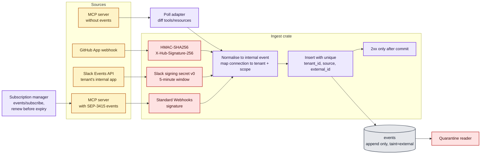

<!-- Copy of README sections: "## Ingest and event adapter". Change the README and this file together; `cargo xtask spec-check` enforces it. -->

## Ingest and event adapter

Every external event enters through one ingest path that verifies, deduplicates and commits it before anything reads it; the text inside is untrusted from that moment on.

- **Sources in v0:** a native adapter for every catalog plugin whose events we can take in directly (signed webhooks or push). GitHub (our GitHub App, one webhook secret) and Slack (each tenant's internal Slack app, its signing secret kept per tenant in the vault and matched by app and team id) come first, then Google Workspace (Drive and Calendar push), Linear, Notion, Sentry, Atlassian, HubSpot, Box, Asana, monday.com, Airtable, Attio, Intercom, Stripe, Vercel and Webflow, each checked against the vendor's webhook docs as it is built. Anything else connects as a custom event source: an MCP server with events (SEP-3415), the poll fallback, or a generic signed webhook per connection with its secret in the vault. Native adapters keep being added one by one.
- **SEP-3415 adapter:** speaks `events/list`, `events/subscribe`, `events/unsubscribe`, `events/poll` and `events/stream` with servers that support MCP Events; webhook delivery is the default mode; the subscription manager renews subscriptions before they expire.
- **Poll fallback:** for servers without events, the adapter polls the server's list tools or resources on a schedule and emits an event for each change it detects.
- **Ordering and duplicates:** delivery can repeat or arrive out of order; the unique key drops repeats, and the projector orders by the source's own timestamp or sequence where one exists.
- **Limits:** body size limits per source; processing is asynchronous after the commit, so webhooks are answered fast.
- **Taint:** every event row carries `taint = external`; anything derived from it inherits that taint (see Security model).
