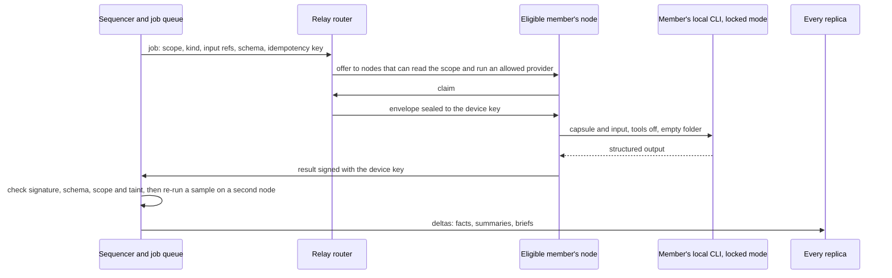

<!-- Copy of README sections: "### Model access", "### Model relay". Change the README and this file together; `cargo xtask spec-check` enforces it. -->

### Model access

Library IDE ships no models of its own in v0. Local CLI mode is the primary way to work: members' own subscriptions run through the official CLIs installed on their machines, so those CLIs must be installed locally. API keys are the second way. Models on credit, sold by Library IDE, come later through the same router.

- **Local CLI mode (primary):** the local node drives each provider's official CLI or SDK on the member's machine, the way T3 Code does: Codex, Claude Code, Grok Build, Kiro, OpenCode, Cursor and agents on the ACP registry. Library IDE never reads or forwards a subscription's login token; it starts the provider's own tool, which keeps the member inside that provider's terms.
- **API keys:** members or admins can add provider API keys. A personal key stays in the member's OS keychain and runs through the local node; a company key sits in the vault and runs through the gateway's model proxy.
- **Models on credit (later):** Library IDE sells model usage on credit through the same router; the API-key budgets below become the base for it.
- **Both at once:** CLIs and keys work independently and together. The router treats every connected CLI and key as a model source with its capabilities, limits and cost, and picks by task type, capability needed, data scope and remaining headroom. Every choice goes to the decision log.
- **Limits and fallback:** when a subscription hits its limit, the run pauses and resumes when the limit resets, or moves to another source the member allowed. Provider rules for programmatic use of subscriptions changed several times during 2026 (Claude plans now draw programmatic use from a separate monthly credit), so every job type must also be able to run on an API key.
- **Usage meter:** local CLI runs have no budget. A meter shows use per member, provider, department and job type: runs, time, tokens where the CLI reports them, and how close each subscription is to its limits, including Claude's programmatic credit. It sits in Settings and the top bar.
- **Brain work** (extraction, community summaries, briefs, God's eye answers, ambient proposals) runs through the model relay below, on members' local CLIs. A company API key, when set, lets the server take relay jobs too.
- **Quality bar:** results must be no worse than Claude Code or Codex. Coding tasks go to the provider's own coding agent, whose harness is tuned for its models, wrapped in Library IDE's context, leases, approvals and evaluator. The coding agent keeps its own tools only within the member's permissions (see Security model: Coding agents' own tools). Other departments run on Library IDE's own harness.
- **Where prompts come from:** internal prompts and harness patterns are studied from open-licensed projects: OpenAI Codex CLI (Apache-2.0), OpenCode (MIT), Gemini CLI (Apache-2.0), Cline (Apache-2.0), Goose (Apache-2.0), Aider (Apache-2.0), Pi, T3 Code (MIT) and Orca (MIT). Anything copied keeps its license notice; leaked prompts from closed products are never used.
- **From Orca** (Stably AI, YC W22, MIT): one git worktree per agent, several accounts per provider with usage tracking, a CLI that lets agents drive the IDE (open projects, create worktrees, post progress), comments on AI diffs sent back to the agent, and remote worktrees over SSH.

### Model relay

Brain work runs on members' own local CLIs and moves between machines the way mail moves between relays. The server queues each job as a sealed envelope and delivers it to a node that may read the job's scope; the node runs it on its member's CLI, and the signed result comes back to be checked, sequenced and synced to every replica. Only the processing moves: data never reaches a machine whose member could not already read it. As in federated learning, raw data stays where it is allowed to be, but nothing is trained; the relay only runs jobs. It is built in P3 alongside extraction.

- **Jobs:** extraction, community summaries, briefs, God's eye answers and ambient proposals. Each job carries its scope, kind, input references, output schema, idempotency key and the change that caused it. Every state change is a delta in relay_jobs, so a job survives any machine going offline.
- **Who can take a job:** like mail records for a domain, each scope has a set of eligible nodes: devices of members who can read that scope, have opted in and run a provider the admin allows for that scope. Sealed scopes go only to their own members. Envelopes are sealed to the claiming device's X25519 key.
- **Raw text:** extraction envelopes carry the raw event text, which never enters a replica; the node deletes it when the job ends.
- **Continuation:** a provider's session lives on one machine and cannot move to another, so continuity lives in the synced state, not in the CLI session. Each job carries a capsule (the stable prompt prefix, the scope's current summaries and the job's checkpoint), and any eligible node continues from the last synced checkpoint. On one machine, the node keeps a warm session per scope and provider and resumes it (claude --resume, codex exec resume and their equivalents) to reuse the provider's prompt cache, and starts a fresh one when it grows past a set size.
- **Locked mode:** every tool, MCP server, file access and web access off; an empty temporary folder; output must match the job's schema or it is discarded. Only providers verified to run this way take relay jobs. Extraction runs under the strictest rules: untrusted text in delimited blocks, closed relation lists and nothing but typed fields carried forward.
- **Verification:** results are signed with the device key, and the server checks signature, schema, scope and taint before the sequencer accepts them. A sample of jobs (5% to start) re-runs on a second eligible node; a disagreement pauses that node's claims and sends its recent results to review.
- **Scheduling:** idle machines on power go first. Each member sets how much of their subscription the relay may use (share, hours, providers), and the usage meter shows it. If no eligible node is online, jobs wait, and briefs show when they were last updated.
- **Where data goes:** a job's text reaches the provider of the member who runs it, under that member's account. Admins choose which providers each scope may use, and can require a company API key or business account for sealed scopes.
- **Reranking stays out of the relay:** the reranker is a small local cross-encoder, not a language model. It runs on members' nodes for their questions and on the server's CPU for God's eye retrieval.
- **Later:** trusted execution environments (attested confidential VMs or enclaves), so brain jobs can run on shared hardware without trusting the machine, and models on credit through the same router.
