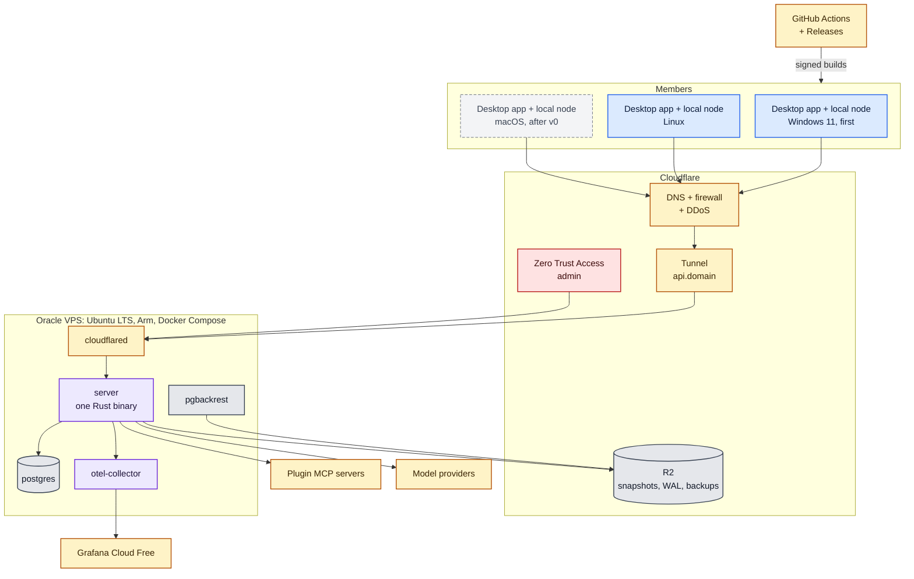

<!-- Copy of README sections: "## Operations". Change the README and this file together; `cargo xtask spec-check` enforces it. -->

## Operations

v0 runs on one Oracle VPS behind Cloudflare; everything except the domain and model usage is free.



### Infrastructure

| Layer | Choice | Cost |
| --- | --- | --- |
| Desktop shell | Electron from the T3 Code fork; Windows 11 first, then Linux; macOS after v0 | Free |
| Local node | Rust: sync client, SurrealDB embedded replica, `ort` embeddings and reranker, harness, wasmtime plus QuickJS sandbox (after v0) | Free |
| Server host | Oracle Cloud VPS (2 OCPU, 12 GB Arm), Ubuntu LTS, Docker Compose | Free |
| Server runtime | One Rust binary (axum, Tokio, sqlx, rmcp, wasmtime) | Free |
| Database | Postgres: events, state graph, full-text, work, runs, row-level security; pgvector later for higher tiers | Free |
| Edge | Cloudflare DNS, Tunnel (no inbound ports on the VPS), firewall and DDoS protection, Zero Trust Access for admin pages | Free |
| Object storage | Cloudflare R2: snapshots, backups | Free up to 10 GB-month |
| Models | Members' own subscriptions through their local CLIs, plus API keys; models on credit later; Ollama for local development | Paid by members |
| Sign-in | Google, Microsoft and GitHub OAuth apps | Free |
| Plugins | GitHub App; HubSpot, Atlassian, Box developer apps; customers' own Slack and Google apps; dynamic registration for the rest | Free |
| Observability | OpenTelemetry collector to Grafana Cloud Free | Free |
| CI and releases | GitHub Actions, GitHub Releases | Free |
| Domain | Cloudflare Registrar | About $10 a year |
| Code signing and distribution | Windows: MSIX through the Microsoft Store, which signs and updates it; no registration fee for Store developer accounts. Linux: `.deb` and AppImage with published checksums. macOS: Apple Developer Program when macOS ships | Free for v0 |

### Deployment

- Docker Compose on the VPS runs `server`, `postgres`, `cloudflared`, `otel-collector` and `pgbackrest`.
- Cloudflare Tunnel routes `api.<domain>` (WebSocket, webhooks, OAuth callbacks) to the server; admin endpoints sit behind Zero Trust Access.
- The master key comes from an environment file readable only by the server user; it moves to a cloud key service after v0.
- Migrations run with `sqlx migrate` as the owner role before each release; the server itself runs as `app_rw`.

### Backups and recovery

- pgBackRest archives the write-ahead log to R2 continuously, with a weekly full backup.
- Scope snapshots go to R2 every 5,000 deltas, or after 24 hours if any delta arrived.
- The restore drill rebuilds the VPS from scratch, restores Postgres, reconnects replicas and confirms state roots match; it runs before every major release.

### Observability and alerts

- Every request, event, delta, run step and dispatch carries one trace id from ingest to replica.
- Dashboards: model time vs tool time, cached-token share, cost per run and per tenant, eval pass^k per suite, brief freshness.
- Alerts: webhook verification failures, projector lag, dead-letter growth, sequencer errors, replica root mismatches, blocked tools awaiting re-approval, expiring plugin connections, budget stops, 5xx rate, disk use, model spend per tenant.

### CI

- On every push: `cargo fmt`, `clippy` with warnings as errors, unit tests, row-level security isolation tests against a real Postgres, quarantine and taint tests, cargo-deny, cargo-audit, npm audit.
- On every build: dynamic-registration probe and smoke test for every standard plugin; tool definition drift check against pinned hashes.
- Before release: all four eval suites at their thresholds.
- Runners: server and database tests (row-level security, integration with real Postgres) run on Linux, because GitHub's Windows runners cannot run Linux containers. The local node and the desktop app are built and tested natively on Windows (MSVC toolchain) and on Linux.
- On tags: build the server for Linux Arm64 (the VPS) and the local node for Windows x64 and Linux x64; bundle the node into the Electron app; submit the MSIX to the Microsoft Store; publish the `.deb`, the AppImage and their checksums to GitHub Releases.

### Repo layout

```
library/
  crates/
    core/          types, traits, RequestCtx
    gateway/  authz/  ingest/  quarantine/  projector/  sequencer/
    brain/         query, retrieval, summaries, briefs, playbooks
    harness/       conduction, orchestration, synchronizer, evaluator, router
    skills/        skill pack loader
    work/  ambient/  registry/  dispatch/  connections/
    vault/  audit/  telemetry/
    server/        server binary wiring
    node/          local node binary: sync, replica, embeddings, retrieval, harness, sandbox
    protocol/      ts-rs exports for the app
  skills/          built-in department skill packs (SKILL.md, criteria, schemas)
  plugins/         standard plugin catalog, setup kits (Slack manifest, Google gcloud script)
  evals/           eval suites and graders
  migrations/
  apps/desktop/    T3 Code fork
  deploy/          compose, cloudflared, pgbackrest, otel
```
