<!-- Copy of README sections: "## Performance, latency and cost". Change the README and this file together; `cargo xtask spec-check` enforces it. -->

## Performance, latency and cost

Input tokens dominate agent cost and latency, so the design keeps prompts cache-warm, small and routed to the cheapest model that can do the step; heavy work moves to members' machines or runs before anyone asks.

```mermaid
%%{init: {"flowchart": {"curve": "basis", "nodeSpacing": 28, "rankSpacing": 42}}}%%
flowchart LR
  REQ["Request"]:::app
  PRE{"Precomputed?"}:::gate
  FAST["Serve instantly"]:::brain
  LOC{"Member's own<br/>scopes?"}:::gate
  LR["Local retrieval<br/>on the replica"]:::app
  SR["Server retrieval"]:::srv
  PK["Slice packer<br/>within budget"]:::srv
  CACHE["Cache-stable<br/>prompt prefix"]:::srv
  RT{"Router"}:::gate
  EX["Executor model"]:::ext
  AD["Advisor model"]:::ext
  TS["Tool search<br/>load only needed tools"]:::srv
  REQ --> PRE
  PRE -->|brief or summary exists| FAST
  PRE -->|no| LOC
  LOC -->|yes| LR
  LOC -->|no| SR
  LR & SR --> PK
  PK --> CACHE --> RT
  RT -->|routine step| EX
  RT -->|hard or risky step| AD
  EX & AD --> TS
  classDef app fill:#dbeafe,stroke:#2563eb,color:#0b1b3a,stroke-width:1.5px
  classDef srv fill:#ede9fe,stroke:#6d28d9,color:#1e1338,stroke-width:1.5px
  classDef brain fill:#dcfce7,stroke:#15803d,color:#0b2a16,stroke-width:1.5px
  classDef store fill:#e5e7eb,stroke:#374151,color:#111827,stroke-width:1.5px
  classDef sec fill:#fee2e2,stroke:#b91c1c,color:#3b0a0a,stroke-width:1.5px
  classDef ext fill:#fef3c7,stroke:#b45309,color:#3a2504,stroke-width:1.5px
  classDef later fill:#f3f4f6,stroke:#6b7280,color:#374151,stroke-dasharray:5 3
  classDef gate fill:#ffffff,stroke:#111827,color:#111827,stroke-width:2px
```

| Lever | Rule | Effect |
| --- | --- | --- |
| Prompt caching | Stable prefix, append-only log, deterministic serialisation, tools masked not removed | Cached input is about 10x cheaper and cuts time to first token |
| Small context | Cited slices within a budget; subagents return 1,000 to 2,000 tokens; pointers instead of content | Less context rot, fewer tokens |
| Tool search | Only core tools loaded; the rest found on demand | Keeps 30+ plugins out of every prompt |
| Advisor routing | Executor model by default, advisor model when needed | Lower cost at similar quality |
| Decomposability check | Fan out only splittable work | Avoids paying multi-agent token costs where they hurt quality |
| Precompute | Community summaries and briefs built in the background | God's eye opens instantly |
| Local-first | Members' retrieval, embeddings and reranking run on their machine | Lower server load, offline reads |
| Budgets | Token, step, wall-time and cost caps on API-key runs and per-tenant spend caps; usage meter for local CLI runs | No runaway cost |
| Parallel tool calls | Independent nodes of the task graph run together | Lower wall-clock time |

Every run step records model time, tool time and cached-token share, so the dashboards show where latency and cost go per skill pack and per plugin.
