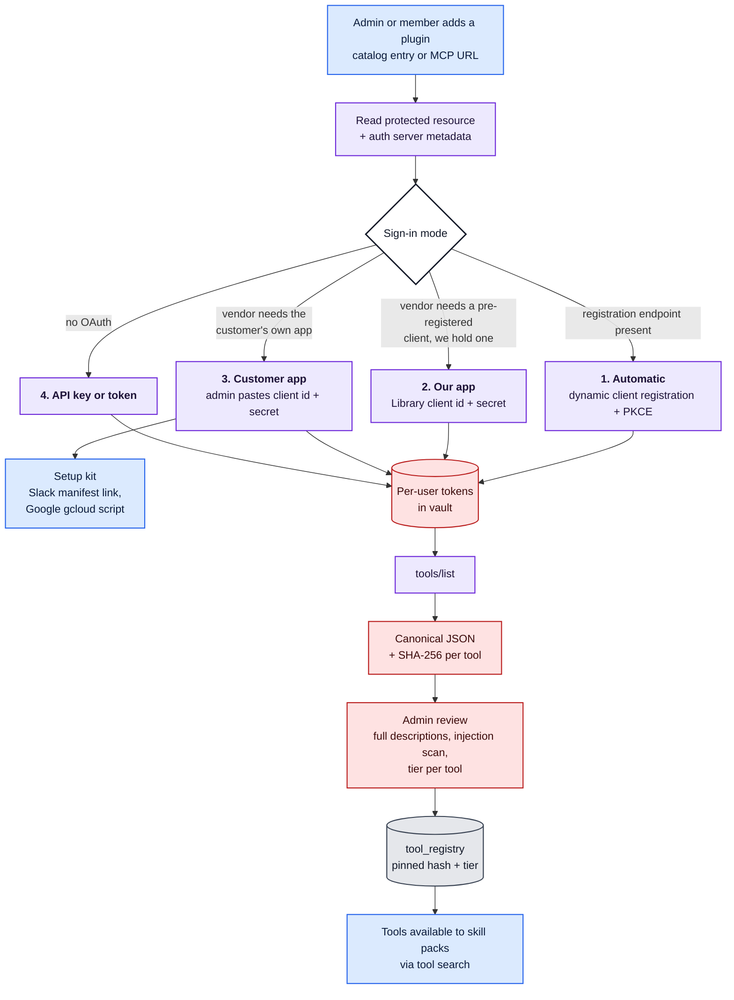
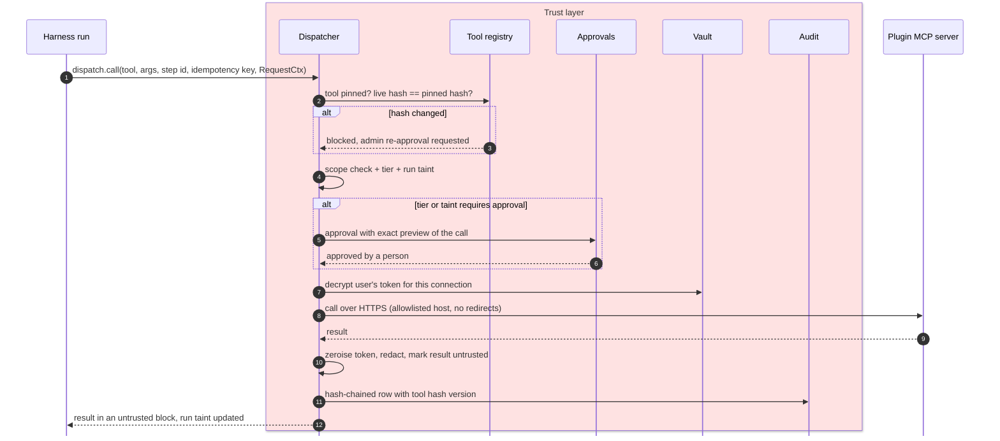

<!-- Copy of README sections: "## Plugins and connections". Change the README and this file together; `cargo xtask spec-check` enforces it. -->

## Plugins and connections

v0 ships 30 standard plugins on official vendor MCP servers, the setup flow for customer-owned apps (Google Workspace, Slack) and the standard MCP way to add any other server; one connection layer with four sign-in modes covers all of them, and every tool definition is pinned by hash.

### Connecting a plugin

- **Mode 1, automatic:** the dispatcher discovers the server's authorization server, registers a client dynamically, runs OAuth with PKCE through the gateway callback and stores per-user tokens. CI probes every mode-1 plugin's metadata on each build, so a vendor dropping dynamic registration is caught before release.
- **Mode 2, our app:** Library holds a registered client for vendors that need one and do not review it (GitHub App, HubSpot MCP auth app, Atlassian and Box developer apps).
- **Mode 3, customer app:** the tenant's admin creates an app in their own vendor account and pastes its credentials into Library; they live in `tenant_oauth_clients`, encrypted by the vault.
- **Mode 4, API key or token:** stored per user or per tenant in the vault; used where a vendor offers keys only or where the customer prefers them.
- **Open servers** need no sign-in, but their tools are pinned and every call still goes through the dispatcher.

### Customer-owned app setup

- **Slack:** Slack's MCP server accepts only Marketplace-published or internal apps, and non-Marketplace distributed apps are throttled on `conversations.history` and `conversations.replies`. Each tenant therefore runs an internal Slack app: Library generates its manifest (user-token scopes for the tools used, Events API subscriptions pointing at our ingest endpoint, the gateway redirect URL), the admin installs it from a link and pastes the client id, client secret and signing secret.
- **Google Workspace:** the admin creates a Google Cloud project under their Workspace organization, sets the OAuth consent screen to Internal (no Google verification needed), enables the Gmail, Drive, Calendar, Chat and People MCP APIs, creates an OAuth client with "Use this client for an AI-powered agent" selected and the gateway redirect URL, and pastes the client id and secret. Library ships a gcloud script and a step-by-step guide for this.
- **Limits stated to customers:** Internal consent works only for Workspace organizations; a personal Google account is limited to 100 test users and re-authorization every 7 days.

### Tool call path

### Tool registry and pinning

- On connect and on every `tools/list_changed` notification, each tool definition is serialised canonically and hashed; a new or changed hash blocks the tool until an admin approves it.
- The review screen shows every description in full and flags injection patterns: instructions addressed to the model, hidden Unicode, references to other tools or credentials.
- Every tool gets an approval tier at review (read, sandbox write, external write); MCP annotations such as `readOnlyHint` and `destructiveHint` suggest the default, the admin decides.
- Every MCP server is treated as untrusted: tool results enter context as untrusted data and set the run's taint.

### Standard plugin catalog

| Plugin | Departments | Endpoint | Sign-in mode |
| --- | --- | --- | --- |
| GitHub | Programming, product | `https://api.githubcopilot.com/mcp/` plus GitHub App webhooks | 2, our app |
| Slack | Everyone | `https://mcp.slack.com/mcp` plus Events API | 3, customer app |
| Google Workspace (Gmail, Drive, Calendar, Chat, People) | Everyone | Google Workspace MCP servers (`gmailmcp.googleapis.com` and siblings) | 3, customer app |
| HubSpot | Marketing, sales | `https://mcp.hubspot.com` | 2, our app |
| Atlassian (Jira, Confluence) | Programming, product | Atlassian Rovo MCP server | 2, our app, or API token |
| Box | Legal, operations | `https://mcp.box.com` | 2, our app |
| Linear | Programming, product | `https://mcp.linear.app/mcp` | 1, automatic |
| Notion | Everyone | `https://mcp.notion.com/mcp` | 1, automatic |
| Sentry | Programming | `https://mcp.sentry.dev/mcp` | 1, automatic |
| Vercel | Programming | `https://mcp.vercel.com/` | 1, automatic |
| Supabase | Programming | `https://mcp.supabase.com/mcp` | 1, automatic |
| Cloudflare | Programming, operations | Cloudflare MCP servers (bindings, observability, docs) | 1, automatic |
| Netlify | Programming | `https://netlify-mcp.netlify.app/mcp` | 1, automatic |
| Neon | Programming | `https://mcp.neon.tech/mcp` | 1, automatic |
| Canva | Design, marketing | `https://mcp.canva.com/mcp` | 1, automatic |
| Webflow | Design, marketing | `https://mcp.webflow.com/sse` | 1, automatic |
| Asana | Operations, product | `https://mcp.asana.com/sse` | 1, automatic |
| monday.com | Operations, product | `https://mcp.monday.com/sse` | 1, automatic |
| Airtable | Operations | `https://mcp.airtable.com/mcp` | 1, automatic |
| Attio | Sales | `https://mcp.attio.com/mcp` | 1, automatic |
| Intercom | Support, operations | `https://mcp.intercom.com/mcp` | 1, automatic |
| Fireflies | Everyone (meeting transcripts) | `https://api.fireflies.ai/mcp` | 1, automatic |
| Stripe | Finance | `https://mcp.stripe.com/` | 1, automatic, or API key |
| PayPal | Finance | `https://mcp.paypal.com/sse` | 1, automatic |
| Square | Finance | `https://mcp.squareup.com/sse` | 1, automatic |
| Ramp | Finance | `https://ramp-mcp-remote.ramp.com/mcp` | 1, automatic |
| Exa | Everyone (web search) | `https://mcp.exa.ai/mcp` | Open |
| Context7 | Programming (library docs) | Context7 MCP server | Open |
| Hugging Face | Programming | `https://hf.co/mcp` | Open |
| DeepWiki | Programming | `https://mcp.deepwiki.com/sse` | Open |

Endpoints are confirmed against each vendor's own docs before pinning; SSE endpoints move to streamable HTTP wherever the vendor offers it.

**Needs a vendor process, not in v0:** Microsoft 365 Work IQ (needs Microsoft 365 Copilot licensing), DocuSign and Salesforce (production requirements to confirm). Figma is not planned: the design workspace ships its own toolset. A Slack Marketplace listing and Google OAuth verification would later remove the customer setup step; neither blocks v0.

**Any other server:** users add an MCP server by URL; it goes through the same discovery, sign-in, hash pinning and admin review, and user-added servers are blocked from private IP ranges.

Sources: [Slack MCP server](https://docs.slack.dev/ai/mcp-server/), [Slack rate limits for non-Marketplace apps](https://docs.slack.dev/changelog/2025/05/29/rate-limit-changes-for-non-marketplace-apps), [Google Workspace MCP setup](https://developers.google.com/workspace/guides/configure-mcp-servers), [Google OAuth user types](https://developers.google.com/identity/protocols/oauth2/production-readiness/overview), [HubSpot remote MCP GA](https://developers.hubspot.com/changelog/remote-hubspot-mcp-server-is-now-generally-available), [GitHub MCP server setup](https://docs.github.com/en/copilot/how-tos/provide-context/use-mcp/set-up-the-github-mcp-server), [Work IQ prerequisites](https://learn.microsoft.com/en-us/connectors/a365mcpservers/), [Remote MCP server list](https://github.com/jaw9c/awesome-remote-mcp-servers/).
