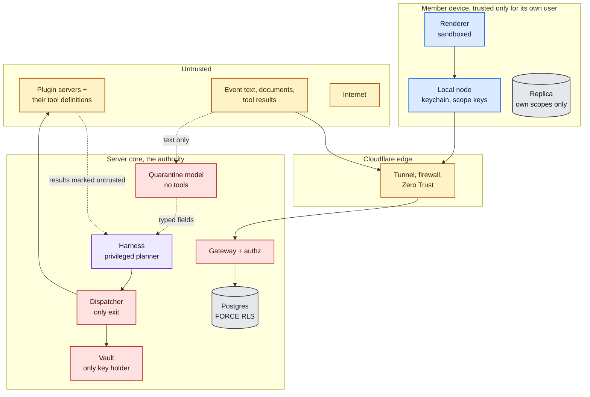
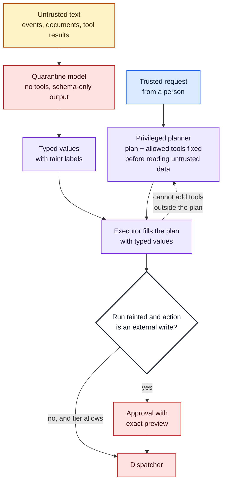
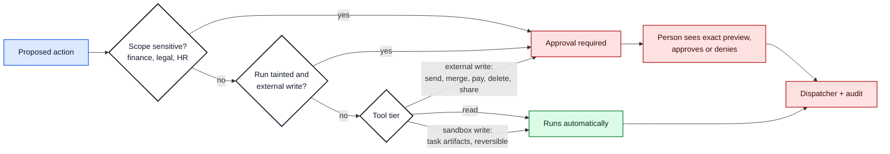

<!-- Copy of README sections: "## Security model". Change the README and this file together; `cargo xtask spec-check` enforces it. -->

## Security model

Two rules hold everywhere: no single bug may expose data across tenants or scopes, and once an agent has read untrusted input it cannot cause a consequential action without a person approving it. Every boundary is enforced twice, once in Rust and once in the database or the dispatcher.

### Trust boundaries

### Identity and sessions

- Sign-in with Google, Microsoft or GitHub via OAuth 2.0 with PKCE, opened in the system browser with a loopback redirect (the native-app pattern), never inside an embedded webview.
- The runtime issues its own tokens: a 15-minute signed access token and a 30-day rotating refresh token bound to the device. Reusing an old refresh token revokes the whole session family.
- The local node stores tokens in the OS keychain (the `keyring` crate); the desktop app never sees them. Each device generates an X25519 key pair at install and registers the public key.
- Agents get their own principal: a task capability covering only the task's scopes, issued after sign-off, expiring when the task ends. Plugin calls use the requesting user's own token, so an agent can never do more in a plugin than its user can.

### Tenancy and scopes

- The runtime connects as `app_rw`, which is not the table owner and has no BYPASSRLS; every table uses FORCE ROW LEVEL SECURITY. Each transaction sets `app.tenant_id`, `app.user_id` and `app.scope_ids` with SET LOCAL, and policies check tenant and scope.
- Migrations run as a separate owner role; the secrets table is readable only by the vault's own role and pool.
- Four runtime roles, none of them the owner and none with BYPASSRLS: `app_rw` (everything the gateway does), `app_sequencer` (the only role that writes state tables), `app_vault` (the only role that reads secrets) and `app_auth` (sign-in, sessions and device registration, which run before any tenant context exists; it reaches only the sign-in tables and read-only views of memberships and tenants).
- Access tokens are 15-minute Ed25519-signed envelopes verified by the gateway. A device registers by signing its tenant, user and X25519 key with its Ed25519 key, which proves it holds the key without sending it.
- The brain's state lives in Postgres, so the same forced row-level security covers it; God's eye, briefs and summaries add the scope filter in code as well.
- HR, legal and finance scopes can never join a fold. Cross-department work passes only the artifacts attached to the task, never a scope's context.

### Replicas and sync

- The server sends a device deltas, snapshots and keys only for scopes its user holds right now, checked on every subscribe and every push.
- Each scope's replica content is encrypted at the application layer with a scope key wrapped to the device's public key (see Client: SurrealDB embedded replica); keys rotate, revoked users stop receiving them, and deleting a scope key makes that scope's data on the device unreadable.
- Revocation deletes the partition on the device and stops key issue. Data already on a laptop can never be fully recalled; this limit is stated plainly to customers.
- Replicas never write state. A tampered replica can only mislead its own user, and state roots let the node detect and repair it.
- The server never trusts anything a replica or local job returns; it validates scope and schema, and spot-checks computed results.

### Secrets

- Envelope encryption: each tenant has a data key (AES-256-GCM) wrapped by a master key held outside the database (environment in v0, cloud KMS later), with key versions for rotation.
- Plugin tokens, customer-owned app secrets, Slack signing secrets and model API keys are decrypted only inside the dispatcher or model proxy at call time and zeroised after use. Log output is scrubbed at the writer for anything credential-shaped (Library tokens, bearer and JWT values, vendor keys, long hex keys, PEM keys, URL credentials, and values of fields named like secrets), and a redaction pattern that fails to load withholds the log line instead of letting it through.
- Secrets never enter a model's context, a run log, a replica or a sandbox.

### Inbound webhooks and outbound calls

- GitHub: HMAC-SHA256 (`X-Hub-Signature-256`) with constant-time comparison. Slack: per-tenant signing secret over timestamp and body, 5-minute window. MCP Events: Standard Webhooks signatures.
- Body size limits, dedupe on the unique event key, and a fast 2xx after commit with processing done asynchronously.
- Each connection has an egress allowlist of the hosts its plugin uses; the dispatcher calls nothing else. User-added MCP servers are blocked from private IP ranges, the IP is re-checked on every request, and redirects are not followed.

### Prompt injection: quarantine, taint and plan-first

- **Quarantine:** untrusted text reaches only a model with no tools whose output must pass a JSON schema; the planner sees typed fields and references, never the raw text as instructions.
- **Taint:** a run becomes tainted the moment untrusted content enters its context (event-derived slices, documents, any tool result); taint is recorded on `runs` and every step.
- **Taint rule:** a tainted run's external writes always need approval, whatever the tool's tier.
- **Plan-first:** for tasks that will read untrusted data, the plan and its tool set are fixed from the trusted request before any untrusted content is read; the executor cannot add tools outside the plan.
- **Context marking:** untrusted slices arrive in delimited blocks marked untrusted, and nothing in them can grant permission.
- **Playbooks:** lessons from tainted runs wait for a department lead's approval before they can influence future runs.

### Plugins: tool poisoning and rug pulls

- Every MCP server is untrusted. Tool definitions are pinned by hash at approval; a changed definition is blocked until an admin re-approves it, which stops a server swapping a benign tool for a malicious one after approval.
- The review screen shows full descriptions and flags injection patterns, hidden Unicode and references to other tools or credentials.
- Tool results are untrusted data and taint the run.

### Coding agents' own tools

Coding tasks run in the provider's own coding agent (Claude Code, Codex and the others) on the member's machine, in a git worktree for the task. That agent has its own tools: shell, file access, web access, git and its own MCP servers. Those tools do not go through the dispatcher, so the member's permission is the gate. Decided 26 Nov 2026: the agent may use them only when the member allows it.

- **Allowed without asking:** reading and editing files inside the task's worktree. Edits reach the member as a diff to accept or reject.
- **Off until the member allows it:** shell commands, network and web access, the CLI's own MCP servers and plugins, package installs, `git push`, opening pull requests, and any file outside the worktree.
- **How a member allows:** per action, through an approval in the agent pane and Inbox that shows the exact command, host or target; or through standing rules the member sets per project (for example, allow `cargo test`, or allow pushes to `task/*` branches). Standing rules are shown in Settings and can be revoked.
- **Enforcement:** the provider runner starts each CLI in its most restrictive permission mode and passes only what the member allowed. It maps the CLI's own permission requests to Library approvals and turns on the provider's OS sandbox wherever one exists. Claude Code has no sandbox on native Windows, so its permission checks are the only gate there, and the app says so.
- **Taint:** repository files, issues and review comments are untrusted, so a coding run is tainted from its first read. In a tainted run, standing rules cover only local commands. Pushes, pull requests, network calls to hosts not on the project's allowlist, and writes through the CLI's MCP servers ask every time.
- **Credentials:** the CLI's own sign-in and the member's git credentials stay where the provider and git keep them; Library never reads them. Library's plugin credentials never reach the coding agent; anything done through a Library plugin goes through the dispatcher as usual.
- **Record:** every permission request, decision and command is stored in the run's steps, and every action outside the worktree is written to the audit log.
- **Relay jobs are different:** model relay jobs always run in locked mode, and member permissions cannot turn tools on for them.

### Approval tiers

- Reads and reversible writes inside the task's own artifacts run without prompts, so approval requests stay rare enough that people read them.
- External writes always show an exact preview (recipient, content, amount, target) before approval.
- Sensitive scopes (finance, legal, HR) default to approval before any action except reads; each scope can tune its tiers.

### Confidence controls in the app

- **Scope badge** on every agent: which scopes it can read right now.
- **Previews** of every gated action before it runs.
- **Source chips** on every answer and brief, linking to the original item.
- **Undo** for actions the plugin can reverse; the audit log keeps the full trail either way.

### Sandbox (after v0)

- Separate process: wasmtime running QuickJS, with no file system, network or clock beyond what the host injects; fuel, memory and wall-clock limits on every script.
- The only exit is the dispatcher; credentials stay on the server, and every call is checked for scope, tier, taint and approval.
- Every step is recorded with an idempotency key so resumes replay results instead of repeating actions.

### Desktop app hardening

- `contextIsolation` and `sandbox` on, `nodeIntegration` off, a strict content security policy, no remote content loaded, and an allowlisted IPC bridge with validated payloads.
- External links open in the system browser; dev tools are disabled in release builds.

### Audit

- Insert-only grants; each row stores `hash = SHA-256(prev_hash || canonical payload)` per tenant, so any edit or deletion breaks the chain.
- Rows record the actor, the approval, and the tool's pinned hash for every plugin call.
- The daily chain head is signed and stored outside the database, and a verifier tool checks the whole chain.

### Abuse and supply chain

- Rate limits per user and tenant, request size limits, per-run budgets and per-tenant model spend limits.
- cargo-deny and cargo-audit in CI, npm audit for the app, pinned lockfiles, GitHub Actions pinned to commit hashes, and Renovate for updates.

### Threats and mitigations

| Threat | Mitigation |
| --- | --- |
| Bug leaks another tenant's data | Forced RLS on tenant, replicas hold only permitted scopes, isolation tests in CI |
| Marketing reads HR or finance data | Scope policies in RLS, scope filter in every brain query, sealed scopes |
| Forged or replayed webhook | Signature check, 5-minute window, unique event key |
| Event or document injects instructions | Quarantine model without tools, typed output, plan-first, taint rule |
| Injected text tries to exfiltrate data | Tainted runs need approval for external writes; egress allowlists; no secrets in context |
| Malicious tool description (tool poisoning) | Admin review with injection scan, untrusted results, plan-fixed tool sets |
| Tool swapped after approval (rug pull) | Hash pinning, block on change, re-approval |
| Approval fatigue | Risk tiers keep prompts to external writes; exact previews |
| Poisoned playbook lesson | Tainted lessons wait for a lead's approval; helpful and harmful counters |
| Stolen desktop session | Short access tokens, refresh rotation with reuse detection, keychain storage, revocation |
| Leaked plugin token or customer app secret | Envelope encryption, vault-only role, redaction, per-user least-privilege tokens |
| Malicious MCP server URL (SSRF) | Private ranges blocked, IP re-checked per request, no redirects |
| Tampering with the audit trail | Insert-only grants, hash chain, signed daily head stored outside |
| Runaway agent cost or loop | Loop detection on every run; per-run budgets and tenant spend caps on API-key runs; usage meter for local CLI runs |
| Compromised dependency | cargo-deny, cargo-audit, npm audit, pinned actions |
| Stolen laptop with a replica | Replica encrypted with scope keys; device revoked; keys stop |
| Tampered or forked replica | Replicas cannot write; state roots expose drift; repair from snapshot |
| Malicious result from a relay or volunteer job | Relay: only eligible devices, envelopes sealed to the device key, locked mode, signed results, schema and scope checks, 5% sampled re-runs that pause a disagreeing node. Volunteer (after v0): only verifiable jobs and spot-checks |
| Coding agent misled by repository content | Tools outside the worktree are off until the member allows them; tainted runs ask before every push, pull request or outside network call; provider sandbox on where available; every command recorded |
| Sandbox escape (after v0) | Separate process, WebAssembly isolation, no credentials inside, every exit checked by the dispatcher |
