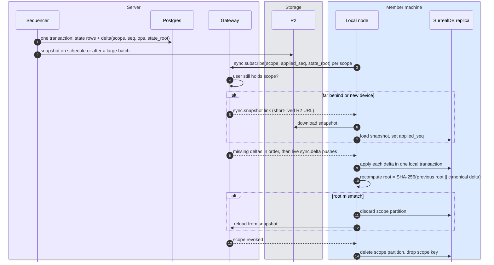

<!-- Copy of README sections: "## Sync engine". Change the README and this file together; `cargo xtask spec-check` enforces it. -->

## Sync engine

Sync works like a chain without consensus: the sequencer is the single writer per tenant, every change is a numbered delta per scope with a state root, and replicas apply deltas in order, verify, and repair themselves from snapshots.

- **State roots:** each delta's root is `SHA-256(previous root || canonical delta)`. Two replicas with the same root at the same sequence have applied exactly the same history. A Merkle tree over state, for proving single facts, is a later upgrade.
- **What deltas carry:** entity, fact, summary and playbook changes with statements and source references (link, title, time), never raw event bodies. Replicas stay small and hold less sensitive material.
- **Scope keys:** each scope's replica is encrypted at rest with a scope key; the server wraps it to the device's X25519 public key; keys rotate, and revoked users stop receiving them.
- **Cursors:** `replica_cursors` records each device's applied sequence and root, so drift is visible on the server.
- **Offline:** an offline node catches up from its cursor on reconnect.
- **Writes from clients:** replicas never write state; the node submits actions through the gateway, and only the sequencer turns accepted actions into deltas.
